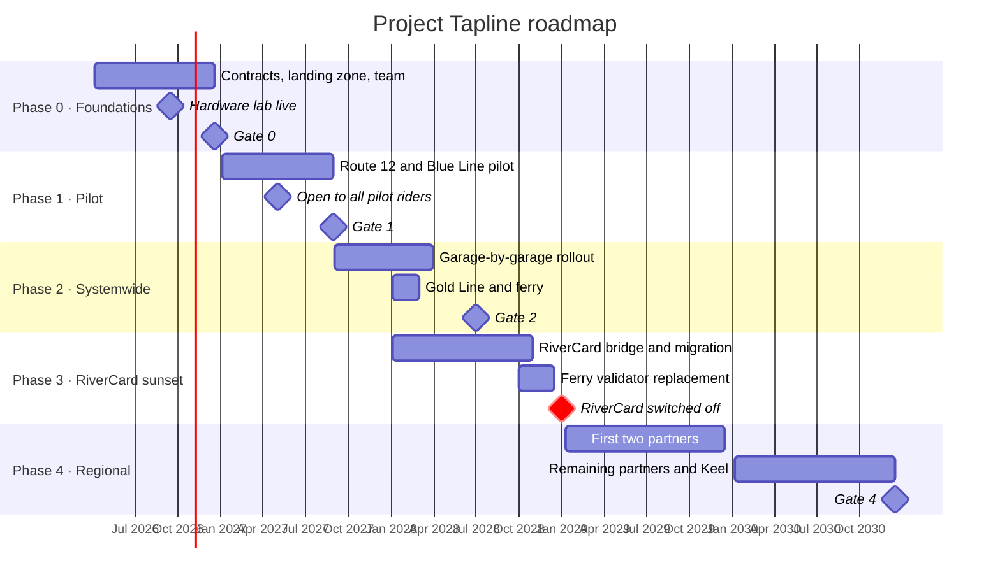

# Architecture Roadmap — Project Tapline

> [!summary] Five phases, one fixed date
> Tapline is delivered in five phases from April 2026 to December 2030. Everything is planned backwards from the one date that cannot move: **RiverCard is switched off on 31 Dec 2028**. Phases 0–3 must finish by then; Phase 4 (regional partners) has room to slip.

## 1. Current State Summary

CRT collects fares with **RiverCard**: a closed-loop smart-card system hosted by Castellan Fare Systems on Oracle, in service since 2012. Fareboxes and card readers on 1,100 buses, 46 rail stations and 6 ferry terminals read RiverCard cards and take cash; all fare logic lives on the card and in Castellan's back office. Partner operators each run their own fare media. Support ends 31 Dec 2028.

Full detail: [Gap Analysis](../09-transition-and-migration/gap-analysis.md) (current-state inventory) and [Architecture Vision §1](architecture-vision.md).

## 2. Target State Summary

An account-based fare platform: any token (bank card, wallet, CRT card, app QR) identifies an account; offline-capable validators make the accept/deny decision locally; taps stream to the cloud, where the fare engine builds trips, applies transfers and caps, and posts to an append-only ledger; Northgate Payments settles card charges; partners integrate through APIs and receive daily apportionment.

Full detail: [Architecture Vision §9](architecture-vision.md), [C4 Container Diagram](../02-core-architecture/c4-model/container-diagram.md) and the [Solution Architecture Document](../02-core-architecture/solution-architecture-document.md).

## 3. Gap Analysis

Summary at roadmap level; the itemized analysis is in [Gap Analysis](../09-transition-and-migration/gap-analysis.md).

| Capability | Current State | Target State | Gap | Priority |
|---|---|---|---|---|
| Fare media | RiverCard and cash only | Bank cards, wallets, CRT card, app QR, cash through retail | Open-payment acceptance; token-to-account model | Critical |
| Fare calculation | On the card, fixed by the vendor | In the cloud, rule-driven, versioned | Fare engine with configurable policy | Critical |
| Fare capping | Not possible | Daily and weekly caps for all riders | Cap accumulation across trips and media | Critical |
| Validators | Fareboxes reaching end of life, online-dependent | ~5,200 offline-capable EMV validators | Full hardware replacement and device management | Critical |
| Payments | Castellan acts as merchant of record for card loads | CRT is merchant of record via Northgate, card data tokenized | Processor integration, PCI scope design | Critical |
| Customer accounts | Optional card registration, vendor portal | CRT-owned accounts, app and portal | Identity, account services, customer-service tools | High |
| Reduced fare | Paper application, 4–6 week turnaround | Online, verified in minutes with State DHS | DHS integration, eligibility service | High |
| Revenue and finance | Monthly vendor reports, manual reconciliation | Append-only ledger, daily settlement and reconciliation | Ledger, settlement, ERP integration | Critical |
| Regional integration | Six separate fare systems | One platform, operator-specific fares, daily apportionment | Multi-operator fare policy and apportionment | Medium (Phase 4) |
| Data and reporting | Vendor-controlled, limited extracts | CRT-owned data platform | Event store, lakehouse, privacy controls | Medium |

## 4. Phased Plan

| Phase | Timeframe | Goal | Milestones | Dependencies |
|---|---|---|---|---|
| **0 · Foundations** | Apr–Dec 2026 | Contracts, platform and team in place; walking skeleton of a tap flowing end to end in the lab | Vantor contract awarded (Jun 2026) · Northgate contract and ICD signed (Aug 2026) · Azure landing zone and card-data subscription live (Aug 2026) · Hardware lab with live validators (Sep 2026) · Title VI analysis for capping approved by Board (Nov 2026) · **Gate 0** (Dec 2026): a lab tap is charged, capped and settled in Northgate's test environment | Business case approval; product team hired (12 of 18 roles by Sep 2026) |
| **1 · Pilot** | Jan–Aug 2027 | Prove Tapline in live service on one bus route and one rail line | Validators installed on Route 12 (60 buses) and Blue Line (22 stations) (Feb 2027) · Closed pilot with 1,800 enrolled riders (Mar 2027) · Open to all riders on pilot lines (May 2027) · Northgate production certification (Jun 2027) · **Gate 1** (Aug 2027): tap success ≥ 99.5% and 30 consecutive days of exact settlement reconciliation | Gate 0; Vantor pilot hardware delivered; DHS API in test |
| **2 · Systemwide open payments** | Sep 2027–Jun 2028 | Open payments, capping and reduced fares on every CRT vehicle and station | Garage-by-garage bus rollout, 6 waves (Sep 2027–Mar 2028) · Gold Line and ferry terminals (Jan 2028) · App and portal general availability (Oct 2027) · Reduced fare via DHS (Nov 2027) · CornerPay retail cash loads (Dec 2027) · **Gate 2** (Jun 2028): 100% of validators accept contactless EMV; ≥ 99.95% of taps processed correctly | Gate 1; DHS API in production; ~5,200 validators delivered |
| **3 · RiverCard migration and sunset** | Jan–Dec 2028 | Move every RiverCard customer and balance to Tapline, then switch RiverCard off | RiverCard cards accepted on Tapline validators through a bridge service (Jan 2028) · Account and balance migration waves (Mar–Sep 2028) · RiverCard sales stop (Jul 2028) · Ferry validators replaced (Q4 2028) · RiverCard acceptance ends (Oct 2028) · **RiverCard switched off (31 Dec 2028)** · **Gate 3**: $0.00 unreconciled stored value | Gate 2 for systemwide acceptance; Castellan data extracts; Board quarterly liability reports |
| **4 · Regional partners and microtransit** | Jan 2029–Dec 2030 | One regional fare system | HCT and Millbrook Express live (2029) · Eastbank, Ridgeline, CSU Shuttle and Southport Trolley live (2030) · Keel Mobility microtransit integrated (2030) · Regional fare cap, subject to RFC and Title VI analysis (2030) · Paratransit fare evaluation (2030) · **Gate 4** (Dec 2030): 6 of 6 partners live | Regional fare agreement signed by the Partner Operator Council; Gate 3 |

**Phase gates** are approved by the ARB (architecture readiness) and the Program Board (business readiness), and reported to the CRT Board. Gate criteria come from the [Architecture Vision §6](architecture-vision.md) success criteria; gate reviews use the [Architecture Compliance Review](../10-testing-and-validation/architecture-compliance-review.md).

## 5. Risks Across Phases

The full register, with owners and scores, is the [Risk Register](../08-risk-and-operations/risk-register.md). These risks span more than one phase and shape the plan itself.

| Risk | Impact | Mitigation |
|---|---|---|
| Validator delivery slips (Buy America-compliant supply chain) | Phase 2 rollout delayed, which squeezes Phase 3 against the fixed RiverCard date | Contractual delivery milestones with penalties; rollout waves sized so that any 4 of 6 garages can go first; 400 spares ordered early |
| Northgate production certification takes longer than planned | Pilot cannot accept live cards; Phase 1 slips | Certification work starts in Phase 0 lab; weekly joint test cadence written into the ICD |
| RiverCard data quality worse than expected | Balance migration slips or produces unreconciled balances | Trial extracts and reconciliation in Phase 1, a full year before migration; Castellan exit-assistance clause invoked early |
| State DHS API late | Reduced-fare riders stay on manual applications | Manual verification fallback in the back office; reduced-fare riders migrated with their existing RiverCard eligibility |
| PCI scope grows (e.g. validators end up in scope) | More controls, higher cost, longer certification | P2PE-capable validators required in the Vantor contract; card data never enters CRT systems; scoping review at every gate |
| Team cannot be hired fast enough | Every phase slips | Delivery partner contract for 6 roles; .NET skills reused from CRT IT |
| Partner operators delay signing the regional agreement | Phase 4 slips | Phase 4 has no fixed external deadline; partners join individually as they sign |
| Running two systems in 2028 confuses riders | Complaints, lost revenue at the boundary | RiverCard bridge so old cards keep working on new validators; one clear switch-off date communicated from Phase 2 |

## 6. Review Cadence

| Review | When | Who | Output |
|---|---|---|---|
| Roadmap review | Quarterly, and after every phase gate | Program Director, Chief Architect, CIO, Chief Revenue Officer | Updated roadmap version; changes recorded below |
| ARB checkpoint | Monthly | Architecture Review Board | Decisions affecting phase scope or sequencing (see [Governance Framework](../07-governance/governance-framework.md)) |
| Board report | At each phase gate, and quarterly on stored-value liability from Phase 3 | CRT Board of Directors | Phase gate approval |
| Partner review | Twice a year | Partner Operator Council | Phase 4 sequencing |

### Change history
| Version | Date | Change |
|---|---|---|
| 1.0.0 | 2026-04-06 | Baseline at the start of Phase 0, following Board approval of the [Business Case](business-case.md). |
