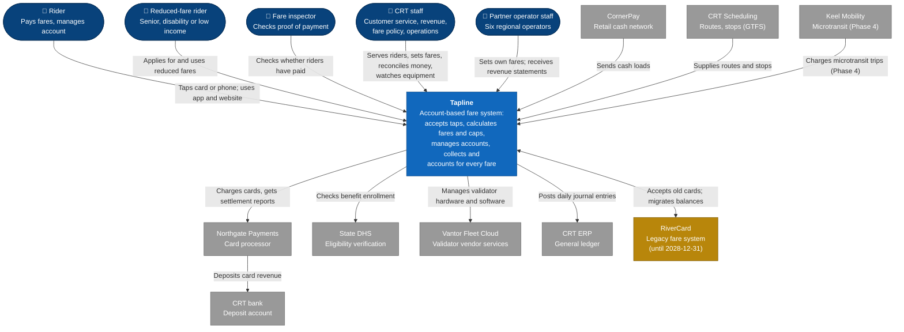

# C4 Model — Level 1: System Context — Project Tapline

## 1. Purpose
Shows Tapline as a single black box: who uses it, and which other systems it depends on or serves. Written for the CRT Board, partner operators and non-technical staff. Technology detail is in the [Container Diagram](container-diagram.md).

## 2. Actors & External Systems
| Name | Type (Person/System) | Relationship / Description |
|---|---|---|
| Rider | Person | Taps a bank card, phone, CRT card or app ticket to ride. Optionally opens an account to see trips, add money and manage cards. About 410k active riders today. |
| Reduced-fare rider | Person | A rider with senior, disability or low-income status. Pays reduced fares and caps. |
| Fare inspector | Person | CRT staff on rail and ferry who check that riders have paid, using a handheld device. |
| CRT staff | Person | Customer service agents, revenue analysts, fare-policy analysts and operations supervisors using back-office tools. |
| Partner operator staff | Person | Finance and fare-policy staff at the six partner operators. They set their own fares and receive daily revenue statements (from Phase 4). |
| Northgate Payments | System (external) | CRT's card processor. Supplies payment tokens for cards, approves combined daily charges, and sends settlement reports. Governed by the [Northgate ICD](../../03-interfaces-and-integration/interface-control-document.md). |
| CRT bank | System (external) | Receives card revenue deposits from Northgate and retail deposits from CornerPay. Shown for completeness; Tapline reads deposit files only for reconciliation. |
| State DHS | System (external) | Confirms whether an applicant is enrolled in SNAP or Medicaid, for low-income reduced fares. |
| CornerPay | System (external) | 420 retail locations where riders add cash to CRT cards and accounts. |
| Vantor Fleet Cloud | System (external) | Vantor's device-management service: firmware updates, hardware diagnostics and warranty. Tapline drives it through its API. |
| CRT ERP | System (internal, outside Tapline) | CRT's financial system. Receives daily summarized journal entries. |
| CRT Scheduling | System (internal, outside Tapline) | Source of truth for routes, stops and service patterns, published as GTFS. |
| RiverCard | System (legacy, external) | Castellan Fare Systems' legacy fare system. Tapline accepts RiverCard cards during the transition and migrates accounts and balances before switch-off on 31 Dec 2028. |
| Keel Mobility | System (external) | Microtransit partner. From Phase 4, charges on-demand trips to Tapline accounts. |

## 3. Notes
- **Validators are part of Tapline**, not an external system. They are CRT-owned devices running CRT-specified software and configuration, even though Vantor supplies the hardware. This is why the boundary includes them, and why Vantor's cloud service appears separately as an external system.
- **Partner operators are users of Tapline**, not external systems. Once they join they don't run their own fare systems. Their staff use the Partner Portal, and their finance systems pull statements through the Partner API (one partner uses an SFTP file instead). Those interfaces are detailed in the [Integration Architecture](../../03-interfaces-and-integration/integration-architecture.md) rather than drawn here.
- **RiverCard** is drawn in a different color because it disappears at the end of 2028. After that, this diagram loses one box and nothing else changes.
- Keep this diagram free of technology. If a box needs a product name to make sense, it belongs on the [Container Diagram](container-diagram.md).
