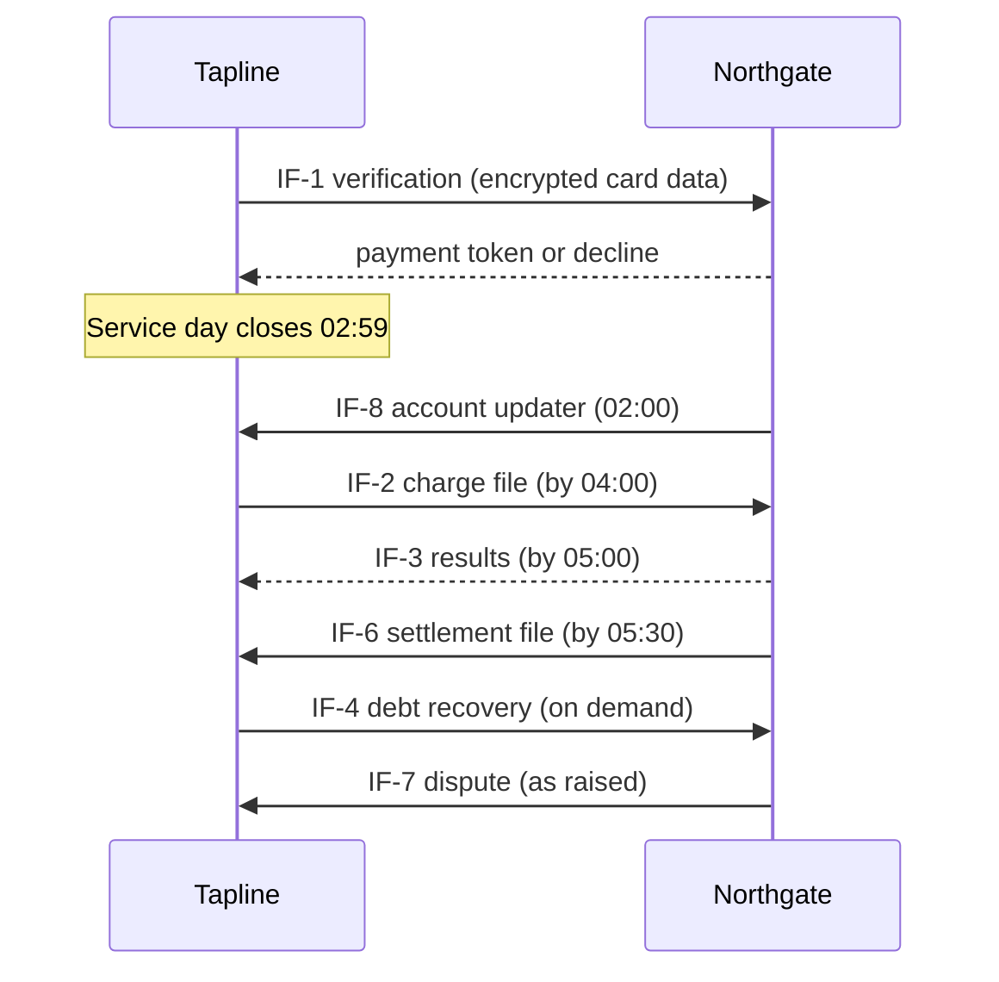

# Interface Control Document — Tapline ↔ Northgate Payments (ICD-001)

> [!summary] What this ICD fixes
> How Tapline and Northgate exchange card data, tokens, charges, results, settlement and disputes. It is a schedule to the Northgate Transit Acquiring Agreement (signed 2026-08-14). Where this ICD and the agreement conflict, **the agreement wins**. Changes follow §6; neither party changes this interface unilaterally.

## 1. Parties
| System | Owning Team | Contact |
|---|---|---|
| **Tapline** (Confluence Regional Transit) | Money Team, CRT | Hannah Cole, Money Team lead — interface owner; CRT Revenue Operations — settlement and disputes; Tapline on-call (Money) via CRT NOC, 24/7 |
| **Northgate Transit Gateway** (Northgate Payments) | Northgate Transit Solutions | Transit Integration Manager — interface owner; Northgate Merchant Support — settlement and disputes; Northgate Technical Operations, 24/7 |

## 2. Interface Description

The interface has eight interface points (IF). Northgate is the merchant acquirer and processor. CRT is the merchant of record (merchant category code 4111, transit).

| IF | Name | Protocol | Direction | Frequency/Trigger |
|---|---|---|---|---|
| IF-1 | Card verification and tokenization | REST/JSON over HTTPS, mutual TLS + OAuth 2.0 client credentials | Tapline → Northgate | Real time, on the first tap of a media token not yet known |
| IF-2 | Nightly charge file | SFTP, JSON Lines, PGP-encrypted and signed | Tapline → Northgate | Daily, delivered by 04:00 local |
| IF-3 | Charge results | HTTPS webhook (HMAC-SHA256 signed, mutual TLS) with pull API `GET /v2/charges/{chargeId}` | Northgate → Tapline | As each charge is processed, by 05:00 |
| IF-4 | Immediate charge (debt recovery, adjustments) | REST, as IF-1 | Tapline → Northgate | On demand, when a rider pays a debt |
| IF-5 | Card-not-present payments (top-ups, autoload) | Northgate Hosted Payment Fields (iframe/SDK) in the app and portal; tokens returned to Tapline | Rider device → Northgate; Northgate → Tapline | On demand |
| IF-6 | Settlement file | SFTP, CSV (Northgate standard v4), PGP-encrypted | Northgate → Tapline | Daily, delivered by 05:30 local |
| IF-7 | Disputes and chargebacks | HTTPS webhook; evidence upload via REST | Bidirectional | As raised; response within network deadlines |
| IF-8 | Account updater (reissued cards) | SFTP, CSV | Northgate → Tapline | Daily, by 02:00 local |

**Card-data boundary.** Validators use Northgate-validated P2PE readers. Encrypted card data travels from the validator through Tapline to IF-1 without decryption. Tapline holds the media token and the payment token only, never card numbers ([ADR-0005](../06-decisions-and-standards/adr/adr-log.md)). In the app and portal, card entry happens inside Northgate's hosted fields (IF-5), so card data never reaches CRT systems.

**Transit aggregation.** Fares for one card in one service day are combined into a single charge (IF-2). Northgate is responsible for applying card-network transit rules (mass transit transaction rules, including aggregation limits and first-ride risk handling) and will tell CRT in advance of any rule change that affects Tapline (§6).

## 3. Data Exchanged

### 3.1 IF-1 Verification request (Tapline → Northgate) and response
| Field | Type | Required | Description | Owner |
|---|---|---|---|---|
| `requestId` | UUID | Y | Idempotency key. Northgate returns the original response for a repeated ID within 24 h. | Tapline |
| `merchantId` | string(15) | Y | CRT's merchant ID, assigned by Northgate | Northgate |
| `terminalId` | string(16) | Y | Validator ID (e.g. `BUS-4471-F`), registered with Northgate | Tapline |
| `encryptedCardData` | base64 | Y | P2PE-encrypted EMV data from the reader | Northgate (format) |
| `keySerialNumber` | hex(20) | Y | Reader key serial for decryption | Northgate (format) |
| `mediaToken` | string(64) | Y | Tapline's media token, echoed in the response and on later charges | Tapline |
| `tapTime` | ISO 8601 UTC | Y | Time of the first tap | Tapline |
| **Response:** `result` | enum | Y | `approved`, `declined`, `referral` | Northgate |
| **Response:** `paymentToken` | string(32) | If approved | Northgate's reusable token. Restricted: card-data zone only. | Northgate |
| **Response:** `declineCode` | string(4) | If declined | Northgate code, mapped by Tapline to a rider-facing reason | Northgate |
| **Response:** `cardBrand`, `last4`, `expiry` | string | If approved | For display only | Northgate |

### 3.2 IF-2 Charge record (one JSON line per charge)
| Field | Type | Required | Description | Owner |
|---|---|---|---|---|
| `chargeId` | string(64) | Y | Deterministic: hash(media token, service date, attempt). Northgate rejects duplicates. | Tapline |
| `paymentToken` | string(32) | Y | From IF-1 or IF-8 | Northgate |
| `amountCents` | integer | Y | Total capped fares for the service day, plus adjustments. Always > 0. Refunds use IF-4. | Tapline |
| `currency` | string(3) | Y | `USD` | Tapline |
| `serviceDate` | date | Y | Service day the charge covers | Tapline |
| `firstTapTime`, `lastTapTime` | ISO 8601 UTC | Y | Window covered, used for network transit rules | Tapline |
| `tapCount` | integer | Y | Number of accepted taps | Tapline |
| `chargeType` | enum | Y | `daily`, `adjustment` | Tapline |
| `descriptor` | string(22) | Y | Bank statement text, e.g. `CRT TRANSIT 05/14` | Tapline |

**File trailer:** record count and total amount. Northgate rejects the whole file if the trailer doesn't match.

### 3.3 IF-3 Charge result
| Field | Type | Required | Description | Owner |
|---|---|---|---|---|
| `chargeId` | string(64) | Y | From IF-2 | Tapline |
| `status` | enum | Y | `approved`, `declined`, `partially_approved` (not used by CRT; treated as declined) | Northgate |
| `authCode` | string(6) | If approved | Authorization code | Northgate |
| `northgateReference` | string(40) | Y | Northgate's ID for reconciliation | Northgate |
| `declineCode` | string(4) | If declined | Decline reason | Northgate |
| `retryable` | boolean | If declined | Whether IF-4 may retry, e.g. after insufficient funds | Northgate |

### 3.4 IF-6 Settlement record
| Field | Type | Required | Description | Owner |
|---|---|---|---|---|
| `settlementDate` | date | Y | Date funds are deposited | Northgate |
| `northgateReference` | string(40) | Y | Matches IF-3 | Northgate |
| `grossCents` | integer | Y | Charge amount | Northgate |
| `interchangeCents`, `schemeFeeCents`, `processingFeeCents` | integer | Y | Fees by type | Northgate |
| `netCents` | integer | Y | Gross minus fees | Northgate |
| `depositBatchId` | string | Y | Links to the bank deposit | Northgate |

The IF-4, IF-5, IF-7 and IF-8 field lists are in the OpenAPI and CSV specifications held in `tapline-platform/specs/external/northgate/`. Northgate owns those formats.

## 4. Error Handling & Retry

| IF | Error | Handling |
|---|---|---|
| IF-1 | Timeout (> 5 s) or 5xx | Tapline retries with the same `requestId` and exponential backoff for up to 24 h. Taps are rated meanwhile; the charge waits for the token. After 24 h the medium is treated as declined. |
| IF-1 | 429 throttled | Tapline honors `Retry-After`. Agreed rate limit: 50 requests/s sustained, 150/s burst. |
| IF-2 | File rejected (bad trailer or signature) | Northgate sends a rejection notice within 15 min. Tapline corrects and re-sends; duplicate charge IDs are ignored. If not resolved by 04:30, both sides' on-call engineers start a bridge call. |
| IF-2 | Individual record rejected | Reported in IF-3 with status `declined` and code `R0xx` (format error). It doesn't block the rest of the file. |
| IF-3 | Webhook not delivered | Northgate retries for 24 h (1, 5, 15, 60 min, then hourly). Tapline pulls any result still missing at 05:00 through the pull API. |
| IF-3 | Declined | Tapline raises a debt and adds the token to the deny list. If `retryable` is true, IF-4 is tried once after 72 h. |
| IF-6 | Late (after 05:30) | Tapline holds reconciliation and logs an SLA breach; Northgate notifies CRT Revenue Operations with an expected time. |
| IF-6 | Totals don't match IF-3 | Both parties' reconciliation teams investigate the same business day. Neither side adjusts automatically. |
| IF-7 | Dispute raised | Tapline responds with tap evidence (times, locations, validator IDs), with no rider personal data beyond what the network requires, within the deadline in the notice. |

All webhooks are verified by HMAC signature and timestamp; payloads older than 5 minutes are rejected as replays.

## 5. SLA

- **Availability:**
  - IF-1, IF-3 pull API, IF-4: **99.95%** monthly, excluding agreed maintenance.
  - SFTP endpoints: **99.9%**.
  - Maintenance windows must be agreed 14 days ahead and **never fall between 02:30 and 06:30 local time**.
- **Latency:**
  - IF-1 verification: **p95 ≤ 1.5 s**, p99 ≤ 3 s.
  - IF-4 immediate charge: p95 ≤ 2 s.
  - IF-3: all results for a file delivered **by 05:00** if the file arrived by 04:00.
  - IF-6: settlement file delivered **by 05:30**.
  - IF-8: account updater file **by 02:00**.
- **Throughput:**
  - IF-1: 50 requests/s sustained, 150/s burst.
  - IF-2: up to **250,000 charges** per file. Typical: ~110,000.
- **Support:** P1 (charge file rejected, settlement missing, API down) — response in 15 min, 24/7. P2 — response in 2 h. P3 — next business day.
- **Service credits** for SLA breaches are set out in the Transit Acquiring Agreement, Schedule C.
- **Reporting:** Northgate provides a monthly SLA report. Tapline monitors IF-1 latency and file timeliness independently and compares them with it.

## 6. Change Management

| Change type | Notice | Process |
|---|---|---|
| **Breaking change** (field removed or retyped, protocol, authentication) | **90 days** written notice | Proposed through the Joint Change Board; new version runs in parallel with the old for at least 60 days; certification re-test |
| **Additive change** (new optional field, new decline code) | **30 days** | Notice to interface owners; Tapline ignores unknown fields |
| **Card-network rule change** affecting transit aggregation | As soon as Northgate is notified, normally **≥ 90 days** before effect | Joint impact assessment; may need a fare-policy or Tapline change |
| **Emergency security change** (e.g. key compromise, TLS policy) | **72 hours**, or less if required by law or the networks | CISO and Northgate security lead agree; review afterwards |
| **Certificate and key rotation** | 30 days; overlap period of 14 days | Scheduled; both certificates accepted during overlap |

- **Joint Change Board:** monthly, attended by both interface owners plus CRT Revenue Operations and Northgate Merchant Support. Decisions are minuted, and this ICD is re-issued with a new version when the interface changes.
- **Environments:** Northgate provides a certification environment matching production behavior, including test cards for every decline code. Tapline's hardware lab is connected to it permanently.
- **Certification:** any change to IF-1, IF-2, IF-4 or the P2PE configuration needs a Northgate certification run before production. Test cases are tagged `TC-CERT-xxx` in the [Test Strategy](../10-testing-and-validation/test-strategy.md).
- **Versioning:** IF-1/3/4 use URI versioning (`/v2/`). File formats carry a version in the header. Tapline's adapter code is the only place Northgate formats appear ([Integration Architecture §2](integration-architecture.md)).

## 7. Sign-off
| Role | Name | Date |
|---|---|---|
| Tapline Approver — Interface owner | Hannah Cole, Money Team lead | 2026-08-27 |
| Tapline Approver — Security | Tom Whitaker, CISO | 2026-08-24 |
| Tapline Approver — Finance | Jordan Hale, CFO | 2026-08-25 |
| Northgate Approver — Interface owner | Transit Integration Manager, Northgate Transit Solutions | 2026-08-27 |
| Northgate Approver — Risk and Compliance | Director of Merchant Risk, Northgate Payments | 2026-08-28 |
