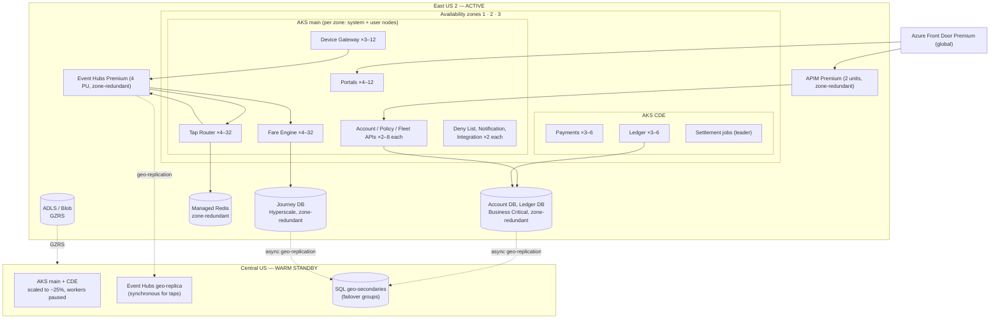

# Deployment Topology — Project Tapline

> [!summary] Where everything runs
> Production runs active in **Azure East US 2**, across three availability zones, with a **warm standby in Central US**. Seven environments lead up to it. The one that matters most is the **hardware lab**, where real Vantor validators talk to Northgate's certification environment. Validator firmware and configuration move through their own four-ring rollout, separate from cloud releases. Network detail is in [Network Architecture](network-architecture.md); the IaC that builds all of this is mapped in [IaC Notes](infrastructure-as-code-notes.md).

## 1. Environments
| Environment | Purpose | URL | Notes |
|---|---|---|---|
| **Dev** | Shared integration of the latest `main` from every team | `dev.tapline.crt-transit.example` | One region, one AKS cluster for both zones (no CDE split). Event Hubs Standard. Simulated validators and Northgate mock. Rebuilt weekly from IaC. |
| **Ephemeral (PR)** | Per pull request, for contexts that opt in | `pr-<n>.dev.tapline…` | Namespace in the dev cluster with the changed services only; others point at dev. Deleted on merge. |
| **Test** | System and contract testing; automated regression every night | `test.tapline…` | Prod-shaped: two clusters, CDE split, Event Hubs Premium (1 PU). Northgate **certification** environment; DHS and CornerPay sandboxes. |
| **Hardware lab** | End-to-end with real devices: 24 Vantor V7, 6 Vantor V5, 8 handhelds, a bus router on the carrier APN | `hwlab.tapline…` | Physical lab at Ridgeline garage. Connected to Northgate certification. Regression suite gates every production release ([Test Strategy](../10-testing-and-validation/test-strategy.md)). |
| **Performance** | Load and soak tests at design capacity (12,000 taps/min) | `perf.tapline…` | Created on demand from the staging definition, sized like production; destroyed after each run. Synthetic data only. |
| **Staging** | Release candidate rehearsal; DR drills; operational acceptance | `staging.tapline…` | Same topology and SKUs as production in East US 2, plus a scaled-down Central US standby for failover drills. Northgate certification. Synthetic production-volume data. |
| **Production** | Live service | `api.crt-transit.example`, `my.crt-transit.example`, etc. | East US 2 active; Central US warm standby. Northgate live. |

Data rules for environments:
- **No production personal data outside production.** Lower environments use synthetic riders generated from production *distributions* (taps per rider, routes, times), never copies.
- The one exception is the **de-identified** lakehouse, which analysts may use in staging for report development.

## 2. Topology Diagram

**Production sizing at Phase 2 (2028)**
| Component | Baseline | Peak / maximum |
|---|---|---|
| AKS main: user node pools | 9 nodes (D8s v5), 3 per zone | Cluster autoscaler to 30 |
| AKS CDE: user node pools | 6 nodes (D4s v5) | 12 |
| Event Hubs Premium | 4 processing units | 8 (manual scale for planned events) |
| Journey DB (Hyperscale) | 8 vCores + 1 HA replica | 24 vCores |
| Account DB / Ledger DB (Business Critical) | 8 vCores each | 16 |
| APIM Premium | 2 units (zone-redundant) | 4 |

Workload placement rules:
- Pods use topology spread constraints, so no zone holds more than half the replicas of any service.
- Stateful jobs (Settlement, deny-list full build) use leader election and run on one pod at a time.

## 3. Scaling Strategy

- **Horizontal vs vertical:**
  - **Horizontal** for every service. All are stateless or partition-owning, so adding pods adds capacity.
  - **Vertical** only for the databases (vCores) and Event Hubs (processing units). Both are resized ahead of known events, and their autoscale is not trusted for sudden surges.
- **Auto-scaling triggers:**

| Workload | Scaler | Trigger | Min / Max |
|---|---|---|---|
| Device Gateway | HPA | CPU > 60% or > 400 requests/s per pod | 3 / 12 |
| Tap Router | KEDA (Event Hubs scaler) | `taps` consumer lag > 2,000 events per partition | 4 / 32 (one per partition) |
| Fare Engine | KEDA (Event Hubs scaler) | `rider-taps` lag > 1,000 events per partition | 4 / 32 |
| Ledger Service | KEDA | `domain-events` lag > 2,000 | 3 / 16 |
| APIs and portals | HPA | CPU > 65%, p95 latency SLO burn | 2 / 8 (portals 12) |
| Cluster nodes | Cluster autoscaler | Pending pods | Per pool, as above |

**Planned events** (stadium concerts, July 4th, New Year's Eve) are scheduled 48 h ahead in the operations calendar. The day before:
- Event Hubs is raised to 8 processing units.
- The Journey DB is raised to 16 vCores.
- Fare Engine minimum replicas are raised to 16.

Rationale and growth projections are in [Capacity Planning](../08-risk-and-operations/capacity-planning.md).

### 3.1 Cloud release strategy
- **APIs and portals:** progressive delivery with Flagger. 10% of traffic for 15 minutes, then 50%, then 100%. Automatic rollback if the error rate or p95 latency breaches the SLO thresholds.
- **Stream workers** (Tap Router, Fare Engine, Ledger): rolling update one pod at a time. Partitions rebalance. Because consumers are idempotent, a crash mid-rollout only causes harmless reprocessing.
- **Change windows:** production deployments run Tuesday–Thursday, 10:00–15:00. Never during the 02:30–06:30 settlement window, and never within 24 h of a planned event.

### 3.2 Database changes
- Schema migrations are **expand-and-contract**: add the new column or table, deploy code that writes both shapes, backfill, switch reads, then remove the old shape in a later release. No migration takes a lock on a hot table during the day.
- **Ledger tables are append-only**, so their migrations only ever add columns or tables.

### 3.3 Validator firmware and configuration rings
Validators are updated separately from the cloud, in rings managed through the Device Management Service and Vantor Fleet Cloud (FR-DEV-02):

| Ring | Devices | Soak time before next ring | Exit criteria |
|---|---|---|---|
| 0 · Lab | 30 lab validators (hardware lab) | Lab regression pass | All `TC-HIL-*` pass |
| 1 · Canary | ~100 validators: Route 12 buses + 2 Blue Line stations | 72 h | Tap success ≥ 99.5%; no new fault codes; upload lag normal |
| 2 · Early | ~1,000 validators: one garage + one rail line | 7 days | As ring 1, plus no rider complaints attributed |
| 3 · Fleet | All remaining | — | — |

Any ring can be halted from the Back-Office Portal. A halted campaign rolls the ring back to the previous firmware within 4 hours as devices reconnect.

**Deny-list and fare-media configuration** are not firmware. They are data files distributed to every validator continuously (see [Sequence Diagrams §4](../02-core-architecture/sequence-diagrams.md)).

## 4. Environment Parity

Deliberate differences, recorded so that incidents aren't misdiagnosed:

| Aspect | Production | Staging | Test | Dev | Why it matters |
|---|---|---|---|---|---|
| Northgate | Live | Certification | Certification | Mock | Certification uses test cards and network simulators. Real-world decline patterns and settlement timing are only seen in production. |
| Validators | ~5,200 real devices on real networks | Simulated (tap generator) + hardware-lab devices on request | Simulated | Simulated | Simulators don't reproduce radio dead spots, clock drift or flaky readers. The hardware lab partly covers this. |
| Data volume | Real (13 months of journeys) | Synthetic, production-scale | Synthetic, ~5% scale | Small fixtures | Query plans and index behavior differ at low volume. Staging is the only place to trust performance results outside the perf environment. |
| Database tiers | Hyperscale / Business Critical | Same | General Purpose | General Purpose | Failover and read-replica behavior only matches in staging and production. |
| Event Hubs | Premium, 4 PU, geo-replicated | Premium, 4 PU, geo-replicated | Premium, 1 PU | Standard | Geo-replication and partition counts match only in staging. |
| Regions | East US 2 + Central US | East US 2 + small Central US | East US 2 | East US 2 | Only staging can rehearse DR. |
| DHS, CornerPay | Live | Sandbox | Sandbox | Stub | Sandbox responses are canned. |
| Time | Real | Real | Real | Controllable clock (for DST and service-day tests) | Time-dependent fare logic is tested by injecting time in dev and test, not by waiting for real dates. |
| Network path for validators | Carrier APN → DC → ExpressRoute | Hardware lab via ExpressRoute | Internet (simulators) | Internet (simulators) | APN latency, MTU and carrier outages exist only in the production path and the lab. |

**Known gap:** no lower environment reproduces a real region outage end to end with real validators. The quarterly DR drill in staging, plus the annual production failover test in the [Disaster Recovery Plan](../08-risk-and-operations/disaster-recovery-plan.md), are the controls for that gap.
