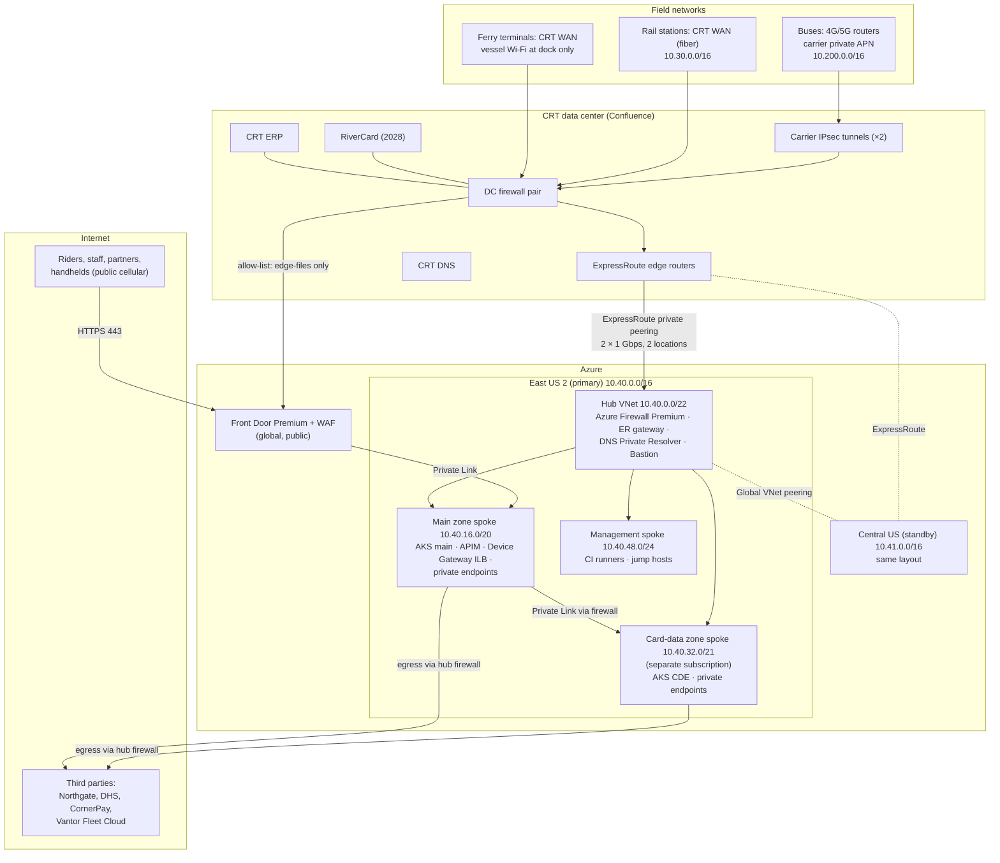

# Network Architecture — Project Tapline

> [!summary] Four trust boundaries
> 1. **Internet → Tapline:** only through Azure Front Door with WAF. No Tapline resource has a public IP.
> 2. **Field devices → Tapline:** validators reach the cloud only over the carrier private APN and CRT WAN, through the CRT data center and ExpressRoute. They never touch the internet, except an allow-listed path to fetch signed deny-list files.
> 3. **Main zone ↔ card-data zone:** separate subscription and VNet. The only paths in are Private Link endpoints for named services, inspected by Azure Firewall (PCI DSS segmentation).
> 4. **Tapline → third parties:** egress only through Azure Firewall to allow-listed destinations, from static IPs the third parties allow-list in return.

**Change history:** v1.0 (2026-08-20) captured the landing zone as built. v1.1 (2026-10-16) added the validator deny-list egress path and the ferry terminal connectivity for the V5 validators.

## 1. Overview

## 2. Network Zones
| Zone | Contents / Purpose | Inbound Allowed From | Outbound Allowed To |
|---|---|---|---|
| **Public edge** | Front Door Premium + WAF: Rider App and Portal API, Back-Office and Partner portals, Fare Data API, edge-files (deny lists and config) | Internet, 443 only | Main zone origins over Private Link only |
| **Field** (CRT-managed, outside Azure) | Validators, vehicle routers, station switches | Nothing from outside. Validators initiate every connection. | Device Gateway (via DC and ExpressRoute); `edge-files` FQDN via DC firewall; Vantor NTP and Fleet Cloud via DC firewall |
| **CRT data center** | Carrier IPsec termination, ExpressRoute edge, RiverCard, ERP, CRT DNS | Field networks; Azure hub over ExpressRoute | Azure hub; allow-listed internet FQDNs |
| **Hub** | Azure Firewall Premium (IDPS on), ExpressRoute gateway, DNS Private Resolver, Bastion | ExpressRoute; spokes | Spokes; internet via firewall (allow-list) |
| **Main zone** (app tier) | AKS main cluster, APIM (internal VNet mode), Device Gateway internal load balancer, private endpoints for Event Hubs, Journey/Account/Policy SQL, Redis, Blob, Key Vault | Front Door (Private Link); field via hub (Device Gateway 443 only); management spoke | Card-data zone private endpoints (listed in §6); hub firewall for internet egress |
| **Card-data zone** (PCI segment) | AKS CDE cluster (Payments, Ledger, Settlement); private endpoints for Ledger SQL, Managed HSM, CDE Key Vault, CDE Event Hubs consumer endpoints | Main zone, only to the CDE ingress controller on 443 and only from named source subnets; management spoke via Bastion (just-in-time) | Northgate (443, SFTP 22) via hub firewall; ERP via ExpressRoute; main-zone Event Hubs private endpoint |
| **Data tier** (inside each spoke) | Private endpoints only. No compute. | Its own spoke's AKS subnets | None |
| **Management** | Self-hosted CI runners, jump hosts | Bastion; GitHub via firewall (runners initiate) | Spokes (deployment), Azure control plane |

## 3. Connectivity

**Azure topology:** hub-and-spoke in each region, built from the CRT Azure landing zone. Spokes peer only with their hub; there is no spoke-to-spoke peering. All traffic between spokes routes through the hub firewall using user-defined routes (UDRs) with `0.0.0.0/0 → firewall` on every spoke subnet. The two regional hubs are joined by global VNet peering for replication traffic.

**IP address plan**
| Range | Use |
|---|---|
| 10.10.0.0/16 | CRT data center (existing) |
| 10.30.0.0/16 | Rail stations and ferry terminals (CRT WAN) |
| 10.200.0.0/16 | Vehicle routers (carrier private APN pool) |
| 10.40.0.0/16 | Azure East US 2. Hub /22, main /20, card-data /21, management /24 |
| 10.41.0.0/16 | Azure Central US. Same layout |
| 192.168.0.0/16 | AKS pod overlay (Azure CNI Overlay). Not routable outside the clusters, so it can repeat in each cluster |

**Subnets in the East US 2 main spoke (10.40.16.0/20)**
| Subnet | CIDR | Contents |
|---|---|---|
| `snet-aks-system` | 10.40.16.0/24 | AKS system node pool |
| `snet-aks-user` | 10.40.17.0/24 – 10.40.18.0/23 | AKS user node pools |
| `snet-apim` | 10.40.20.0/26 | API Management (internal) |
| `snet-devicegw-ilb` | 10.40.20.64/27 | Device Gateway internal load balancer |
| `snet-pe` | 10.40.21.0/24 | Private endpoints (Event Hubs, SQL, Redis, Blob, Key Vault) |
| `snet-pls` | 10.40.22.0/27 | Private Link Service for Front Door origins |

**Field connectivity**
- **Buses:** each bus has a 4G/5G router (dual carrier SIMs) on the carrier's private APN. The carrier delivers APN traffic to the CRT data center over two IPsec tunnels. There is no internet breakout from the APN.
- **Rail stations:** fiber to the CRT WAN. Each platform switch has a dedicated validator VLAN.
- **Ferry:** the 120 Vantor V5 validators on vessels have no connectivity at sea. They upload at dock over terminal Wi-Fi (WPA3-Enterprise, device certificates) into the CRT WAN. Their limits (TLS 1.2, batch upload) are covered by the [Exception Request](../07-governance/architecture-exception-request.md).
- **CRT data center to Azure:** two ExpressRoute circuits, 1 Gbps each, at two peering locations, connected to both regions' gateways (zone-redundant). If ExpressRoute is lost, a site-to-site VPN over the internet takes over, at reduced bandwidth (sized for taps, not bulk data).

## 4. Load Balancing & Traffic Management

| Traffic | Mechanism | Failover |
|---|---|---|
| Riders, staff, partners (HTTPS) | Front Door Premium → Private Link → APIM and portal ingress | Front Door origin groups with both regions; health probes every 30 s; Central US used automatically if East US 2 origins fail |
| APIs inside a region | APIM (internal) → AKS ingress (Application Gateway for Containers) → services | Zone-redundant; pods spread across 3 zones |
| Validator uploads | Device Gateway internal load balancer (per region) | DNS-based: `device.tapline.internal` points to the active region's ILB, TTL 60 s. It is switched by the DR runbook, not automatically, so validators don't split between regions during a partial failure. Validators hold taps meanwhile. |
| Deny-list and config downloads | Front Door (`edge-files.crt-transit.example`), cached at the edge | Blob origins in both regions |
| Between services | Kubernetes services; mutual TLS through the service mesh (Istio add-on) | Within cluster |
| Main zone → card-data zone | Private Link Service on the CDE ingress → private endpoint in the main zone | Per region |

## 5. DNS Strategy

| Zone | Type | Hosted in | Records |
|---|---|---|---|
| `crt-transit.example` | Public | Azure DNS | `api`, `my` (Rider Portal), `backoffice`, `partners`, `fares` (Fare Data API), `edge-files`: all CNAMEs to Front Door |
| `tapline.internal` | Private | Azure Private DNS, linked to hubs; CRT DNS forwards to it | `device` (Device Gateway ILB, TTL 60 s), internal service names for on-premises callers (ERP integration) |
| `privatelink.*` (database, servicebus, blob, vaultcore, redis, managedhsm …) | Private | Azure Private DNS, linked to hub VNets | Private endpoint records, created by IaC policy |

- **Resolution:** CRT DNS has conditional forwarders for `tapline.internal` and `privatelink.*` pointing to the Azure DNS Private Resolver inbound endpoints in each hub. Spokes use the hub resolver.
- **Validators** are configured with CRT DNS only. They can resolve `device.tapline.internal` and `edge-files.crt-transit.example`, and nothing else is reachable even if resolved.
- **Back-Office and Partner portals** are public hostnames, but they need Entra ID sign-in with Conditional Access: back-office requires a CRT-managed device; partners require MFA.

## 6. Firewall / Security Group Rules Summary

Azure Firewall policy is defined in IaC (`tapline-infra/modules/network/firewall-policy`). Network security groups (NSGs) on every subnet deny by default. This summary lists the allowed flows; anything not listed is denied and logged.

| # | Source | Destination | Port / Protocol | Purpose | Enforced by |
|---|---|---|---|---|---|
| F1 | Vehicle APN, station and terminal VLANs | `device.tapline.internal` (Device Gateway ILB) | 443/TCP | Tap upload, heartbeats | DC firewall, hub firewall, NSG |
| F2 | Vehicle APN, station and terminal VLANs | `edge-files.crt-transit.example` | 443/TCP (FQDN rule) | Deny-list and config download | DC firewall (only internet egress allowed for field devices) |
| F3 | Vehicle APN, station and terminal VLANs | Vantor Fleet Cloud, Vantor NTP | 443/TCP, 123/UDP (FQDN) | Firmware and time | DC firewall |
| F4 | Front Door (service tag `AzureFrontDoor.Backend`) | Private Link Service (main zone) | 443/TCP | Public APIs and portals | Private Link, NSG |
| F5 | Main zone AKS user subnets | CDE ingress private endpoint | 443/TCP | Payments API, Ledger API (balances, statements) | Hub firewall (IDPS), NSG |
| F6 | CDE AKS subnets | Main zone Event Hubs private endpoint | 5671/TCP (AMQP over TLS) | Consume `domain-events`, publish payment events | Hub firewall, NSG |
| F7 | Device Gateway pods (main zone) | CDE ingress (`/card-data` route only) | 443/TCP | Pass encrypted card data to Payments | Hub firewall, CDE ingress policy |
| F8 | CDE AKS subnets | Northgate API and SFTP (FQDN) | 443/TCP, 22/TCP | ICD-001 interfaces | Hub firewall; static egress IP allow-listed by Northgate |
| F9 | CDE AKS subnets | CRT ERP (10.10.20.15) | 443/TCP | Journal posting | Hub firewall, DC firewall |
| F10 | Main zone AKS subnets | State DHS, CornerPay, Vantor Fleet Cloud, Azure Communication Services (FQDN) | 443/TCP | Integrations | Hub firewall |
| F11 | Main zone AKS subnets | Castellan RiverCard (10.10.40.0/24) | 443/TCP | RiverCard bridge (2028; rule expires 2029-03-31) | Hub firewall, DC firewall |
| F12 | Management spoke runners | All spokes | 443/TCP | Deployments | Hub firewall, NSG |
| F13 | Bastion | Jump hosts | 3389/22 | Break-glass administration (just-in-time, logged) | NSG |
| F14 | Any spoke | Azure platform (service tags: AzureMonitor, AzureActiveDirectory, AzureKeyVault …) | 443/TCP | Platform services | Hub firewall |

**PCI segmentation tests** (penetration test of the segmentation controls) run every 6 months and after any change to rules F5–F9, as required by PCI DSS for service providers and adopted by CRT for itself.

## 7. Ingress/Egress Rules

**Ingress**
- Public ingress exists **only at Front Door**. WAF policy: OWASP default rule set 2.1 in prevention mode, bot protection, rate limits per client IP (e.g. 300 requests/min on sign-in), and geo-filtering that allows US traffic and blocks others on staff and partner portals only.
- Every origin is reachable only through Private Link. APIM and ingress controllers have no public IPs, and Azure Policy denies public IPs in Tapline subscriptions.
- **Field ingress** exists only from CRT-managed networks, through ExpressRoute, to the Device Gateway ILB on 443. The gateway then authenticates every validator by device certificate.
- **Card-data zone ingress** comes only from the main zone, on the Private Link endpoints listed in rules F5 and F7.

**Egress**
- All egress from Azure goes through the hub firewall, with FQDN allow-lists per source subnet. Default deny, and every denied flow is logged to Log Analytics.
- Egress uses two static public IPs per region (one main zone, one card-data zone), so third parties can allow-list CRT precisely. Northgate allow-lists only the card-data zone IPs.
- TLS inspection is enabled on the firewall for general internet egress from the main zone, but **not** for Northgate traffic (mutual TLS, certificate pinning) or Azure platform endpoints.
- Field devices have no internet egress except rules F2 and F3, enforced at the DC firewall.

**Monitoring:** firewall, NSG flow logs (VNet flow logs) and WAF logs go to Log Analytics, are kept 90 days online, and feed Microsoft Sentinel. Alerts fire on denied egress from the card-data zone (any), new destinations from field networks, and WAF block spikes.
