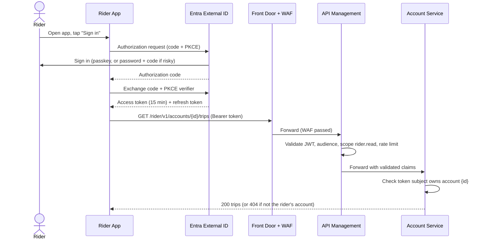
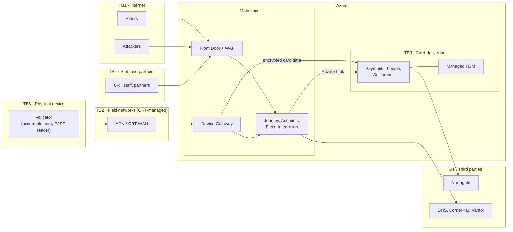

# Security Architecture — Project Tapline

> [!summary] What we protect, and the five controls that matter most
> Tapline protects **riders' money and travel history**, **CRT's fare revenue**, and **card data CRT never sees**. The controls that carry the most weight:
> 1. **No card numbers in CRT systems:** P2PE readers, media tokens and Northgate payment tokens ([ADR-0005](../06-decisions-and-standards/adr/0005-no-card-numbers-in-crt-systems.md)).
> 2. **Signed everything at the edge:** per-device certificates, signed taps and signed deny lists.
> 3. **Separate identity planes** for riders, staff, partners, devices and services.
> 4. **Two-person control** over money and fare rules, with tamper-evident audit.
> 5. **A segmented card-data zone** with its own subscription, cluster, keys and firewall rules.

## 1. Security Principles

| Principle | How it applies in Tapline |
|---|---|
| **Minimize what we hold** | No card numbers; DHS case details never stored; disability recorded as a category only; trip history deletable after 90 days. Data we don't hold can't leak. |
| **Zero trust** | Every call is authenticated and authorized, including service to service (mesh mTLS + workload identity) and validator to cloud (device certificates). Network location grants nothing by itself. |
| **Least privilege** | Role-based access per staff function; just-in-time elevation for administrators; each workload identity can reach only its own resources. |
| **Defense in depth** | WAF → API gateway → service authorization → database permissions; firewall → NSG → mesh policy. |
| **Separation of duties** | Two-person rules for refunds over limits, fare rule versions and deny-list overrides; developers have no production write access. |
| **Assume breach** | Immutable audit and archives; ledger tables with signed digests; anomaly detection on staff behavior; segmentation so a main-zone compromise doesn't reach card-data keys. |
| **Secure by default** | Azure Policy denies public IPs, unencrypted storage and missing diagnostics. Templates enforce private endpoints. |
| **Privacy by design** | Identity and travel separated; analytics only on pseudonymized data with monthly key rotation ([Data Architecture §7](../02-core-architecture/data-architecture.md)). |

## 2. Authentication
- **Mechanism:** OAuth 2.0 / OpenID Connect for people; mutual TLS with X.509 certificates for devices and third parties; managed identities and mesh mTLS for services; HMAC signatures for inbound webhooks.
- **Identity provider:** **Entra External ID** for riders; **Entra ID** for CRT staff; **Entra ID B2B** for partner staff; **CRT Device CA** (in Managed HSM) for validators and handhelds.
- **MFA requirements:** see the table.

| Population | Identity provider | Sign-in method | MFA | Session |
|---|---|---|---|---|
| Riders | Entra External ID | Email or phone + password, or a passkey | Email/SMS one-time code at sign-up and on risky sign-ins; passkeys encouraged | Access token 15 min; refresh token 30 days, device-bound |
| CRT staff | Entra ID | CRT single sign-on | **Phishing-resistant** (FIDO2 key or Windows Hello for Business), always | 8 h; re-authentication for sensitive actions (refunds, fare approval) |
| Privileged admins | Entra ID + Privileged Identity Management | As staff | Phishing-resistant + PIM approval | Elevation 4 h max |
| Partner staff | Entra ID B2B (their own IdP) | Partner's single sign-on | Required (enforced by CRT Conditional Access) | 8 h |
| Validators | CRT Device CA | Mutual TLS, per-device certificate; private key in the secure element | n/a | Certificate valid 2 years, renewed automatically 60 days before expiry |
| Handhelds | CRT Device CA + Entra ID | Device certificate **and** inspector sign-in | Inspector: phishing-resistant at shift start | Shift (10 h) |
| Services | Entra workload identity; Istio | Managed identity tokens to Azure resources; mesh mTLS between pods | n/a | Short-lived tokens |
| Third parties | Per ICD | Mutual TLS, OAuth client credentials, HMAC | n/a | Per ICD |

**Rider sign-in and API call**

**Validator authentication.** Each validator is provisioned in the hardware lab:
1. Its secure element generates a key pair.
2. The CRT Device CA signs the certificate, binding it to the asset ID (e.g. `BUS-4471-F`).
3. The Device Gateway accepts a connection only from a certificate chained to the CA whose device is registered and **active** in Device Management.

A validator that is reported stolen is revoked in Device Management. The revocation takes effect at the gateway at once and spreads to other validators within one deny-list cycle.

## 3. Authorization
- **Model:**
  - **RBAC** (Entra app roles) for staff and partners.
  - **Resource ownership** for riders: a rider can only touch their own account.
  - **ABAC** for partner data (operator code claim) and for masking decisions (the agent's role plus whether the rider is in an active support session).
- **Where enforced:** at every layer. No single layer is trusted alone.

| Layer | Enforces |
|---|---|
| Front Door + WAF | Protocol, OWASP rules, bots, rate limits |
| API Management | Token validity, audience, scopes, per-client quotas |
| Service (ASP.NET Core policy-based authorization) | Roles, ownership checks, two-person rules, masking. **This is the authoritative check.** |
| Database | Least-privilege database roles per workload; row-level security on partner-facing apportionment views; ledger tables reject UPDATE and DELETE for everyone |
| Event Hubs | Each workload identity can send to or receive from only its own hubs and consumer groups |

**Staff roles**
| Role | Can | Cannot |
|---|---|---|
| `cs.agent` | Find accounts, view masked details, see trips during a support session, block media, refund up to $50 (max 3 per account per 30 days) | Approve own refunds; see Restricted data; change fare rules |
| `cs.supervisor` | Everything `cs.agent` can; approve held refunds | Approve a refund they initiated |
| `fare.analyst` | Create and simulate fare rule versions | Approve own versions |
| `fare.approver` | Approve fare rule versions | Edit a version they approve |
| `revenue.analyst` | Reconciliation, ledger queries, adjustments with second approval | Change charges already sent; see rider identity beyond what an exception needs |
| `fleet.operator` | Device status, ring rollouts, halt campaigns, revoke devices | Change deny-list contents directly |
| `fleet.denylist.override` | Emergency add or remove of a token, with a second approver | Act alone |
| `security.analyst` | Read audit logs, break-glass archive access with CISO approval | Change anything |

## 4. Trust Boundaries

| Boundary | What crosses it | Main controls |
|---|---|---|
| **TB1** Internet → Tapline | Rider and public API traffic | WAF, OAuth, rate limits, no public origins |
| **TB2** Field → Tapline | Taps, heartbeats, deny-list downloads | Private APN, device certificates, signed taps, signed deny lists |
| **TB3** Main zone → card-data zone | Fare and money events; encrypted card data | Separate subscription and cluster, Private Link only, firewall IDPS, separate keys |
| **TB4** Tapline ↔ third parties | ICD traffic | Mutual TLS, HMAC, static egress IPs, ACL adapters |
| **TB5** Staff and partners → back office | Privileged actions | Phishing-resistant MFA, managed devices, two-person rules, audit |
| **TB6** Physical device | A device in a public place that anyone can touch | Tamper-responsive P2PE reader, keys in secure element, locked debug ports, revocation |

Each boundary is walked threat by threat in the [Threat Model](threat-model.md).

## 5. Data Classification
Same scheme as the [Data Architecture §7](../02-core-architecture/data-architecture.md), which defines where each class may be stored.

| Class | Examples | Handling Requirements |
|---|---|---|
| Public | Fare tables, GTFS-Fares, published ridership statistics | Integrity only: published from approved sources |
| Internal | De-identified usage, validator status, aggregate revenue, architecture documents | CRT staff and contracted partners; not published |
| Confidential | Rider contact details, eligibility category, media tokens joined to taps, trip history, staff identities in audit logs | Encrypted at rest with customer-managed keys; access by role and audited; masked by default in the back office; never in logs or analytics in identifiable form |
| Restricted (PII/PHI/PCI) | Payment tokens, P2PE-encrypted card data, cryptographic keys, eligibility documents during their 90 days | Card-data zone or HSM only (documents: isolated container, 90-day deletion); encryption + audit logging required; just-in-time access with named approval; never exported |

## 6. Data Protection / Encryption
- **At rest:**
  - All Azure SQL databases use TDE with **customer-managed keys** in Managed HSM (main zone and CDE use separate HSM key sets).
  - Storage accounts use customer-managed keys with infrastructure encryption (double encryption) for archives.
  - Redis is encrypted at rest. Validator storage is encrypted by the device using a key held in the secure element.
- **In transit:**
  - TLS 1.2 minimum, TLS 1.3 preferred on every external endpoint.
  - The only TLS 1.2-only clients are the ferry's Vantor V5 validators, under an exception ([Exception Request](../07-governance/architecture-exception-request.md)).
  - Mesh mutual TLS between pods.
  - P2PE from the card reader to Northgate. Card data is encrypted inside the tamper-responsive reader using DUKPT keys injected by Northgate's key-injection facility.
- **Key management:** Managed HSM (FIPS 140-3 Level 3).

| Key | Holder | Rotation | Notes |
|---|---|---|---|
| CRT Device CA root | Managed HSM (offline use only) | 10 years | Used only to sign intermediates, at a key ceremony |
| Device CA intermediate | Managed HSM | 2 years | Signs validator and handheld certificates |
| Deny-list signing key | Managed HSM | 1 year, overlapping | Validators trust current + next public key |
| Per-device tap signing key | Validator secure element | Lifetime of certificate (2 years) | Never leaves the device |
| TDE customer-managed keys | Managed HSM | 1 year (automatic) | Separate per zone |
| Ledger digest signing | Managed HSM | 1 year | Signs the 15-minute digests in immutable storage |
| Media-token derivation key | Northgate key-injection facility; inside P2PE readers | Per Northgate's P2PE program | CRT never holds it |
| Analytics pseudonymization key | Managed HSM | **Monthly** | Rotation is what prevents linking a rider across months |
| Northgate client certificate | CDE Key Vault | 1 year | 14-day overlap per ICD-001 |
| Webhook HMAC secrets (Northgate, CornerPay) | Key Vault (CDE / main) | 6 months | Dual-secret validation during rotation |

## 7. Secrets Management
- **Vault solution:** Azure Key Vault, one per zone per environment, with private endpoints only. Managed HSM for keys that must never leave hardware.
- **Access:** workloads read secrets with their own managed identity through the Secrets Store CSI driver. People have no standing access to production secrets; reading one requires PIM elevation and is alerted.
- **Rotation:** automated where the counterparty supports it. Otherwise a rotation reminder fires at 30 days, and an expired secret is a P2 incident.
- **No secrets in code or pipelines.** OIDC federation for CI, secret scanning with push protection, and Gitleaks. Details are in [IaC Notes §5](../04-infrastructure-and-network/infrastructure-as-code-notes.md).

## 8. Audit & Logging
- **What's logged:**

| Event | Source | Fields |
|---|---|---|
| Staff sign-in, MFA, elevation (PIM), break-glass | Entra ID | Who, when, from where, device compliance |
| Every staff action on an account, medium, refund, adjustment, fare rule or deny-list override | Each service, as an audit event | Who, role, action, target, before/after values, reason, approver, trace ID |
| Every staff *view* of a rider's trip history or contact details | Account Service, Journey read API | Who, which account, support session ID |
| Rider security events (sign-in, password change, media linked or blocked) | Entra External ID, Account Service | Account, event, device fingerprint |
| Device events (certificate issued or revoked, firmware change, tamper alarm) | Device Management, Vantor Fleet Cloud | Device, event, operator |
| Infrastructure changes | Azure Activity Log, GitHub audit log | Who, what, pipeline run |
| Data exports and archive access | Lakehouse, ADLS | Who, what, approval reference |

- **Retention:** audit events are kept **1 year in Log Analytics** (searchable) and **7 years in immutable Blob storage**. Legal holds are applied by CRT Legal and suspend deletion.
- **Who can access:** the security operations team (Microsoft Sentinel) and auditors (read-only, time-bound). Staff can't read or alter audit entries about themselves. Audit storage is in a separate subscription where Tapline administrators have no write rights.
- **Tamper evidence:** immutable storage, and ledger digests signed in the HSM every 15 minutes, which detect any alteration of financial history.
- **Detection:**
  - Sentinel analytics rules on refund patterns: the same agent and rider repeatedly, or refunds just under the $50 limit.
  - Mass account lookups by one agent.
  - Validators with abnormal deny rates or clock jumps.
  - Sign-ins from impossible locations.
  - Any denied egress from the card-data zone.

## 9. Threat Model Summary
The full STRIDE analysis is in the [Threat Model](threat-model.md). Highest-rated threats and their main controls:

| Threat | Main controls |
|---|---|
| Insider refund fraud (T-17) | Two-person rule above limits, audit, Sentinel pattern detection |
| Spoofed validator injecting taps (T-01) | Device certificates in secure element, signed taps, asset registration, revocation |
| Tampered or forged deny list (T-05) | HSM signatures, version chaining, reject-and-alarm on mismatch |
| Account takeover to steal stored value (T-03) | Passkeys, risk-based MFA, notifications on media changes, cooling-off on new media for refunds |
| Card skimming via a tampered validator (T-08) | Tamper-responsive P2PE readers, tamper alarms, physical inspection schedule |
| Deliberate use of a debt-laden card on offline buses (T-12) | Accepted risk within limits; deny list on reconnection; debt recovery |

## 10. Compliance Requirements
| Requirement | Drives |
|---|---|
| **PCI DSS v4.0.1.** CRT is a Level 1 merchant (more than 6M Visa transactions a year), so it needs an **annual Report on Compliance by a QSA**. | Card-data zone, P2PE, segmentation testing, key management, audit logging, quarterly ASV scans, annual penetration tests |
| **State consumer privacy law** | Data minimization, rider access and deletion rights, privacy notice, the 90-day option |
| **NIST CSF 2.0** (CRT's security framework) | Governance, asset inventory, detection and response processes |
| **CRT Rider Privacy Policy (2025)** | Law-enforcement request process, no sale of data, retention limits |
| **Vendor assurance** | Northgate: PCI DSS AOC (service provider) annually. Vantor + Northgate P2PE solution: PCI SSC listing. CornerPay: SOC 2 Type II. Microsoft Azure: PCI DSS AOC and SOC 2 via the Service Trust Portal. |

Control-by-control mapping and open gaps are in the [Compliance Matrix](../07-governance/compliance-matrix.md).
