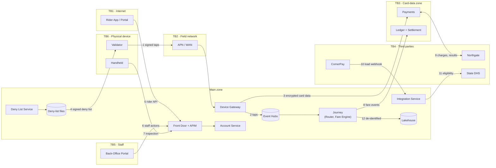

# Threat Model — Project Tapline

> [!summary] How this was done
> Four workshops (June–October 2026) walked each trust boundary in the [Security Architecture §4](security-architecture.md), asking which STRIDE categories apply to each data flow. The result is 26 threats: 22 mitigated by design, 2 in progress, 1 open (Phase 4) and 1 accepted. Seven residual risks are consciously accepted, each with a named owner (§4). Likelihood and impact use CRT's enterprise risk scale: **H**igh, **M**edium, **L**ow.

**Change history**
| Version | Date | Change |
|---|---|---|
| 0.9 | 2026-06-19 | Edge-only model (TB2, TB6) produced as input to [ADR-0004](../06-decisions-and-standards/adr/0004-offline-first-validators-with-signed-deny-lists.md) and the ARB of 2026-06-24 |
| 1.0 | 2026-09-11 | Whole-system model after the container design |
| 1.2 | 2026-10-30 | Updated for the network design and the P2PE card-data flow; T-25 and T-26 added |

## 1. Scope
**In scope:**
- The Tapline system as designed for Phases 1–2: validators and handhelds, Device Gateway, streaming pipeline, all cloud services, the Rider, Back-Office and Inspection APIs.
- Integrations with Northgate, DHS, CornerPay and Vantor Fleet Cloud.

**Out of scope, with separate models planned:**
- The RiverCard Bridge (Phase 3, model due 2027-09).
- The Partner API and Apportionment (Phase 4). T-24 is a placeholder.
- Keel Mobility.
- CRT corporate IT (ERP, Entra tenant), which is covered by CRT's enterprise threat model.
- Attacks on the carrier's network itself.

**Assets protected, in priority order:**
1. Fare revenue and stored value ($14.7M liability at migration).
2. Card data that CRT never holds.
3. Rider identity and travel history.
4. Availability of boarding.
5. Integrity of fare rules and the ledger.

## 2. Data Flow Diagram

Numbered flows are referenced in the threat table. Dashed boxes are trust boundaries (TB).

## 3. Threats Identified
| ID | STRIDE Category | Threat | Affected Component | Likelihood | Impact | Mitigation | Status |
|---|---|---|---|---|---|---|---|
| T-01 | Spoofing | A rogue or cloned device posing as a validator injects fabricated taps, to charge victims' cards or inflate an operator's revenue (flow 1) | Device Gateway | L | H | Per-device certificates with keys in the secure element; device must be registered and active; every tap signed by the device key; gateway rejects taps from unregistered assets; Sentinel alert on taps from a device far from its assigned route | Mitigated |
| T-02 | Tampering | Captured tap batches replayed to double-charge riders (flow 1) | Device Gateway, Fare Engine | L | M | Mutual TLS; `tap_id` uniqueness at every stage; signatures cover tap ID and time; duplicates are dropped and counted | Mitigated |
| T-03 | Spoofing | Account takeover (credential stuffing, SIM swap) to drain stored value or link the attacker's card to a victim's reduced-fare account (flow 5) | Rider API, Account Service | M | M | Passkeys encouraged; risk-based MFA in Entra External ID; WAF bot protection and sign-in rate limits; notification on every new media link and contact change; refunds to a newly linked card held 72 h | In progress (risk policies tuned during pilot) |
| T-04 | Tampering | Validator clock manipulated to move taps into a transfer window or a cheaper service day | Validator, Fare Engine | L | L | GPS-synced clocks; signed timestamps; gateway flags taps whose time differs from receipt time by more than device-offline duration allows; clock-jump fault code in heartbeats | Mitigated |
| T-05 | Tampering | Forged or altered deny list to remove a blocked card, or to block legitimate riders (flow 4) | Deny-list distribution, Validator | L | H | Deltas and manifests signed by an HSM key; validators verify signature and version chaining; rejected files raise a fault; storage write limited to the Deny List Service identity | Mitigated |
| T-06 | Denial of Service | Deny-list distribution stalls (service failure or Front Door issue), so blocked and debt-laden cards keep working | Deny List Service, Front Door | M | M | *Deny-list age* alert at 20 min; runbook *Deny-list distribution stalled*; nightly full list; validators keep last good list | Mitigated (residual R-2) |
| T-07 | Information Disclosure | Card data exposed from validator storage, gateway logs or traces (flows 1, 3) | Validator, Device Gateway | L | H | P2PE: only encrypted card data leaves the reader; encrypted field excluded from `taps`, logs and traces by an allow-list logger, with a test; never persisted outside the CDE | Mitigated |
| T-08 | Information Disclosure | Skimming: a tampered validator or overlay captures card data or PINs (contactless, so no PINs) | Validator (physical) | L | H | Tamper-responsive P2PE reader erases keys on intrusion; tamper alarm in heartbeat triggers revocation; monthly physical inspection during bus maintenance | Mitigated |
| T-09 | Elevation of Privilege | Attacker uses a validator's debug port or maintenance mode to run code or read keys | Validator | L | H | Debug ports fused off in production firmware; only Vantor-signed firmware boots; maintenance mode needs a short-lived token from Device Management; keys in secure element | Mitigated |
| T-10 | Spoofing | Cloned CRT card used to ride on someone else's balance | CRT card, Validator | L | M | CRT cards are MIFARE DESFire EV3 with AES mutual authentication (the serial alone is not accepted); Fare Engine flags the same card in two places too far apart to travel between | Mitigated |
| T-11 | Spoofing | App QR ticket shared by screenshot or forwarded | App ticket, Validator | M | L | QR code rotates every 30 s with a device-bound signed code that validators verify offline; a screenshot expires quickly; one active ticket per account | Mitigated |
| T-12 | Repudiation | Rider deliberately uses a card that will be declined, especially on offline vehicles, then never pays (first-ride risk abuse, including single-use prepaid cards) | Payments, Fare Engine | M | L | Token added to deny list on decline; debt must be paid before reuse; Northgate velocity checks on prepaid card ranges; loss monitored daily against the ≤ 0.3% threshold | **Accepted** (residual R-1) |
| T-13 | Denial of Service | Volumetric or application-layer DDoS on public APIs and portals (flow 5) | Front Door, APIM | M | M | Front Door DDoS protection and WAF; per-client and per-IP rate limits; autoscaling; boarding unaffected because validators don't depend on public endpoints | Mitigated |
| T-14 | Information Disclosure | Broken object-level authorization: a rider reads another account's trips by changing an ID (flow 5) | Rider API, Account Service | M | H | Ownership check in every handler (authoritative, not only at the gateway); "not found" for not-yours; non-guessable IDs; automated authorization tests in CI; annual penetration test | Mitigated |
| T-15 | Spoofing | Forged CornerPay webhook credits stored value that was never paid (flow 10) | Integration Service | L | H | Mutual TLS + HMAC with timestamp; load confirmed by calling CornerPay's confirmation API before credit; daily reconciliation with CornerPay's settlement | Mitigated |
| T-16 | Spoofing | Forged Northgate result marks declined charges as approved (flow 9) | Payments Service | L | M | Mutual TLS + HMAC per ICD-001; results reconciled against the settlement file each day; mismatch blocks day close | Mitigated |
| T-17 | Elevation of Privilege | Insider refund fraud: an agent issues refunds to accounts they control | Back-Office, Account and Payments services | M | M | $50 and 3-per-30-days limits; second approver above limits; cannot approve own; refunds only to the original funding source; Sentinel rules for repeated agent–rider pairs and amounts just under the limit; audit | Mitigated (detective controls monitored weekly) |
| T-18 | Tampering | Insider changes a fare rule to benefit themselves or others | Fare Policy Service | L | H | Two-person approval; immutable versions; mandatory simulation report attached; effective time must be in the future; publication notifies Revenue Operations | Mitigated |
| T-19 | Repudiation | Staff member denies making an adjustment or approval | Audit | L | M | Immutable audit with identity, phishing-resistant MFA, re-authentication for sensitive actions; staff can't alter their own audit records | Mitigated |
| T-20 | Information Disclosure | Staff browse a rider's trip history without reason (for example, stalking an ex-partner) | Back-Office, Journey read API | M | H | Trip history visible only within an active support session started from a rider contact; every view audited; Sentinel alerts on lookups without a contact record; disciplinary policy | Mitigated |
| T-21 | Information Disclosure | Re-identification of riders from analytics data (home and work patterns) | Lakehouse (flow 12) | L | H | Monthly pseudonym key rotation; times rounded to 15 min; groups under 10 suppressed; no identity data in the lakehouse; analyst access by role and logged | Mitigated (residual R-5) |
| T-22 | Elevation of Privilege | Compromise of a main-zone workload pivots into the card-data zone | Main zone, CDE | L | H | Separate subscription, cluster, identities and Key Vault; only Private Link endpoints F5–F7 reachable; firewall IDPS; CDE workloads accept only mesh identities of named callers | Mitigated |
| T-23 | Elevation of Privilege | Supply-chain compromise: a malicious dependency, image or pipeline change reaches production | CI/CD, AKS | M | H | Branch protection + CODEOWNERS; dependency and container scanning; signed images with admission policy; OIDC (no stored credentials); target SLSA Level 3 build provenance | In progress (provenance by Phase 1) |
| T-24 | Information Disclosure | One partner operator reads another operator's revenue or trips | Partner API (Phase 4) | M | M | Planned: operator claim + row-level security; separate model in Phase 4 | Open (Phase 4) |
| T-25 | Denial of Service | A malfunctioning or compromised validator floods the Device Gateway with uploads | Device Gateway, Event Hubs | M | M | Per-device rate limits and maximum batch size; abnormal devices quarantined automatically (uploads accepted at reduced rate, alert raised) | Mitigated |
| T-26 | Repudiation | Rider disputes a charge, claiming they never rode | Payments, Journey | M | L | Signed taps with validator, location and time provide evidence; chargeback responses include them (ICD-001 IF-7); customer service can show the trip history | Mitigated |

## 4. Residual Risk

These risks remain after mitigation and are consciously accepted. Each is reviewed at the date shown or after any incident involving it.

| # | Residual risk | Related | Why accepted | Accepted by | Review |
|---|---|---|---|---|---|
| R-1 | First-ride risk: losses from cards declined after an offline acceptance, including deliberate abuse | T-12, [ADR-0004](../06-decisions-and-standards/adr/0004-offline-first-validators-with-signed-deny-lists.md) | Waiting for online authorization would break the 300 ms boarding target and fail during outages. Industry experience suggests losses well under the 0.3% of card fare revenue limit. | Miguel Serrano, CRO (2026-06-24, with ADR-0004) | Phase 1 exit, using real loss data |
| R-2 | During a long outage, validators keep using a deny list up to 72 h old | T-06 | Same trade-off as R-1; boarding continues | Miguel Serrano, CRO | Phase 1 exit |
| R-3 | Ferry Vantor V5 validators use TLS 1.2 and upload in batches at dock until replaced | T-02, T-07 | Hardware can't support more; replacement planned with vessel refits | Tom Whitaker, CISO, through the [exception request](../07-governance/architecture-exception-request.md) | Exception expiry, Q4 2028 |
| R-4 | Vantor firmware is closed source; CRT relies on Vantor's signing and secure development process | T-09 | No commercially available validator offers source access. Mitigated by contract (security SLAs, right to audit), PCI P2PE listing and lab testing of each release | Priya Raman, CIO | Annually, at Vantor's security review |
| R-5 | Small chance of re-identification from de-identified analytics within one month's pseudonyms | T-21 | Needed for transfer and cap analysis required by Title VI; controls make it impractical | Grace Liu (data owner) and CRT General Counsel | Annually |
| R-6 | Raw tap archive keeps taps for 13 months even for riders who chose 90-day deletion | T-20, T-21 | Immutable archive required for fraud and financial audit; access is break-glass only and disclosed in the privacy notice | CRT General Counsel | Annually |
| R-7 | Partner data isolation not yet designed | T-24 | No partner is live before Phase 4 | Dana Okafor, Chief Architect | Phase 3 design sprint |

**Next review of the whole model:** before Phase 1 go-live (target 2027-01), and after any security incident or architecture change that adds a data flow or trust boundary.
