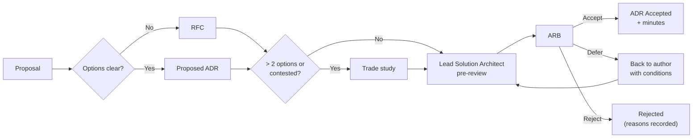

# Architecture Governance Framework — Project Tapline

> [!summary] Governance in one line
> Teams decide inside their context. The ARB decides anything that crosses contexts, touches a quality attribute, an external interface, PCI scope, or a principle. The CISO can veto on security. The Board and the Partner Operator Council decide policy, not technology. Every decision is written down: as an ADR, an exception, or minutes.

**Change history**
| Version | Date | Change |
|---|---|---|
| 1.0 | 2026-04-10 | Adopted with ADR-0001 at the first ARB |
| 1.1 | 2026-06-10 | Added the exception register (§6) and the trade-study rule |
| 1.2 | 2026-10-07 | Added Partner Operator Council seats; phase-gate checklist; metrics |
| 1.2.1 | 2027-12-08 | Exception register: EX-002 approved |

## 1. Purpose
Tapline is a five-year, $89.6M program with four product teams, a platform team, a delivery partner, three critical vendors and six partner operators who will eventually depend on it. Governance exists to:
1. Keep the architecture coherent as many people make many decisions over years.
2. Make the decisions that are expensive to reverse slowly and visibly, and the cheap ones fast and locally.
3. Leave a record that auditors, the FTA, the Board and future engineers can follow.
4. Give partner operators a real voice in decisions that will affect their revenue.

It explicitly does **not** exist to approve routine design inside a team's own context. That would slow delivery and push decisions away from the people with the most knowledge.

## 2. Roles & Responsibilities
| Role | Responsibility |
|---|---|
| **CRT Board of Directors** | Approves budget, fare changes, Title VI analyses and phase gates. Not involved in technology decisions. |
| **Program Board** (Miguel Serrano chair; Priya Raman, Jordan Hale, Elena Brooks, Marcus Bell) | Scope, schedule, budget, risk appetite; accepts business risks (e.g. first-ride risk); business readiness at phase gates |
| **Architecture Review Board (ARB)** (Dana Okafor chair; membership in the [Reference Architecture §7](../06-decisions-and-standards/reference-architecture-and-technology-radar.md)) | Accepts ADRs; owns principles, reference architecture and radar; approves exceptions and RFCs with architectural impact; architecture readiness at phase gates |
| **Chief Architect** (Dana Okafor) | Chairs the ARB; owns the SAD and principles; decides urgent matters between ARB meetings with the CISO, ratified afterwards |
| **CISO** (Tom Whitaker) | **Veto** on decisions affecting security, PCI scope or card data; owns the security architecture, threat model and compliance matrix |
| **Lead Solution Architect** (Aisha Karimi) | Day-to-day architectural direction across teams; reviews cross-context designs before they reach the ARB; owns C4, integration and data architecture |
| **Engineering / team leads** (Journey, Rider, Money, Edge, Platform) | Decide designs inside their context; raise ADRs for anything in §3.1; own their services' runbooks and SLOs |
| **Partner Operator Council** (Linda Park chair) | Approves the regional fare agreement and regional fare rules; advisory ARB seat now, voting seat on regional matters from Phase 4 |
| **CRT Change Advisory Board (CAB)** | Approves production changes (not designs) under CRT's change process; pre-approves standard change templates |
| **Vendors** (Vantor, Northgate) | Bound by ICDs and contracts. They propose changes through the joint change boards defined in each ICD, never directly to teams. |

## 3. Review Process

### 3.1 What needs the ARB

| Decision type | Who decides | Record |
|---|---|---|
| Design inside one context, no change to its contracts or NFRs | Team | Code review, team notes |
| Changes to a context's public contracts (events, APIs), backward-compatible | Team, with Lead Solution Architect review | Contract change in `specs/` |
| Breaking contract change; new context or service; change to a quality attribute; new technology not on the radar as Adopt/Trial | **ARB** | ADR |
| Choice with more than two real options, or contested | **ARB**, after a trade study | Trade study + ADR |
| Anything affecting PCI scope, card data, keys or authentication | **ARB + CISO** (veto) | ADR |
| Deviation from a standard or principle | **ARB** (+ CISO if security) | [Exception request](architecture-exception-request.md) + register (§6) |
| Cross-team or cross-organization change of direction (e.g. a regional fare cap) | **ARB** for architecture; Program Board and/or Partner Operator Council for policy | [RFC](rfc-template.md), then ADRs |
| External interface change | ARB + the joint change board in the ICD | ICD revision |
| Fare levels, caps, products | CRT Board (and Partner Operator Council for regional rules) | Board resolution; then fare rule version in Tapline (FR-POL-01) |

### 3.2 Flow
1. **Submit an RFC** ([rfc-template.md](rfc-template.md)) for proposals that need discussion before a decision, or go straight to a **proposed ADR** when the options are already clear.
2. **Lead Solution Architect pre-review** within 5 business days. Checks completeness, links to requirements, and whether a trade study is needed.
3. **ARB review** at the next monthly meeting (submission deadline: 5 business days before). The author presents for up to 15 minutes, followed by discussion.
4. **Decision:** accept, accept with conditions, defer (with what's needed), or reject (with reasons). Decided by consensus where possible, otherwise by vote. The CIO has a casting vote on technology direction; the CISO has a veto on security.
5. **Decision recorded:** the ADR status changes to Accepted in the same week (see [ADR Log](../06-decisions-and-standards/adr/adr-log.md)), and the minutes record the decision ([ARB minutes](arb-minutes-template.md)).
6. **Follow-through:** actions are tracked in the minutes and reviewed at the start of the next meeting.

### 3.3 Phase-gate architecture review
Before each roadmap gate ([Roadmap §4](../00-vision-and-strategy/architecture-roadmap.md)), the ARB runs an [Architecture Compliance Review](../10-testing-and-validation/architecture-compliance-review.md) covering:
- [ ] All ADRs implemented as decided, or superseded
- [ ] No expired exceptions; open exceptions within scope
- [ ] Threat model and compliance matrix current; no open High threats
- [ ] NFR evidence for the gate's success criteria (test results, SLO dashboards)
- [ ] Runbooks exist for every alert of services going live
- [ ] Documentation set current (SAD, C4, data architecture)

The ARB's result is one of **ready**, **ready with conditions** or **not ready**. It goes to the Program Board with the business-readiness assessment.

## 4. Escalation Path
| Disagreement | Escalate to | Then |
|---|---|---|
| Between teams on a cross-context design | Lead Solution Architect | ARB |
| With an ARB decision | ARB chair (reconsideration at the next ARB, with new information only) | CIO, whose decision is final on technology |
| Security or PCI (including a CISO veto) | CISO | CIO and General Counsel; CISO veto can only be overridden by the CEO in writing |
| Architecture vs schedule or budget | Program Director and Chief Architect jointly | Program Board |
| Partner operator objection to a regional decision | Partner Operator Council | Regional fare agreement dispute process; CRT Board for policy |
| Vendor interface dispute | ICD joint change board | Contract governance (Procurement, General Counsel) |

Escalations are recorded in the minutes of the body that resolves them.

## 5. Cadence
| Forum | Frequency | Standing agenda |
|---|---|---|
| **ARB** | Monthly, second Wednesday, 90 min; extra sessions as needed | 1. Actions from last meeting · 2. Decisions (ADRs, RFCs, exceptions) · 3. Exception register due for review · 4. Radar changes (quarterly) · 5. Risks escalated by teams |
| **Architecture sync** (Lead Solution Architect + team leads) | Weekly, 45 min | Cross-context design questions; ARB pipeline; contract changes |
| **Technology radar review** | Quarterly, in the ARB | Moves between rings; change log |
| **Phase-gate review** | Before each gate | §3.3 |
| **Program Board** | Monthly | Includes the ARB chair's report |
| **Partner Operator Council** | Twice a year, plus as needed for regional RFCs | Regional rules, Phase 4 sequencing |

**Governance metrics**, reported quarterly to the Program Board:
| Metric | Target |
|---|---|
| Median time from proposed ADR to decision | ≤ 21 days |
| Decisions made retrospectively (ADR written after implementation) | ≤ 20% |
| Exceptions past expiry | 0 |
| Gate conditions closed by the agreed date | 100% |

## 6. Exception Register
| ID | Exception | Standard excepted | Status | Approved | Expiry |
|---|---|---|---|---|---|
| [EX-001](architecture-exception-request.md) | Ferry Vantor V5 validators: TLS 1.2 and upload at dock only | Edge connectivity standard (Security Architecture §6; NFR-PERF-02, NFR-PERF-04) | **Approved with conditions** | 2026-06-24 | 2028-12-15 |
| EX-002 | RiverCard Bridge reads Castellan's Oracle read replica directly for balance lookups | Principle P5 (integrate by contract, not by database) | **Approved** (see [Transition Architecture](../09-transition-and-migration/transition-architecture.md) TS2b) | 2027-12-08 | 2029-01-15 (bridge decommissioned) |
