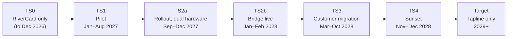
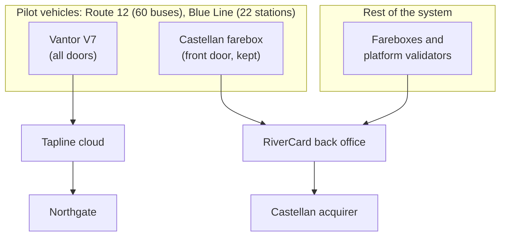
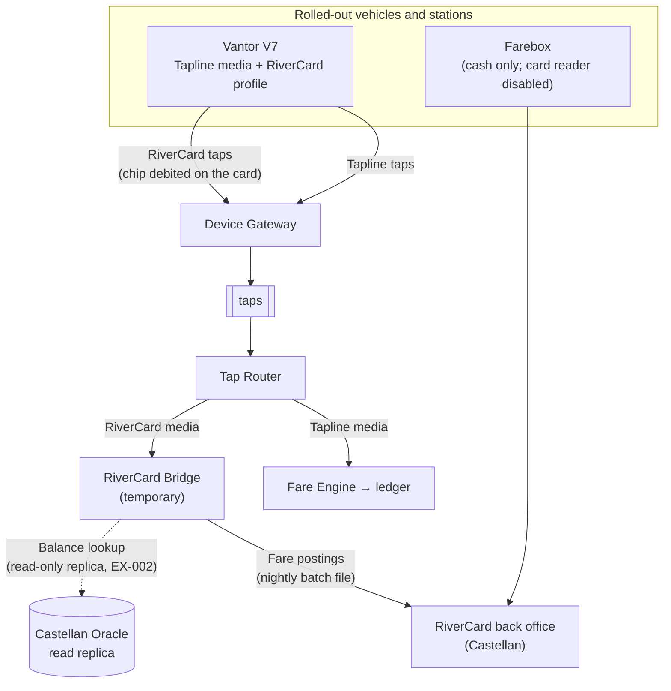
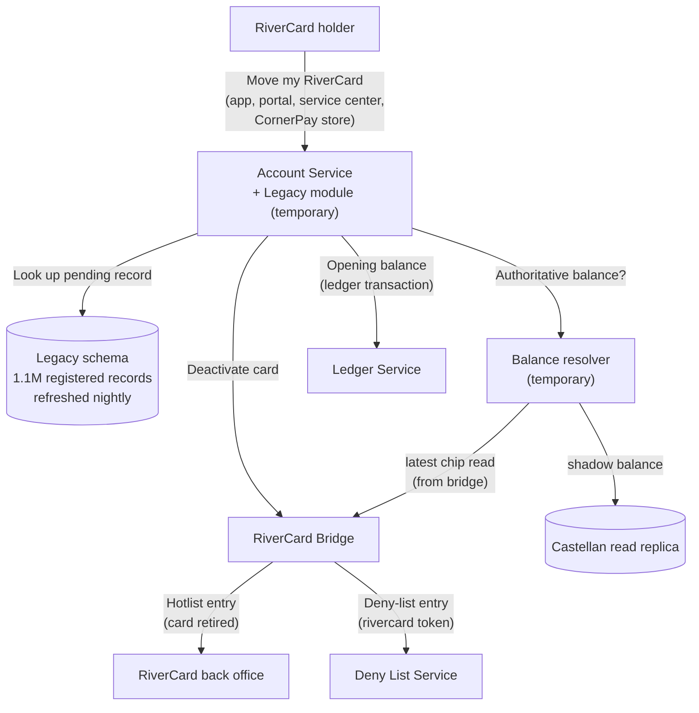

# Transition Architecture — Project Tapline

> [!summary] Five interim states between RiverCard and Tapline
> Tapline replaces RiverCard as a **strangler fig**: new equipment and accounts grow around the old system until it can be switched off. Riders never face a "big bang" day. The temporary pieces are:
> - The **RiverCard Bridge**, which lets new validators read and debit old cards.
> - The **Legacy module** in the Account Service, which holds pending RiverCard records.
> - **Fareboxes left in place** for cash during 2027–2028.
>
> Each state has exit criteria. The final transition, RiverCard switched off on 31 Dec 2028, is the one fixed date in the program.

**Change history:**
- v1.0 (2026-11-20): first version.
- v1.1 (2027-06-30): split TS2 into TS2a and TS2b after the card-key schedule slipped to Q4 2027.
- v1.2 (2027-12-15): bridge redesigned around a read-only balance lookup (EX-002) after Castellan's delays (RSK-18); TS4 refund service added.

## 1. Purpose
Describes the interim architecture states between RiverCard (current) and Tapline (target). Migration happens in waves over two years, and fare collection must keep working throughout. For each state: what changed, the temporary components, and the exit criteria for moving on. Wave dates and cutover steps are in the [Migration Plan](migration-plan.md); data handling is in the [Data Migration Strategy](data-migration-strategy.md).

## 2. Transition State TS1: Pilot (January–August 2027)

- **Timeframe:** 2027-01-04 to 2027-08-31 (Gate 1).
- **What's changed from previous state:**
  - V7 validators on pilot vehicles and stations accept open payments, CRT cards and app tickets.
  - Tapline cloud, Northgate settlement and the rider app are live for pilot riders.
  - Everything else is unchanged.
- **Temporary components/bridges:**
  - RiverCard fareboxes stay at the front door of pilot buses, so RiverCard holders and cash riders are unaffected.
  - Riders can't use a RiverCard on a V7, and the Blue Line keeps its Castellan validators alongside the V7s.
- **Exit criteria (what triggers the next transition):** Gate 1.
  - Tap success ≥ 99.5%.
  - 30 consecutive days of exact settlement reconciliation.
  - First-ride losses ≤ 0.3%.
  - Northgate production certification. *Met on 2027-08-31: 99.7%, 30 days exact, 0.11%, certified 2027-06-11.*

## 3. Transition State TS2a: Rollout with dual hardware (September–December 2027)

- **Timeframe:** 2027-09-01 to 2027-12-31.
- **What's changed from previous state:** V7s are installed garage by garage (waves 1–3), as in the [Migration Plan](migration-plan.md). The app and portal are generally available, reduced fare through DHS is live (2027-11-01), and CornerPay retail loads are live (December).
- **Temporary components/bridges:**
  - The same as TS1, but on more vehicles. Fareboxes stay at front doors for RiverCard cards and cash, because the RiverCard Bridge isn't ready: Castellan released the card keys only on 2027-10-29 (R-4 in the [Gap Analysis](gap-analysis.md), RSK-18).
  - Riders on rolled-out buses can use either system.
- **Exit criteria:**
  - Castellan card keys loaded into Vantor's key-injection facility and V7 firmware with the RiverCard profile (7.3) through ring 2.
  - Bridge passes the hardware-lab regression suite (TC-MIG-001, TC-HIL-006).

## 4. Transition State TS2b: RiverCard Bridge live (January–February 2028)

- **Timeframe:** 2028-01-03 to 2028-02-29. Rollout waves 4–6 continue during this state.
- **What's changed from previous state:**
  - **V7s read and debit RiverCard cards.** The fare is deducted from the chip balance on the card, as RiverCard does today, using the RiverCard profile and Castellan's keys.
  - These taps flow through the normal Tapline ingestion path, then the Tap Router sends them to the **RiverCard Bridge**, never to the Fare Engine. RiverCard rules still apply to RiverCard media.
  - Farebox card readers are disabled on rolled-out garages. Fareboxes now take cash only.
- **Temporary components/bridges:**
  - **RiverCard Bridge** (.NET worker, main zone). It translates V7 RiverCard taps into Castellan's farebox upload format and posts them nightly over SFTP, so Castellan's shadow balances stay current.
  - Per the v1.2 design, the bridge also performs **read-only balance lookups** against Castellan's Oracle read replica for the migration service. This deviates from principle P5 under **EX-002**, approved by the ARB on 2027-12-08 with expiry at switch-off.
  - **Tap Router routing rule:** media type `rivercard` goes to the bridge. It is removed in TS4.
  - **Cash vaults** in fareboxes stay until on-board cash is below 5% per garage ([Gap Analysis R-7](gap-analysis.md)).
- **Exit criteria:**
  - All six garages and all rail lines on V7s (wave 6 complete).
  - Bridge postings accepted by Castellan with < 0.1% rejects for 4 consecutive weeks.
  - Legacy module and the "Move my RiverCard" flow ready (UC-08).

## 5. Transition State TS3: Customer migration (March–October 2028)

- **Timeframe:** 2028-03-01 to 2028-10-31 (RiverCard **acceptance ends** 2028-10-31). RiverCard sales stop 2028-07-01.
- **What's changed from previous state:**
  - Riders move their RiverCard balance, reduced-fare status and autoload preference into a Tapline account, in migration waves M1–M4 ([Migration Plan §2](migration-plan.md)).
  - A moved card is deactivated in both systems. Its balance becomes a ledger opening-balance transaction in Tapline, and the liability moves from Castellan's books to CRT's Tapline ledger in the same day's reconciliation.
- **Temporary components/bridges:**
  - **Legacy module** in the Account Service: pending RiverCard records loaded nightly from Castellan extracts, with no trip history. See the [Data Migration Strategy](data-migration-strategy.md).
  - **Balance resolver:** applies the CFO-approved rule set to choose the authoritative balance (latest chip read from the bridge, or shadow balance), and routes cases above $50 difference to manual review.
  - **Tap-to-transfer** for unregistered cards: CornerPay handheld readers and service-center readers with the RiverCard profile read the chip balance directly and move it to a new or existing Tapline account. The chip is then zeroed.
  - **Daily liability report** across both systems (FR-FIN-04 plus Castellan's liability file), reported to the Board quarterly.
- **Exit criteria:**
  - RiverCard acceptance ended on 2028-10-31 (published since Phase 2).
  - ≥ 95% of RiverCard stored value (by dollars) moved or refunded.
  - Every reduced-fare enrollment migrated or contacted three times.
  - Daily liability reconciliation across both systems exact for 30 days.

## 6. Transition State TS4: Sunset (November–December 2028)

- **Timeframe:** 2028-11-01 to 2028-12-31 (**RiverCard switched off**).
- **What's changed from previous state:**
  - V7s deny RiverCard cards with the message "RiverCard retired. Move your balance at …". The Tap Router rule for `rivercard` media is removed; denied RiverCard taps are logged for outreach.
  - Remaining balances can still be moved through service centers and stores (tap-to-transfer), or refunded on request.
  - Final extract on 2028-12-31, then Castellan switches RiverCard off.
- **Temporary components/bridges:**
  - **RiverCard refund service:** a small read-only function in the Account Service, backed by the final extract, which keeps paying refunds on request until 2029-12-31.
  - Unclaimed balances after that go through the state unclaimed-property process (FR-MIG-04).
  - The **RiverCard archive** (immutable, 7 years) holds the final extract and transaction history for disputes and audit.
  - The bridge is decommissioned on 2029-01-15, and firewall rule F11 expires on 2029-03-31 ([Network Architecture §6](../04-infrastructure-and-network/network-architecture.md)).
- **Exit criteria:** Gate 3.
  - RiverCard off.
  - Final liability reconciled to $0.00 unexplained.
  - Bridge, Legacy module routing and EX-002 removed.
  - Archive verified.

## 7. Target State (2029 onward)
Tapline only, as described in the [SAD](../02-core-architecture/solution-architecture-document.md). Remaining transition artifacts:
- The RiverCard refund service, until 2029-12-31.
- The RiverCard archive, until 2035.
- Fareboxes' cash vaults, until each garage passes the < 5% on-board cash threshold.
