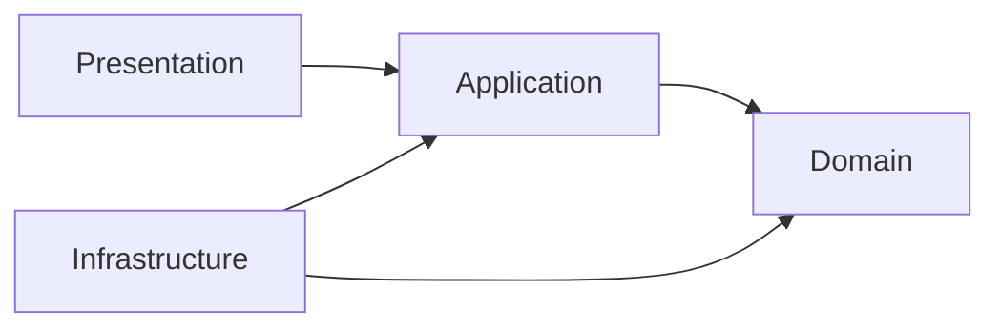

> [!summary] TL;DR
> Business rules sit at the center, independent of frameworks, UI and database, and **dependencies always point inward**. It shares separation of concerns, dependency inversion and framework independence with [[Onion Architecture]], but emphasizes protecting *use cases* where Onion emphasizes layering *around the domain*. In .NET this is usually four projects: Domain, Application, Infrastructure, Presentation.

## Problem
- Business rules tangled with frameworks, ORMs and UI code are hard to test and hard to change when the technology changes.

## Solution
- Put the domain (entities, value objects, business rules) at the core with no outward dependencies.
- Put use cases (application business rules) around it; they depend only on the domain and on interfaces they define.
- Outer layers (infrastructure, UI, frameworks) implement those interfaces (dependency inversion) and are wired up at startup.

## Clean vs Onion
| | Clean Architecture | Onion Architecture |
| - | ------------------ | ------------------ |
| **Focus** | Separating enterprise business rules from application use cases | Organizing the application in layers around the domain |
| **Outer layer** | Frameworks & Drivers: ASP.NET Core, EF Core, UI, external APIs | Infrastructure: database, EF Core, external services, file storage |
| **Adapter layer** | Interface Adapters: controllers, presenters, repositories, gateways | *(merged into Infrastructure / Application)* |
| **Application layer** | Application / Use Cases: application business rules, use cases, services | Application / Services: use cases, application services, interfaces |
| **Core** | Entities / Domain: enterprise business rules, entities, value objects | Domain: entities, value objects, business rules |
| **Rule** | Inner layers don't depend on outer layers; enterprise rules at the core | Domain at the center; all layers depend on the inner layer |

Don't follow an architecture because of its name; **follow the principles**: clarity, independence and long-term maintainability. Onion has its own note → [[Onion Architecture]]. Hexagonal (ports and adapters) expresses the same idea as ports on the core and adapters outside it → [[Hexagonal Architecture]].

## Structure

## .NET example
A typical solution layout:

| Project | Contains |
| ------- | -------- |
| **Domain** (core) | Entities; value objects; interfaces (e.g. `ICustomerRepository`). No `DependencyInjection.cs`: it has nothing to register |
| **Application** | Commands / queries (CQRS, with MediatR or plain handlers); DTOs; events; exceptions; mapping; `DependencyInjection.cs` |
| **Infrastructure** | `AppDbContext` (EF Core); migrations; repositories; external services (email, files); `DependencyInjection.cs` |
| **Presentation** | Controllers or endpoints; `Program.cs`; `DependencyInjection.cs` |

- Application, Infrastructure and Presentation each expose a `DependencyInjection.cs` extension method that registers their own services; `Program.cs` calls them.
- Infrastructure *implements* the interfaces the inner layers define (Dependency Inversion).
- MediatR is optional: see [[7 .NET Habits to Reconsider]] for the plain-handler alternative, and the habit of grouping by feature (vertical slices) instead of by layer.
- Enforce the dependency rule with architecture tests (NetArchTest, ArchUnitNET): see [[Architecture Governance Tests]].

## When to use / when not to
| Use when | Avoid when |
| -------- | ---------- |
| Large, long-lived systems with real business rules | Simple CRUD apps where the layers only pass data through |
| High testability matters | A small team needs to ship quickly with little domain logic |

## Trade-offs
| Pro | Con |
| --- | --- |
| Domain and use cases testable without infrastructure | Indirection and mapping boilerplate |
| Frameworks and databases replaceable at the edges | One feature change touches several projects (vertical slices avoid this) |

## Related patterns
- **Alternatives:** [[Vertical Slice Architecture]]; [[Layered Architecture]]
- **Same family:** [[Onion Architecture]] · [[Hexagonal Architecture]] · [[Entity-Boundary-Control Architecture]] (ancestor) · [[Functional Core, Imperative Shell]]
- **Often combined with:** [[CQRS]]; [[SOLID Principles]] (dependency inversion)
- **Compared in:** [[Architecture Styles Compared]]
- [[DotNet Learning Path]]

## Sources
- Robert C. Martin, [The Clean Architecture](https://blog.cleancoder.com/uncle-bob/2012/08/13/the-clean-architecture.html) (2012)
- Robert C. Martin, *Clean Architecture: A Craftsman's Guide to Software Structure and Design* (2017)
- Jeffrey Palermo, [The Onion Architecture](https://jeffreypalermo.com/2008/07/the-onion-architecture-part-1/) (2008), for the Clean vs Onion comparison
