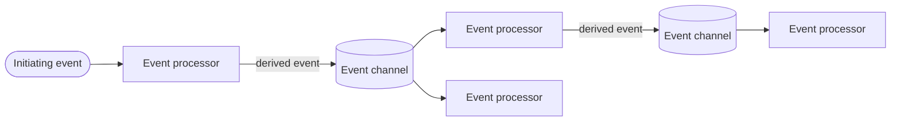

> [!summary] TL;DR
> An **initiating event** starts the work; **event processors** (services) react and publish **derived events** fire-and-forget through a "dumb" event or streaming broker, and other services react in turn. Asynchronous, parallel processing gives five-star performance, scalability, elasticity, fault tolerance, evolvability and abstraction. It costs simplicity and testability, and it fits poorly where you need tight consistency, synchronous flows or strict event ordering.

## Problem
- Synchronous request chains couple services in time: one slow or failed service stalls the whole workflow.
- The domain is about reacting to things that happen (bids, payments, sensor readings), often non-deterministically and at unpredictable volume.

## Solution
- **Definition:** a style that asynchronously responds to events triggered in the system; everything is async.
- **Broker:** a streaming or event broker with event channels; a simple broker that only accepts events and makes them available (not a smart message bus as in SOA).
- **Initiating event:** the one external or internal event that kicks off all processing.
- **Event processors:** the formal term; usually just called services today.
- **Derived events:** formally "processing events"; a service advertises what it did so interested services can react. See [[Events vs Messages]], [[Anemic Events]] and [[Swarm of Gnats Anti-Pattern]] for payload and granularity design.
- **Abstraction without a performance penalty:** unlike largely synchronous SOA, async parallel processing keeps abstraction from lowering performance.
- **Fault tolerance via asynchrony:** a service doesn't depend on others, so services can come and go and events are processed when they're available (microservices get the same rating by isolating each function).
- **Domain fit:** listen for "event" and "triggered" in the business problem (bidding and auction systems; defined contribution and defined benefit systems); suits non-deterministic systems. See [[Domain to Architecture Isomorphism]].
- **History:** decades old; it fell into the trough of disillusionment on complexity and immature tooling, and has resurged with new tools, microservices and non-deterministic systems.
- **Handoff** (Lesson 110): a processor announces what happened ("payment applied") and doesn't care who responds; one event fans out to many responders in parallel (order placed → payment, notify customer, update inventory).
- **Back pressure** (Lesson 110): the queue or topic between services is a back-pressure point, so you can accept orders faster than they're processed and each service scales as its own island.
- **Mid-day redeploys** (Lesson 110): persistent queues, durable topics or durable subscribers let you take a processor down and redeploy it while others keep firing events, an agility edge over pure microservices.
- **The hard parts** (Lesson 110): error handling (when was an event handled, how to restart or recover, who owns its state); workflow control, especially with complex event processing (CEP); event timing and ordering (very few ways to force event 1 before event 2); coupling through event contracts; and end-to-end scenario testing, where unexpected events fire and timing changes results.

- **Advertise every derived event** (course: [[11. Examining Event-Driven Architectures]]): publish what a processor did even if nobody listens yet; it is the hook future consumers use (extensible derived events). Fit test: if the domain is about responding to events, the style suits it; if it is mostly CRUD, use a request-based style.

## Structure

## Event-driven topics
| Topic | One line | Home note |
| ----- | -------- | --------- |
| Why choose it | One of two basic models; buys responsiveness, scale and extensibility at the cost of consistency, control and testability (Lesson 69) | [[Request-Based vs Event-Driven Architecture]] |
| Not microservices | EDA constrains neither service nor data granularity nor bounded context (Lesson 131) | [[Microservices vs Event-Driven Architecture]] · [[Hybrid Architectures]] |
| Decoupling has a price | Fire-and-forget drops coupling to near zero but costs workflow control, error handling and consistency (Lesson 59) | [[Service Coupling]] |
| Extensibility | New features add durable subscribers without changing the producer (Lesson 61) | [[Point-to-Point vs Publish-Subscribe Messaging]] |
| Keeping data in sync | Publish an event to durable subscribers after commit (Lesson 109) | [[Eventual Consistency Patterns]] |
| Self-healing errors | Forward failed events to a workflow processor to repair and resubmit (Lesson 81) | [[Workflow Event Pattern]] |
| No lost messages | Persisted queues, synchronous send, client acknowledge, ack after commit (Lesson 70) | [[Guaranteed Message Delivery]] |
| Broker throughput | Spread sends across several brokers (Lesson 72) | [[Multi-Broker Pattern]] |
| Ratings | Performance, responsiveness, scalability and elasticity (Lessons 83, 85) | [[Performance vs Responsiveness]] · [[Scalability]] · [[Elasticity]] |

## When to use / when not to
| Use when | Avoid when |
| -------- | ---------- |
| High performance through async, parallel processing | Simplicity and low cost matter (simplicity rated one star) |
| High scalability or elasticity | Testability matters (async flows are hard to test) |
| High fault tolerance | Tight data synchronization, consistency and integrity are needed |
| The domain is event-shaped ("triggered", bids, auctions) | Most processing must be synchronous while the user waits (use request-driven) |
| Non-deterministic workflows with many paths | Tight control over event ordering; deterministic systems |

## Trade-offs
| Pro | Con |
| --- | --- |
| Five stars for performance, scalability, elasticity, fault tolerance, evolvability, abstraction | Complex; simplicity one star, which drives cost |
| Services decoupled in time; no dependence on others to process | Hard to test |
| Mostly operational characteristics rated highly | Weak on consistency and ordering guarantees |

## Related patterns
- **Alternatives:** request-based styles (see [[Request-Based vs Event-Driven Architecture]]); [[Space-Based Architecture]]; [[Service-Based Architecture]]
- **Often combined with:** [[Microservices Architecture]] (see [[Microservices vs Event-Driven Architecture]]); [[Event Sourcing]]; [[Broker Architecture]]; [[Workflow Event Pattern]]; [[Guaranteed Message Delivery]]; [[Multi-Broker Pattern]]; [[Point-to-Point vs Publish-Subscribe Messaging]]
- **Anti-pattern to watch for:** [[Anemic Events]]; [[Swarm of Gnats Anti-Pattern]]
- **Context:** [[Service Coupling]] · [[Events vs Messages]] · [[Atomic vs Eventual Transactions]] · [[Domain to Architecture Isomorphism]] · [[Scalability]] · [[Performance vs Responsiveness]]
- Index: [[Architecture Styles Compared]]. MOC: [[Architecture]]

## Sources
- [[Lesson 165 — Event-Driven Architecture]] (Mark Richards, Software Architecture Monday)
- [[Lesson 131 — Microservices vs Event-Driven Architecture]] (Mark Richards, Software Architecture Monday): EDA's lack of granularity, data and bounded-context constraints vs microservices
- [[Lesson 110 — The Pros and Cons of Event Driven Architecture]] (Mark Richards, Software Architecture Monday): pros and cons; error handling, timing, contract coupling and scenario testing
- [[Lesson 109 — BASE Transactions and Eventual Consistency]] (Mark Richards, Software Architecture Monday): event-based synchronization with durable subscribers
- [[Lesson 89 — Becoming A Software Architect Part 4]] (Mark Richards, Software Architecture Monday): EDA usually melded into hybrids
- [[Lesson 81 — Workflow Event Pattern]] (Mark Richards, Software Architecture Monday): self-healing error handling for asynchronous processing
- [[Lesson 85 — Defining Scalability and Elasticity]] (Mark Richards, Software Architecture Monday): scalability, elasticity and mean time to startup
- [[Lesson 83 — Defining Performance and Responsiveness]] (Mark Richards, Software Architecture Monday): asynchrony and parallelism for responsiveness and performance
- [[Lesson 72 — Multi Broker Pattern Part 1]] (Mark Richards, Software Architecture Monday): multi-broker pattern for messaging throughput and capacity
- [[Lesson 70 — Preventing Data Loss When Using Messaging]] (Mark Richards, Software Architecture Monday): three loss points in messaging and how to close them
- [[Lesson 69 — Importance of Event Driven Architecture]] (Mark Richards, Software Architecture Monday): request-based vs event-driven, advantages, disadvantages and when to choose each
- [[Lesson 61 — Extensibility Using PubSub Messaging]] (Mark Richards, Software Architecture Monday): extensibility through pub/sub and its three trade-offs
- [[Lesson 59 — The Tradeoffs of Loose Coupling]] (Mark Richards, Software Architecture Monday): fully decoupling services with a topic and queues, and the four trade-offs of loose coupling
- [[9. Understanding Event-Driven Architecture Style]] (O'Reilly Software Architecture course): initiating events, event processors and derived events
- [[11. Examining Event-Driven Architectures]] (O'Reilly Software Architecture course): derived events, extensibility, when the style fits
