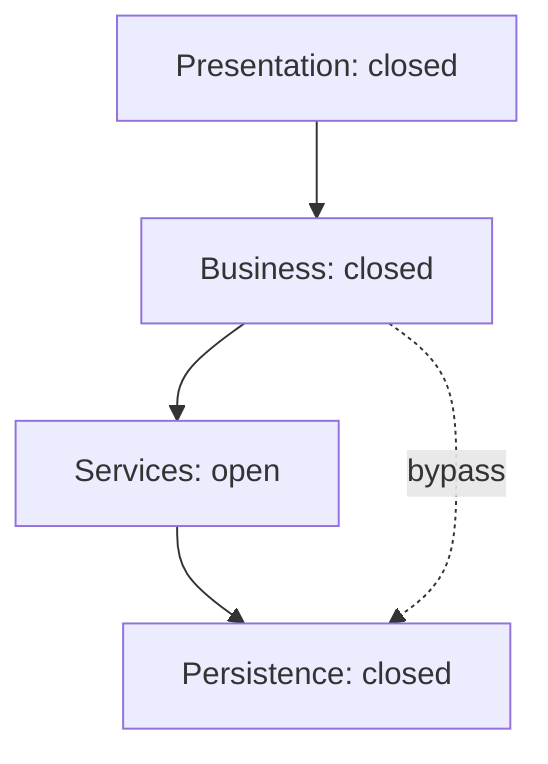

> [!summary] TL;DR
> A **single deployment unit** whose code is **partitioned by technical category** (presentation, business, shared services, persistence); requests flow down through layers that are **closed** (must pass through) or **open** (may be bypassed). Cheap, simple and familiar, it fits tight budgets, mostly technical change and technically divided teams, but not domain-based change, fast time to market, or high elasticity, scalability and fault tolerance (Mark Richards).

## Problem
- A small team needs a working application quickly and cheaply, in a structure everyone already understands.
- UI, business rules and data access mixed together make every change risky and every part hard to replace.

## Solution
- **Monolithic and technically partitioned:** the top-level grouping is the layer; the [[Modular Monolith Architecture]] turns it 90 degrees and groups by domain.
- **Closed vs open layers:** a closed layer must be traversed to reach the one below; an open layer may be bypassed. Mark a shared-services layer open so business can reach persistence directly.
- **Superpowers:** cost and simplicity (Lesson 158).
- **Change isolation:** technical change (UI, business rules, data) stays in one layer; domain change (e.g. an expiration date on wish list items) touches every layer.
- **Team fit:** teams divided by technical area (UI, business, database). See [[Architectural Intersections]].
- **Change and deployment scope** (Lesson 120): because a domain is spread across every layer, the change scope of a domain feature is the whole application and the deployment unit is the entire application, including unrelated domains. See [[Domain vs Technical Partitioning]].
- **Namespaces:** technical partitioning shows as the layer in the second node, e.g. `app.presentation.customer` (Lesson 120).
- **Governance:** the isolation only holds if layer constraints are enforced (no direct DB access outside persistence; Lesson 213). Enforce it with architecture tests, e.g. ArchUnitNET: types outside the persistence namespace must not depend on `IDbConnection`, `IDbCommand`, `IDataReader` or `IDataAdapter`. See [[Architecture Definition Language]].
- **Automated layer governance** (Lesson 68): ArchUnit's layered-architecture rules define each layer by package, then state who may access it (business only by presentation; services only by business; persistence by business and services), enforcing the open/closed layers on every commit or deployment. NetArchTest does the same in C#. See [[Architecture Governance Tests]].

- **Architecture sinkhole anti-pattern** (course: [[7. Examining Layered Monolithic Architectures]]): requests pass through layers that do nothing but forward them. Opening layers to avoid it chips away at the style's isolation, so a change in one layer starts touching others.
- **Common variants:** client/server desktop apps, web apps (front end → API → database) and embedded or mobile apps are all layered hybrids. Most large organizations run at least one.

## Structure

## The layers
| Layer | Responsibility |
| ----- | -------------- |
| **Presentation** (UI/API) | User interaction, browser communication and API requests (HTML/CSS/JS, REST controllers) |
| **Business logic** (BLL/domain) | Business rules, processing and application behavior (discounts, validation, order processing) |
| **Data access** (persistence) | Communication with the data source: CRUD queries to store and retrieve data |
| **Database / storage** | The physical database or file system |

### Where business logic should live
| Where | Why |
| ----- | --- |
| Domain / application layer (recommended) | Keeps the codebase testable and maintainable and separates core rules from UI and database |
| Backend services | Trusted, secure operations (authentication, payments) can't be left to a client-side frontend |
| Data transformation layer | In data solutions, keep logic in the version-controlled transformation layer (e.g. dbt models), not in BI reports |
| Database (selective) | Close to the data, but couples logic to the schema and is harder to scale and maintain |
| Domain entities | Encapsulating rules inside entities keeps the domain from entering an invalid state |

Keep it out of the **front end** (security risk and duplication across web and mobile) and mostly out of the **database** (harder to update, and it scales with the database server rather than the application servers).

## When to use / when not to
| Use when | Avoid when |
| -------- | ---------- |
| Tight budget and time | Changes must ship fast (agility is low) |
| Most change is technical and isolated to one layer | Most change is domain based |
| Teams are organized by technical area | High elasticity, scalability or fault tolerance |

## Trade-offs
| Pro | Con |
| --- | --- |
| Inexpensive, familiar, simple | Single deployment unit limits maintainability, testability and deployability |
| Technical change localized to one layer | Domain change cuts across every layer |
| Open/closed layers give clear guidance to teams | Operational characteristics poorly supported |

## Related patterns
- **Alternatives:** [[Modular Monolith Architecture]] (same single deployment, partitioned by domain instead of layer); [[Clean Architecture]]; [[Vertical Slice Architecture]]
- **Often combined with:** [[Microkernel Architecture]] (a layered core); [[Client-Server Architecture]] (layers deployed as tiers); [[Architecture Governance Tests]] (enforce closed layers)
- **Anti-pattern to watch for:** the architecture sinkhole (layers that only forward calls); [[Big Ball of Mud]] when layer rules aren't enforced
- **Context:** [[Domain vs Technical Partitioning]] · [[Monolithic vs Distributed Architecture]] · [[Architecture Style Risks]]
- Index: [[Architecture Styles Compared]]. MOC: [[Architecture]]

## Sources
- [[Lesson 158 — Layered Architecture]] (Mark Richards, Software Architecture Monday)
- [[Lesson 120 — Domain vs Technical Partitioning]] (application-level change scope; namespaces)
- [[Lesson 213 — Governing Architectural Constraints]] (governing layer constraints with architecture tests)
- [[Lesson 68 — Automating Architecture Governance]] (Mark Richards, Software Architecture Monday): enforcing open and closed layers with ArchUnit / NetArchTest
- [[5. Understanding Layered Monolithic Architecture Style]] (O'Reilly Software Architecture course): topology, closed layers and star ratings
- [[7. Examining Layered Monolithic Architectures]] (O'Reilly Software Architecture course): open/closed layers, sinkhole anti-pattern, variants, governance
