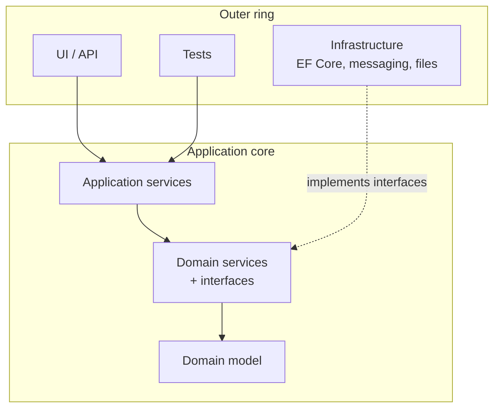

> [!summary] TL;DR
> Build the application **around the domain model**, not around the database. The domain model sits at the center, domain services and application services wrap it, and UI, infrastructure and tests live on the outer ring. **Coupling points only inward**: inner layers define interfaces, outer layers implement them. Close cousin of [[Clean Architecture]] and [[Hexagonal Architecture]].

## Problem
- In a traditional [[Layered Architecture]], business logic depends on the data access layer, so the database schema and ORM shape the domain.
- Infrastructure (databases, file systems, web services) changes more often than business rules, yet every change ripples into the core.
- The core can't be compiled, run or tested without the infrastructure behind it.

## Solution
Jeffrey Palermo's four tenets (2008):
- The application is built around an **independent object model** (the domain model).
- **Inner layers define interfaces; outer layers implement them** (e.g. `IOrderRepository` in the core, `EfOrderRepository` in infrastructure).
- **Coupling is toward the center.** A layer may depend on any layer closer to the center, never on one further out.
- **All application core code can be compiled and run separately from infrastructure.**

Rings, from the center out:
| Ring | Holds |
| ---- | ----- |
| **Domain model** | Entities and value objects: state and behavior, no dependencies |
| **Domain services** | Domain logic that spans entities; repository and other interfaces the domain needs |
| **Application services** | Use-case orchestration, transactions, DTOs; depends on domain services and model |
| **Outer ring** | UI, infrastructure (EF Core, messaging, file storage, external APIs) and tests |

- Infrastructure sits on the **outside**, next to the UI. It is not the bottom layer, which is the key break from layered architecture.
- Dependencies are wired at the composition root (`Program.cs`) through [[Dependency Injection]].

## Structure


## When to use / when not to
| Use when | Avoid when |
| -------- | ---------- |
| Long-lived systems with real domain logic | CRUD apps where the core would be empty pass-through code |
| Infrastructure is expected to change (database, cloud provider, messaging) | Small, short-lived tools or prototypes |
| The domain must be unit-tested without databases or web servers | The team isn't comfortable with dependency inversion and interfaces |

## Trade-offs
| Pro | Con |
| --- | --- |
| Domain independent of database and frameworks | More projects, interfaces and mapping code |
| Core testable in isolation | Interfaces for every dependency can feel ceremonial |
| Infrastructure replaceable at the edge | Feature changes still cut across rings (see [[Vertical Slice Architecture]]) |
| Clear rules that architecture tests can enforce | Ring boundaries (domain vs application services) are easy to blur |

## .NET example
Project references point inward only:

```text
Shop.Domain          (no references)
Shop.Application  →  Shop.Domain
Shop.Infrastructure → Shop.Application, Shop.Domain
Shop.Api          →  Shop.Application, Shop.Infrastructure   (composition root only)
```

```csharp
// Shop.Domain: the interface lives with the domain that needs it
public interface IOrderRepository
{
    Task<Order?> GetAsync(OrderId id, CancellationToken ct);
    Task AddAsync(Order order, CancellationToken ct);
}

// Shop.Infrastructure: the outer ring implements it
internal sealed class EfOrderRepository(ShopDbContext db) : IOrderRepository
{
    public Task<Order?> GetAsync(OrderId id, CancellationToken ct) =>
        db.Orders.FirstOrDefaultAsync(o => o.Id == id, ct);

    public async Task AddAsync(Order order, CancellationToken ct) =>
        await db.Orders.AddAsync(order, ct);
}

// Architecture test (NetArchTest): the core must not see infrastructure
var result = Types.InAssembly(typeof(Order).Assembly)
    .ShouldNot().HaveDependencyOnAny("Microsoft.EntityFrameworkCore", "Shop.Infrastructure")
    .GetResult();
Assert.True(result.IsSuccessful);
```

## Related patterns
- **Alternatives:** [[Layered Architecture]] (infrastructure at the bottom); [[Vertical Slice Architecture]]
- **Same family:** [[Clean Architecture]] (see [[Clean Architecture#Clean vs Onion|Clean vs Onion]]) · [[Hexagonal Architecture]] · [[Functional Core, Imperative Shell]]
- **Often combined with:** [[Repository Pattern]]; [[Dependency Injection]]; [[SOLID Principles]] (dependency inversion); [[Architecture Governance Tests]]
- **Anti-pattern to watch for:** [[Anemic Domain Model]] (the center holds only data, and the logic leaks into application services)
- Index: [[Architecture Styles Compared]]. MOC: [[Architecture]]

## Sources
- Jeffrey Palermo, *The Onion Architecture* parts 1–4 (2008): https://jeffreypalermo.com/2008/07/the-onion-architecture-part-1/
- Clean vs Onion comparison: see [[Clean Architecture#Clean vs Onion]]
