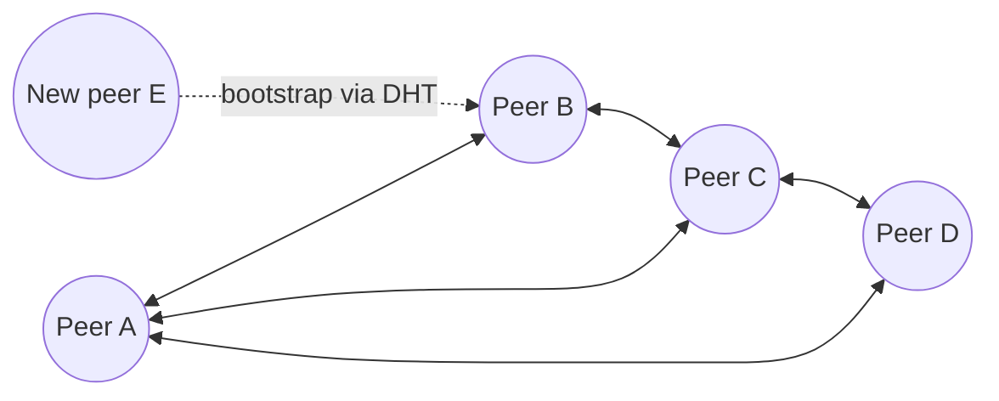

> [!summary] TL;DR
> In peer-to-peer, every node (**peer**) both serves and consumes resources, and peers talk directly instead of through a central server. Capacity grows as peers join, and there is no single point of failure or control. The hard parts are **discovery** (finding who has what), **trust**, **consistency** and peers that come and go (**churn**). BitTorrent, blockchains, IPFS and LAN game sessions are the classic examples.

## Problem
- A central server is a bottleneck, a single point of failure, or a cost that grows with every user.
- The resources (files, bandwidth, compute) already sit on the participants' machines.

## Solution
- **Symmetric roles:** each peer runs client and server code; contrast with [[Client-Server Architecture]].
- **Three topologies:**

| Topology | How peers find content | Examples |
| --- | --- | --- |
| **Centralized index (hybrid)** | A central server indexes who has what; transfer is peer-to-peer | Napster (1999), BitTorrent trackers, many VoIP and game lobbies |
| **Unstructured** | Flood or random-walk queries across neighbors | Gnutella, early Kazaa |
| **Structured (DHT)** | Keys map to peers via a distributed hash table, so lookups take O(log n) hops | Kademlia (BitTorrent DHT, IPFS, Ethereum discovery), Chord |

- **Super-peers:** well-connected, long-lived nodes take extra duties (routing, indexing) to cope with churn. Early Skype used them.
- **NAT traversal** is a practical obstacle: peers behind home routers need STUN/TURN/ICE (as in WebRTC) or relays.
- **Consistency and trust:** with no authority, agreement needs consensus protocols (Raft or Paxos within a trusted cluster; proof-of-work or proof-of-stake in open blockchains) and content addressing (hash = identity) to detect tampering.
- **Inside data centers**, P2P ideas appear as **gossip protocols** for membership and failure detection (Cassandra, Consul/Serf) and as leaderless replication (Dynamo-style databases).
- **Local-first software** uses P2P sync and CRDTs so devices merge changes without a server.

## Structure


## When to use / when not to
| Use when | Avoid when |
| -------- | ---------- |
| Large content distribution where users can share bandwidth | You need central authority, auditing or strong consistency |
| No party should own or censor the system | Peers are untrusted and the data is sensitive |
| Offline or local-network collaboration (local-first, LAN games) | Most clients are behind restrictive NATs and you can't afford relays |
| Cluster membership and failure detection (gossip) | Predictable latency and SLA matter more than resilience |

## Trade-offs
| Pro | Con |
| --- | --- |
| Capacity scales with the number of peers | Discovery, routing and NAT traversal are complex |
| No single point of failure or control | Hard to secure: Sybil attacks, poisoned content, free riders |
| Low infrastructure cost for the operator | Eventual consistency at best without heavy consensus |
| Resilient to censorship and outages | Churn makes availability of any one item unpredictable |

## .NET example
.NET has no built-in P2P stack; typical options are WebRTC data channels (in browsers via Blazor JS interop), libp2p ports, or a gossip protocol over UDP. A minimal gossip heartbeat between known peers:
```csharp
// Each node both listens (server) and sends (client) on UDP
using var udp = new UdpClient(port);
var peers = new ConcurrentDictionary<IPEndPoint, DateTimeOffset>(seedPeers.ToDictionary(p => p, _ => DateTimeOffset.UtcNow));

_ = Task.Run(async () =>                          // server side: receive gossip
{
    while (true)
    {
        var msg = await udp.ReceiveAsync();
        peers[msg.RemoteEndPoint] = DateTimeOffset.UtcNow;
        foreach (var ep in JsonSerializer.Deserialize<string[]>(msg.Buffer)!)
            peers.TryAdd(IPEndPoint.Parse(ep), DateTimeOffset.UtcNow);   // learn peers of peers
    }
});

var timer = new PeriodicTimer(TimeSpan.FromSeconds(1));
while (await timer.WaitForNextTickAsync())        // client side: gossip to 3 random peers
{
    var payload = JsonSerializer.SerializeToUtf8Bytes(peers.Keys.Select(k => k.ToString()));
    foreach (var target in peers.Keys.OrderBy(_ => Random.Shared.Next()).Take(3))
        await udp.SendAsync(payload, target);
    foreach (var dead in peers.Where(p => DateTimeOffset.UtcNow - p.Value > TimeSpan.FromSeconds(10)))
        peers.TryRemove(dead.Key, out _);         // failure detection
}
```
Microsoft Orleans clusters use a membership table plus peer probing in a similar spirit.

## Related patterns
- **Alternatives:** [[Client-Server Architecture]]; [[Primary-Replica Architecture]] (central coordination instead)
- **Often combined with:** [[Shared-Nothing Architecture]]; [[Eventual Consistency Patterns]]
- **Anti-pattern to watch for:** assuming peers are reliable, honest or always online (see [[Fallacies of Distributed Computing]])
- **Context:** [[CAP Theorem]]
- Index: [[Architecture Styles Compared]]. MOC: [[Architecture]]

## Sources
- [Peer-to-peer](https://en.wikipedia.org/wiki/Peer-to-peer) (Wikipedia)
- Petar Maymounkov and David Mazières, *Kademlia: A Peer-to-peer Information System Based on the XOR Metric* (2002)
- [[Architecture Styles Compared]] (style list)
