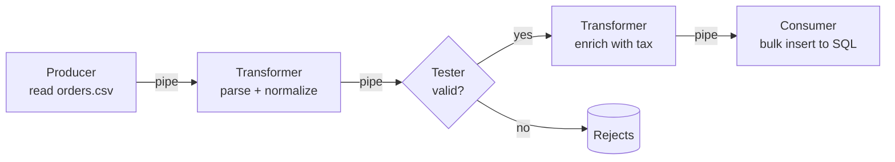

> [!summary] TL;DR
> One of the oldest styles (Unix pipes, 1973): break processing into **filters**, each a self-contained step that reads input, transforms it and writes output, connected by **pipes** that carry data one way. Filters don't know their neighbors, so you can reorder, reuse, test and scale them independently. It suits ETL, media processing, compilers and integration flows; it fits interactive, conversational work poorly.

## Problem
- Processing is a sequence of transformations (parse, validate, enrich, transform, load) that becomes tangled when written as one routine.
- Steps need to be reused, reordered, tested or scaled independently.

## Solution
- **Filters** come in four kinds (Richards and Ford):
    - **Producer (source):** starts the flow (reads a file, consumes a topic).
    - **Transformer:** changes data (map, enrich, convert format).
    - **Tester:** checks a condition and passes, drops or routes data (filter, validate).
    - **Consumer (sink):** ends the flow (writes to a database, emits a report).
- **Pipes** are one-way, usually point-to-point, and carry a stable payload contract. They can be in-memory (method calls, `Channel<T>`, streams) or distributed (queues, topics).
- **Filters are stateless and single-purpose**, which gives reuse (one `Compress` filter in many pipelines) and parallelism (several copies of a slow filter).
- **Monolithic or distributed:** a pipeline can run in one process (a compiler, an ASP.NET Core middleware chain) or across services (each filter a function or container reading from a queue). Richards and Ford classify the in-process form as a monolithic, technically partitioned style.
- **Batch vs streaming:** classic pipelines process whole batches; streaming pipelines (Kafka Streams, Azure Stream Analytics) process records continuously and need back-pressure.
- **Not the same as the [[Pipeline Pattern]]** in this vault, which is about wrapping a request handler in cross-cutting behaviors. Pipes and Filters is about data flowing through transformation steps.

- **Typical uses:** ETL and data-warehouse loads, image or video transcoding, log processing, compilers (lexer → parser → optimizer → code generator), EDI and integration flows, ML feature pipelines, CI/CD pipelines.
- **Ratings** (Richards and Ford, *Fundamentals of Software Architecture*): strong on cost, simplicity and modularity; weak on elasticity, scalability and fault tolerance in the monolithic form; the distributed form trades simplicity for scalability.

## Structure


## When to use / when not to
| Use when | Avoid when |
| -------- | ---------- |
| Processing is a series of independent, one-way transformations | Steps need lots of back-and-forth or shared mutable state |
| Steps are reusable across several flows | Low-latency request/response with a user waiting on every step |
| You want to scale or replace slow steps independently | The flow branches so much it's really a workflow (use orchestration) |
| Batch or stream processing, ETL, media | Transactions must span every step atomically |

## Trade-offs
| Pro | Con |
| --- | --- |
| Filters are simple, testable and reusable | Every hop serializes and copies data; overhead adds up |
| Easy to add, remove or reorder steps | Errors mid-pipeline need a strategy (retry, dead-letter, compensation) |
| Parallelism and per-filter scaling (in the distributed form) | Hard to share state or context between filters |
| Natural fit for streaming and back-pressure | Long pipelines are hard to trace end to end without correlation IDs |

## .NET example
In-process pipeline using `System.Threading.Channels` (bounded channels give back-pressure):
```csharp
var parsed   = Channel.CreateBounded<Order>(1_000);
var enriched = Channel.CreateBounded<Order>(1_000);

// Producer + transformer: read lines, parse
var produce = Task.Run(async () =>
{
    await foreach (var line in File.ReadLinesAsync("orders.csv"))
        if (Order.TryParse(line, out var o)) await parsed.Writer.WriteAsync(o);   // tester: drop bad rows
    parsed.Writer.Complete();
});

// Transformer: enrich (run 4 copies in parallel)
var enrich = Task.WhenAll(Enumerable.Range(0, 4).Select(_ => Task.Run(async () =>
{
    await foreach (var o in parsed.Reader.ReadAllAsync())
        await enriched.Writer.WriteAsync(o with { Tax = TaxRules.For(o) });
}))).ContinueWith(_ => enriched.Writer.Complete());

// Consumer: batch insert
var consume = Task.Run(async () =>
{
    var batch = new List<Order>(500);
    await foreach (var o in enriched.Reader.ReadAllAsync())
    {
        batch.Add(o);
        if (batch.Count == 500) { await db.BulkInsert(batch); batch.Clear(); }
    }
    if (batch.Count > 0) await db.BulkInsert(batch);
});

await Task.WhenAll(produce, enrich, consume);
```
Distributed form: each filter is an Azure Function or worker service reading from one Service Bus queue and writing to the next. TPL Dataflow (`TransformBlock`, `ActionBlock`) is the other built-in option.

## Related patterns
- **Alternatives:** [[Staged Event-Driven Architecture]] (queues and thread pools between stages); [[Event-Driven Architecture]]
- **Often combined with:** [[Enterprise Integration Patterns]] (pipes, filters, routers, translators); [[Kappa Architecture]] (streaming pipelines as the whole data platform)
- **Anti-pattern to watch for:** confusing it with the [[Pipeline Pattern]] (request-handler behaviors, a different idea); filters that share state
- **Context:** [[Domain vs Technical Partitioning]]
- Index: [[Architecture Styles Compared]]. MOC: [[Architecture]]

## Sources
- Mark Richards and Neal Ford, *Fundamentals of Software Architecture* (2020), chapter on the pipeline architecture style
- Mary Shaw and David Garlan, *Software Architecture: Perspectives on an Emerging Discipline* (1996)
- Microsoft, [Pipes and Filters pattern](https://learn.microsoft.com/azure/architecture/patterns/pipes-and-filters) (Azure Architecture Center)
- [[Architecture Styles Compared]] (pipeline diagram)
