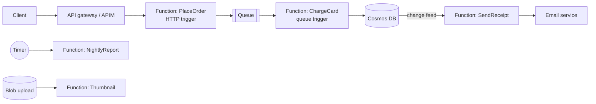

> [!summary] TL;DR
> Build the system from **functions** (FaaS: Azure Functions, AWS Lambda) and **managed backend services** (queues, databases, auth, storage), with no servers to provision. Functions are triggered by events, scale out automatically, scale to zero when idle, and are billed per execution. You give up control of the runtime and accept cold starts, execution limits and vendor coupling.

## Problem
- Traffic is spiky or unpredictable, and paying for idle servers wastes money.
- The team wants to ship business logic without provisioning, patching or scaling servers.

## Solution
- **Two halves** (Mike Roberts):
    - **FaaS:** your code, packaged as short-lived, stateless functions triggered by events (HTTP, queue message, blob upload, timer, change feed).
    - **BaaS:** managed services you call instead of running your own (Cosmos DB, DynamoDB, Entra ID/Cognito, Event Grid, S3/Blob).
- **Event-driven by nature:** a serverless system is usually a mesh of triggers and bindings, so it shares [[Event-Driven Architecture]] trade-offs (tracing, idempotency, eventual consistency).
- **Statelessness:** an instance can be created or destroyed between calls; state lives in storage. For long-running workflows, use orchestration (Azure **Durable Functions**, AWS **Step Functions**).
- **Scaling model:** platform adds instances per event volume (consumption/flex plans), down to zero. Concurrency limits and downstream capacity (a SQL database) become the real ceiling.
- **Cold starts:** the first request after idle pays for runtime start-up. Mitigations: premium/flex plans with always-ready instances, provisioned concurrency, smaller packages, Native AOT.
- **Limits:** maximum execution time, payload size, memory, and outbound connections per instance.
- **Container serverless** (Azure Container Apps, Cloud Run, AWS Fargate) brings scale-to-zero and per-use billing to ordinary containers, blurring the line with microservices.
- **Hub rating** ([[Architecture Styles Compared]]): medium-high complexity; best for event-driven workloads and highly variable traffic.

## Structure


## When to use / when not to
| Use when | Avoid when |
| -------- | ---------- |
| Spiky or unpredictable traffic, long idle periods | Steady high load (always-on compute is cheaper) |
| Event glue: file processing, webhooks, scheduled jobs, change-feed reactions | Long-running or CPU-heavy jobs beyond the execution limit |
| Small team that wants no infrastructure to run | Low, predictable latency is required (cold starts) |
| Prototypes and MVPs where pay-per-use keeps cost near zero | Portability across clouds is a hard requirement |

## Trade-offs
| Pro | Con |
| --- | --- |
| No servers to patch or scale | Cold starts and per-instance limits |
| Pay per use; scale to zero | Cost can exceed VMs or containers at sustained high volume |
| Automatic, fine-grained scaling | Vendor lock-in through triggers, bindings and managed services |
| Forces small, single-purpose units | Harder local testing, debugging and end-to-end tracing |
| | Can overload downstream resources (connection storms to SQL) |

## .NET example
Azure Functions, isolated worker model (.NET 8+):
```csharp
public sealed class Orders(ILogger<Orders> log, OrdersDb db)
{
    // HTTP trigger → writes to a queue via an output binding
    [Function("PlaceOrder")]
    [QueueOutput("orders-to-charge")]
    public async Task<OrderPlaced> PlaceOrder(
        [HttpTrigger(AuthorizationLevel.Function, "post", Route = "orders")] HttpRequestData req)
    {
        var order = await req.ReadFromJsonAsync<PlaceOrder>();
        var id = await db.Insert(order!);
        return new OrderPlaced(id, order!.Total);
    }

    // Queue trigger: retried automatically; must be idempotent
    [Function("ChargeCard")]
    public async Task ChargeCard([QueueTrigger("orders-to-charge")] OrderPlaced evt, PaymentClient payments)
    {
        if (await db.IsCharged(evt.OrderId)) return;           // idempotency guard
        await payments.Charge(evt.OrderId, evt.Total);
        await db.MarkCharged(evt.OrderId);
        log.LogInformation("Charged {OrderId}", evt.OrderId);
    }
}

// Program.cs
var host = new HostBuilder()
    .ConfigureFunctionsWebApplication()
    .ConfigureServices(s => { s.AddSingleton<OrdersDb>(); s.AddHttpClient<PaymentClient>(); })
    .Build();
await host.RunAsync();
```
For multi-step workflows with waits, timers or compensation, use Durable Functions orchestrators instead of chaining queues by hand.

## Related patterns
- **Alternatives:** [[Microservices Architecture]] on containers
- **Often combined with:** [[Event-Driven Architecture]]; [[Transactional Sagas]] (compensation across functions); [[Twelve-Factor App]]
- **Anti-pattern to watch for:** long synchronous chains of functions calling functions (latency and cost multiply)
- **Context:** [[Elasticity]] · [[Scalability]] · [[Cloud & Infrastructure]]
- Index: [[Architecture Styles Compared]]. MOC: [[Architecture]]

## Sources
- Mike Roberts, [Serverless Architectures](https://martinfowler.com/articles/serverless.html) (martinfowler.com, 2018)
- Microsoft, [Azure Functions overview](https://learn.microsoft.com/azure/azure-functions/functions-overview) and [Durable Functions](https://learn.microsoft.com/azure/azure-functions/durable/durable-functions-overview)
- [[Architecture Styles Compared]] (quick-reference rating and main cost)
