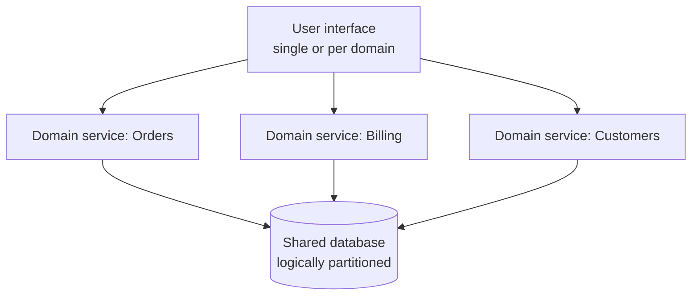

> [!summary] TL;DR
> A distributed style built from **domain services**: each independent domain of functionality lives in one coarse-grained service, and the services can share a single database. Because the data doesn't have to be broken apart, it is a practical stepping stone from which you split only the domain services that really need microservices.

## Problem
- A monolith has grown too large to test and deploy as one unit, but microservices' costs (database split, DevOps automation, team change) aren't justified.
- The team wants domain-partitioned services that deploy independently, without distributed transactions.

## Solution
- **Domain services, not microservices:** independent domains of functionality, all of a domain's functionality in a single coarse-grained service.
- **Shared database:** the style doesn't require breaking apart the data; e.g. admin, warehousing, fulfillment and customer services all using the same database.
- **Stepping stone:** after moving here, decide per domain service whether to break it into microservices; only those needing microservices characteristics (agility, scalability, fault tolerance…) get split.
- **Hybrid outcome:** domain services plus microservices where needed, an extremely popular combination.
- Listed among the distributed styles in [[Architecture Styles Compared#Style diagrams]].
- **Cost mitigation for microservices** (Lesson 203): service-based hybrids cut microservices cost → [[Architecture Style Risks]].
- **Modularity: three stars** (Lesson 196): coarse-grained domain services → [[Architectural Modularity]].
- **Fits highly cohesive problems** (Lesson 182): intertwined functionality stays inside one domain service → [[Domain to Architecture Isomorphism]].
- **Shape** (Lesson 180): well-defined, independent domains deployed as separate units (microservices make each function standalone; service-based makes the whole domain a service). Adds maintainability, testability, deployability, low cost and fault tolerance.

- **Not SOA** (Lesson 164) → [[Service-Oriented Architecture]] · [[Service-Based vs Service-Oriented Architecture]].
- **Size guideline** (Lesson 163): usually three to twelve domain services; beyond twelve, change control on the shared database breaks down and you are entering microservices territory.
- **Flexible topology** (Lesson 163): split the UI into domain-aligned deployments ("micro front ends") and split the data, up to domain-based databases that form separate [[Architectural Quantum|architectural quanta]].
- **Ratings** (Lesson 163): maintainability, testability, deployability, cost and fault tolerance four stars; low elasticity (coarse services take too long to start); abstraction one star; no five-star ratings, a pragmatic, balanced style. Cost (four stars vs one for microservices) is the differentiator: no organizational change, database split, DevOps automation or Kubernetes required.
- **Application scope, not enterprise scope** (Lesson 153): weak on systems integration, complex workflows and elasticity → [[Service-Based vs Service-Oriented Architecture]].
- **Controlling shared database change** (Lesson 136): one entity library per data domain → [[Logical Database Partitioning]].
- **Vs microservices** (Lesson 114): shares data and code, needs no DevOps automation or team reorganization; weaker elasticity → [[Microservices vs Service-Based Architecture]].

## Structure

## When to use / when not to
| Use when | Avoid when |
| -------- | ---------- |
| Creating a new distributed system without yet knowing which parts need microservices | A domain clearly needs microservices superpowers from the start (split that domain) |
| Migrating a legacy system and you want to postpone breaking apart the data | |
| High time to market, agility or fault tolerance needs at low cost (Lesson 163) | High elasticity needs (Lesson 163) |
| Monolithic data too difficult or not feasible to break apart (Lesson 163) | High semantic coupling between domains: a big ball of distributed mud (Lesson 163) |
| Well-defined, independent domains that communicate only through the data layer (Lesson 163) | More than about twelve services (Lesson 163) |

## Trade-offs
| Pro | Con |
| --- | --- |
| No need to break apart the data yet | Shared database couples the domain services at the data level |
| Coarse-grained services avoid microservices' cost and complexity where not needed | Less fine-grained agility and scalability than microservices for domains that need them |

## Related patterns
- **Alternatives:** [[Microservices Architecture]] (see [[Microservices vs Service-Based Architecture]]); [[Modular Monolith Architecture]]; [[Service-Oriented Architecture]] (see [[Service-Based vs Service-Oriented Architecture]])
- **Often combined with:** [[Logical Database Partitioning]]; [[Legacy Migration Approaches]] (a stepping stone out of a monolith); [[Microservices Architecture Blueprint]]
- **Anti-pattern to watch for:** [[Microservice All the Things Pitfall]]
- **Context:** [[Architectural Quantum]] · [[Architecture Style Risks]] · [[Domain to Architecture Isomorphism]]
- Index: [[Architecture Styles Compared]]. MOC: [[Architecture]]

## Sources
- [[Lesson 214 — Microservice All The Things Pitfall]] (Mark Richards, Software Architecture Monday)
- [[Lesson 203 — Understanding Architecture Style Risks]] (Mark Richards, Software Architecture Monday): hybrids to mitigate microservices cost
- [[Lesson 196 — Modularity and Architectural Styles]] (Mark Richards, Software Architecture Monday): three-star modularity from coarse-grained domain services
- [[Lesson 182 — Domain To Architecture Isomorphism Part 3]] (Mark Richards, Software Architecture Monday): service-based as a better shape for highly cohesive functionality
- [[Lesson 180 — Domain To Architecture Isomorphism Part 2]] (Mark Richards, Software Architecture Monday): shape of service-based vs microservices
- [[Lesson 164 — Service Oriented Architecture]] (Mark Richards, Software Architecture Monday): service-based vs service-oriented
- [[Lesson 163 — Service Based Architecture]] (Mark Richards, Software Architecture Monday): topology variants, star ratings, when to use and avoid
- [[Lesson 153 — Service Based vs SOA]] (Mark Richards, Software Architecture Monday): service-based vs SOA by scope, structure and ratings
- [[Lesson 136 — Managing Shared Database Changes]] (Mark Richards, Software Architecture Monday): logical database partitioning to control shared database change
- [[Lesson 114 — Microservices vs. Service Based Architecture]] (Mark Richards, Software Architecture Monday): structural and operational differences from microservices
