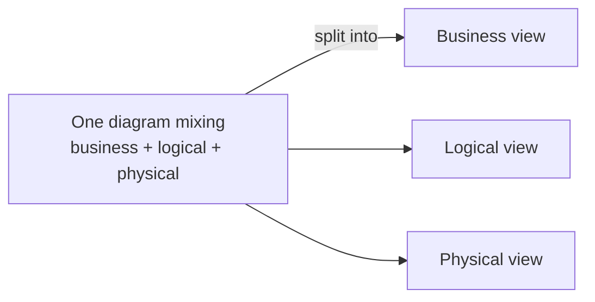

> [!summary] TL;DR
> A diagram that mixes business concepts, logical components and physical implementation, without saying which it is, invites misreadings: is `Customer` a business concept, a class or a table? State the viewpoint of every model and keep viewpoints separate.

## Problem
- Models blend conceptual, specification and implementation views in one picture.
- Readers draw different conclusions; implementation details leak into business discussions and vice versa.

## Solution
- Label each model with its viewpoint and audience (business, logical, physical/deployment).
- Use a viewpoint framework such as 4+1 views or C4 levels.
- Link views rather than merging them.

## Structure

## When to use / when not to
| Tolerable when | Harmful when |
| --- | --- |
| Quick whiteboard sketches that are thrown away | Diagrams used for decisions, documentation or hand-off |

## Trade-offs
| Why it's tempting | What it costs |
| --- | --- |
| Faster to draw a single picture | Misunderstanding between stakeholders |
|  | Implementation details lock in decisions too early |

## Related patterns
- **Fix with:** labelled views (4+1, C4); [[Logical vs Physical Architecture]]; [[Architecture Diagram Guidelines]]
- **Often found with:** [[Big Ball of Mud]]
- **Related anti-patterns:** [[Architecture by Implication Anti-Pattern]]
- Catalog: [[Software Design Patterns & Anti Patterns#Generic|Generic anti-patterns]].
