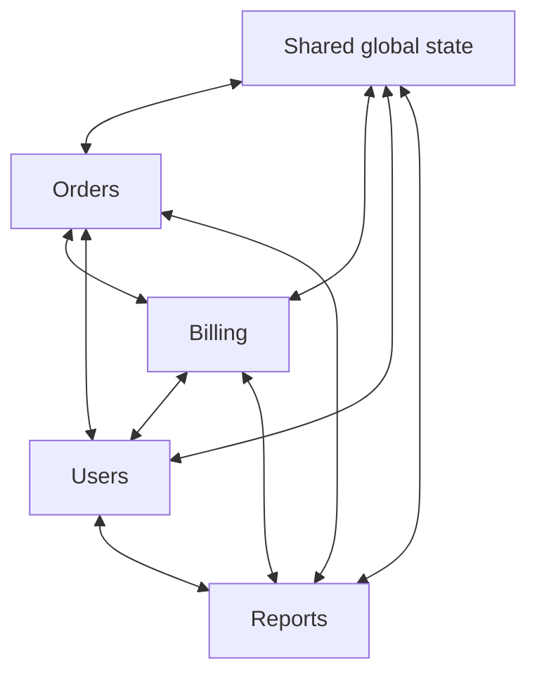

> [!summary] TL;DR
> The most common architecture in practice: expedient changes accumulate until there are no clear boundaries, information is shared promiscuously and every change risks breaking something unrelated. It's usually the result of schedule pressure and entropy rather than a decision. Recovery is incremental: find seams, draw boundaries, enforce them.

## Problem
- No module boundaries: any class calls any other, and data is shared globally.
- Changes ripple unpredictably; onboarding takes months; nobody can explain the structure.
- Driven by deadlines, turnover, piecemeal growth and never paying down structural debt.

## Solution
- Identify domains and draw logical component boundaries (see [[Component-Based Decomposition]]).
- Enforce boundaries with namespaces, assemblies and architecture tests or fitness functions.
- Refactor incrementally (strangler fig) instead of attempting a rewrite.
- Make structural health visible with code metrics.

## Structure

## When to use / when not to
| Tolerable when | Harmful when |
| --- | --- |
| Throwaway prototypes and spikes expected to be discarded (see [[Sacrificial Architecture]]) | Any system expected to live and change for years |

## Trade-offs
| Why it's tempting | What it costs |
| --- | --- |
| Fast initial delivery | Change becomes slow and risky |
| No up-front design effort | Hard to test, scale, or hand over |
|  | Rewrites become tempting and dangerous |

## Related patterns
- **Fix with:** [[Modular Monolith Architecture]]; [[Layered Architecture]]; [[Architectural Fitness Functions]] to enforce structure
- **Often found with:** [[Spaghetti Code]]; [[God Object]]; [[Circular Dependency]]; [[Structural Decay]]
- **Related anti-patterns:** [[Architecture by Implication Anti-Pattern]]; [[Stovepipe Architecture Anti-Pattern]]
- Context: [[Legacy Migration Approaches]], [[Architecture Code Metrics]]
- Catalog: [[Software Design Patterns & Anti Patterns#Generic|Generic anti-patterns]].
