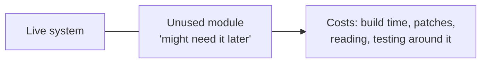

> [!summary] TL;DR
> An unused library, a half-built feature or an abandoned module stays in the codebase because it was expensive or might be useful someday. It still has to be compiled, understood, patched and tested around. Delete it; version control remembers.

## Problem
- Unused code and dependencies remain because removing them feels wasteful or risky.
- They add build time, security patches, cognitive load and confusion about what's live.

## Solution
- Delete unused code; rely on version control to recover it.
- Remove unused NuGet packages and services.
- Use code coverage, analyzers and dependency tools to find dead code.
- If a capability might be needed, keep it as a documented branch or design note, not live code.

## Structure

## When to use / when not to
| Tolerable when | Harmful when |
| --- | --- |
| Very short term, when removal is scheduled | Long-lived code nobody uses |

## Trade-offs
| Why it's tempting | What it costs |
| --- | --- |
| Avoids writing it again (rarely needed in practice) | Maintenance and security cost |
|  | Confuses readers about what's live |

## Related patterns
- **Fix with:** deletion with version history; YAGNI (see [[Laws & Principles]])
- **Often found with:** [[Lava Flow]]; [[Cargo Cult Programming]]
- **Related anti-patterns:** [[Premature Optimization]]
- Catalog: [[Software Design Patterns & Anti Patterns#Programming|Programming anti-patterns]].
