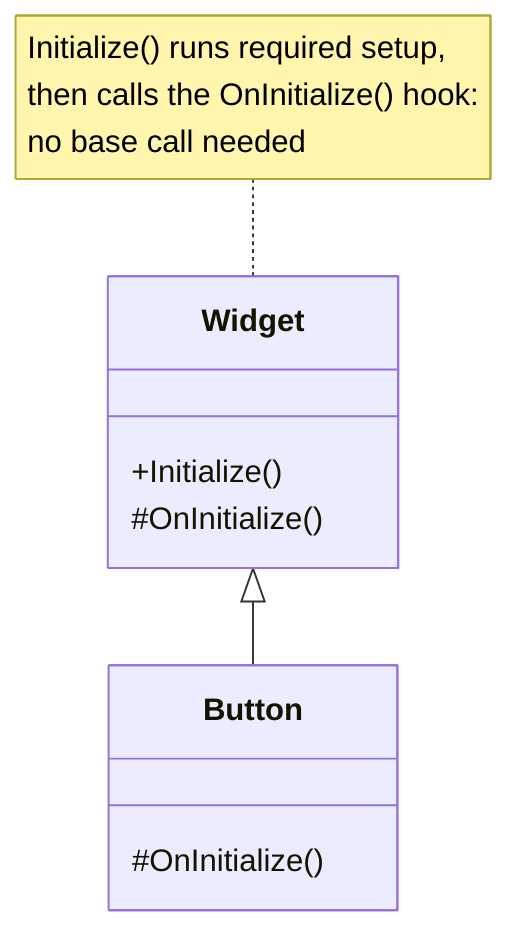

> [!summary] TL;DR
> If overriding `OnStart()` only works when you remember `base.OnStart()`, the design relies on every subclass author's memory. Use a template method instead: the base class calls a separate hook that subclasses override, so the required code always runs.

## Problem
- Overrides must call `base.Method()` (at the right time) or the object breaks.
- Nothing enforces it; forgotten calls produce subtle bugs.

## Solution
- Make the public method non-virtual and have it call a protected virtual hook.
- Put the mandatory logic in the non-virtual method, before or after the hook.
- Document optional hooks; provide empty default implementations.

## Structure

## When to use / when not to
| Tolerable when | Harmful when |
| --- | --- |
| Framework conventions that are well known and documented (some UI lifecycles) | Your own base classes where a hook method is possible |

## Trade-offs
| Why it's tempting | What it costs |
| --- | --- |
| Simple to write the base class | Fragile: forgotten calls break behavior silently |
|  | Order of the base call matters and is unclear |

## Related patterns
- **Fix with:** [[Template Method]] with hook methods
- **Often found with:** [[Yo-Yo Problem]]; deep inheritance
- **Related anti-patterns:** [[Sequential Coupling]]
- Catalog: [[Software Design Patterns & Anti Patterns#Object-oriented|Object-oriented anti-patterns]].
