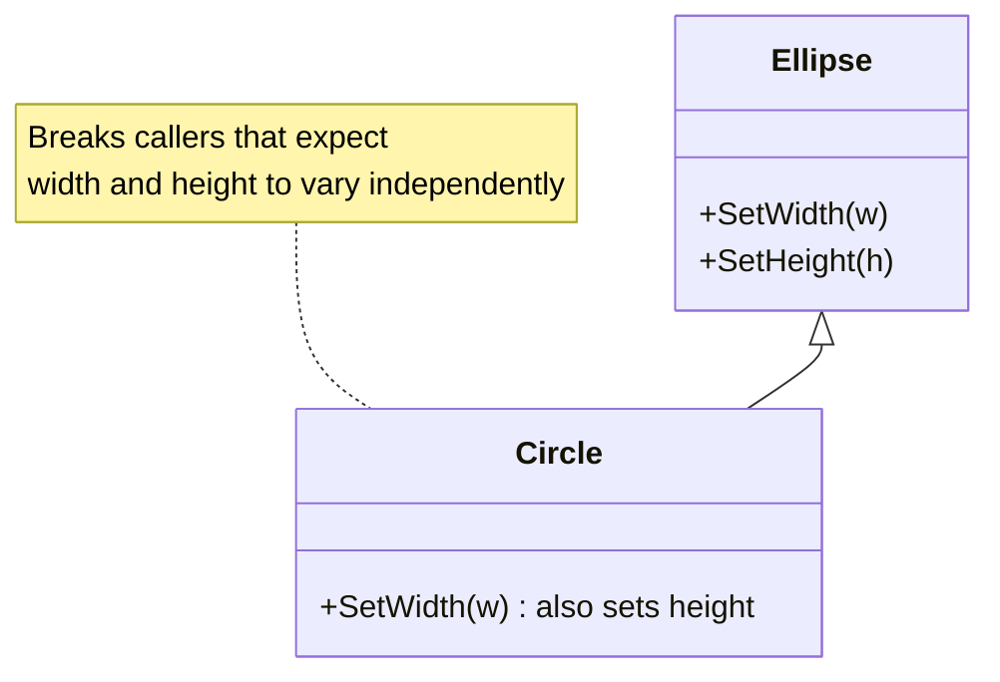

> [!summary] TL;DR
> Mathematically a circle is an ellipse, but if `Ellipse` has `SetWidth` and `SetHeight`, a `Circle` subclass can't support them without breaking either its own invariant or callers' expectations. "Is-a" in the real world doesn't guarantee substitutability in code. The square-rectangle problem is the same thing.

## Problem
- A subclass inherits mutators that would violate its own invariants.
- Overriding them to throw or to change other properties surprises callers that expect the base behavior.

## Solution
- Model by behavior, not taxonomy: inherit only if the subtype can honor every contract of the base type.
- Make shapes immutable (methods return new shapes), which removes the conflicting mutators.
- Use a common read-only interface (`IShape`) with separate types.

## Structure

## When to use / when not to
| Tolerable when | Harmful when |
| --- | --- |
| Immutable hierarchies where the subtype only adds constraints that no base operation can break | Mutable hierarchies built on real-world "is-a" taxonomy |

## Trade-offs
| Why it's tempting | What it costs |
| --- | --- |
| Reuses base-class code | Broken substitutability (LSP violations) |
|  | Surprising exceptions or side effects for callers |

## Related patterns
- **Fix with:** immutable types; composition; separate types behind a shared interface; see [[SOLID Principles]] (Liskov substitution)
- **Often found with:** [[Yo-Yo Problem]]; [[Call Super]]
- **Related anti-patterns:** [[Twin Pattern]] or other workarounds for a hierarchy that doesn't fit
- Catalog: [[Software Design Patterns & Anti Patterns#Object-oriented|Object-oriented anti-patterns]].
