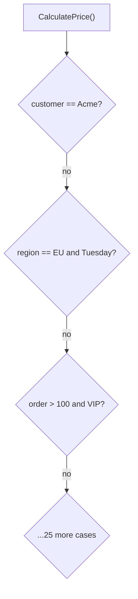

> [!summary] TL;DR
> "If customer is Acme, do this; if region is EU and it's Tuesday, do that." Each special case is quick to add, but together they make the code unreadable and fragile. Look for the concept behind the exceptions and model it (a strategy, a policy, configuration).

## Problem
- New requirements are bolted on as `if` branches for specific customers, values or situations.
- Logic becomes hard to follow and test; cases interact unexpectedly.

## Solution
- Identify the variation behind the special cases and model it explicitly.
- Use [[Strategy Pattern]], [[State Pattern]], [[Specification Pattern]] or rules tables for the varying behavior.
- Refactor when the third similar special case appears.

## Structure

## When to use / when not to
| Tolerable when | Harmful when |
| --- | --- |
| A genuinely one-off case that will be removed soon | Recurring variation along a recognizable dimension |

## Trade-offs
| Why it's tempting | What it costs |
| --- | --- |
| Fast to add each case | Unreadable, fragile logic |
|  | Combinatorial interactions between cases |

## Related patterns
- **Fix with:** [[Strategy Pattern]]; [[Chain of Responsibility]]; [[Specification Pattern]]
- **Often found with:** [[Spaghetti Code]]; [[Magic Strings]]
- **Related anti-patterns:** [[Hard Coding]]
- Catalog: [[Software Design Patterns & Anti Patterns#Programming|Programming anti-patterns]].
