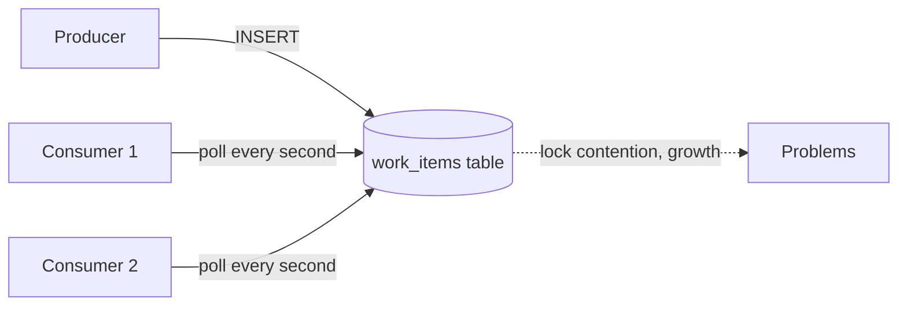

> [!summary] TL;DR
> One process inserts rows into a table and another polls it to find work. It seems simple because the database is already there, but polling adds load and latency, locking and ordering get tricky, and the table becomes a hidden integration contract. Use a message broker, or the outbox pattern if you need transactional hand-off.

## Problem
- Processes need to exchange messages or work items, and a shared table looks like the quickest channel.
- Polling wastes resources and adds latency; concurrent consumers contend on locks; processed rows pile up.
- The table schema becomes a coupling point between services.

## Solution
- Use a message broker or queue for communication (RabbitMQ, Azure Service Bus, Kafka).
- When the message must be committed with a database change, use a transactional outbox and relay it to the broker.
- If a table queue is unavoidable, use `READPAST`/`SKIP LOCKED` dequeueing, indexes and clean-up jobs.

## Structure

## When to use / when not to
| Tolerable when | Harmful when |
| --- | --- |
| Very low volume, single consumer, where adding a broker is truly unjustified | Medium or high message volume |
| Outbox tables that are relayed to a broker | Several consumers or services sharing the table |

## Trade-offs
| Why it's tempting | What it costs |
| --- | --- |
| No new infrastructure | Polling load and latency |
| Transactional with the producer's data | Locking and duplicate processing |
|  | Schema coupling between services |

## Related patterns
- **Fix with:** [[Messaging Design Pattern]]; [[Point-to-Point vs Publish-Subscribe Messaging]]; outbox (see [[Distributed Systems Pattern Catalog]])
- **Often found with:** [[Busy Waiting]]; shared database integration (see [[Integration Styles]])
- **Related anti-patterns:** [[Golden Hammer]] (the database as the answer to everything)
- Catalog: [[Software Design Patterns & Anti Patterns#Generic|Generic anti-patterns]].
