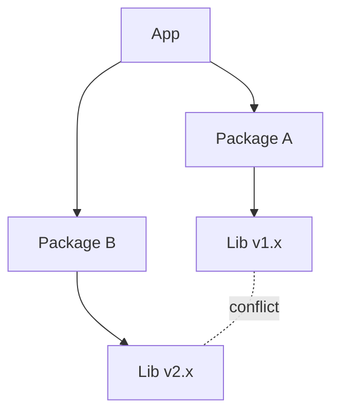

> [!summary] TL;DR
> Package A needs version 1 of a library and package B needs version 2; upgrading one breaks the other; transitive dependencies pull in surprises. Manage it with semantic versioning, lock files, central package management and regular, small upgrades.

## Problem
- Conflicting version requirements between direct and transitive dependencies.
- Long dependency chains make upgrades risky.
- Builds differ between machines without pinned versions.

## Solution
- Use lock files and central package management (`Directory.Packages.props`).
- Follow [[Semantic Versioning]] and respect major-version boundaries.
- Keep dependencies few and upgrade little and often (Dependabot, Renovate).
- Isolate conflicting components (separate processes or containers) when necessary.

## Structure

## When to use / when not to
| Tolerable when | Harmful when |
| --- | --- |
| Never by choice; it's a condition to manage | Unpinned versions and many rarely updated dependencies |

## Trade-offs
| Why it's tempting | What it costs |
| --- | --- |
| Reusing libraries saves effort (the reason dependencies exist) | Broken builds and upgrades |
|  | Security fixes delayed by upgrade pain |

## Related patterns
- **Fix with:** lock files; central package management; fewer dependencies
- **Often found with:** [[DLL Hell]]; [[JAR Hell]]; [[Extension Conflict]]
- **Related anti-patterns:** [[Not Invented Here]] (the overcorrection: writing everything yourself)
- Context: [[Versioning in Distributed Systems]]
- Catalog: [[Software Design Patterns & Anti Patterns#Configuration management|Configuration management anti-patterns]].
