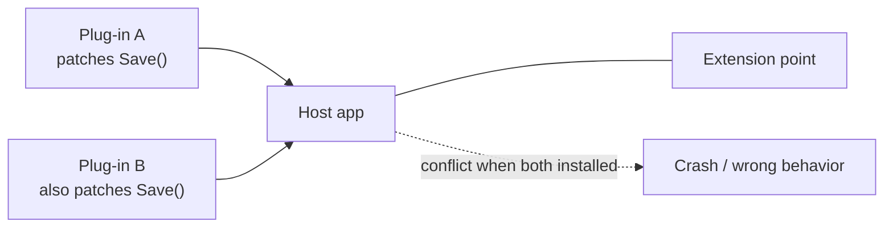

> [!summary] TL;DR
> Two plug-ins both patch the same function, hook the same event in incompatible ways or ship different versions of a shared library, and the host breaks only when both are installed. Hosts prevent it with well-defined extension points, isolation and version contracts.

## Problem
- Extensions patch or override the same host behavior.
- Shared dependencies in different versions are loaded into one process.
- Failures appear only with particular combinations of extensions.

## Solution
- Offer explicit, versioned extension points instead of letting plug-ins patch internals.
- Isolate plug-ins (`AssemblyLoadContext` in .NET, separate processes).
- Define ordering and conflict rules; detect conflicts at install time.
- Test common extension combinations.

## Structure

## When to use / when not to
| Tolerable when | Harmful when |
| --- | --- |
| Never by choice | Plug-in systems without isolation or contracts |

## Trade-offs
| Why it's tempting | What it costs |
| --- | --- |
| Open extensibility (the reason plug-ins exist) | Unpredictable failures in combination |
|  | Support burden |

## Related patterns
- **Fix with:** [[Microkernel Architecture]] with defined contracts; isolated load contexts
- **Often found with:** [[Dependency Hell]]; [[DLL Hell]]
- **Related anti-patterns:** [[Extension Object]] misuse
- Catalog: [[Software Design Patterns & Anti Patterns#Configuration management|Configuration management anti-patterns]].
