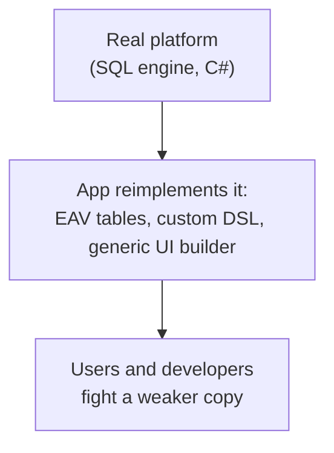

> [!summary] TL;DR
> Trying to make software infinitely flexible, architects rebuild the development platform inside it: a rules engine that is really a worse programming language, or a single generic table that reimplements a database. The result is slower, less safe and harder to use than the platform it imitates.

## Problem
- Requirements for "total flexibility" lead to generic data models (EAV), custom expression languages or workflow engines.
- The inner platform lacks the tooling, performance, typing and safety of the real one.

## Solution
- Use the platform's own features (schema, code, scripting) for what they do well.
- Design for the variability you actually have, not every possible one.
- Where users really need configuration, embed a proven engine instead of inventing one.

## Structure

## When to use / when not to
| Tolerable when | Harmful when |
| --- | --- |
| The product is genuinely a platform (a low-code tool, a DBMS) | Business applications with knowable requirements |

## Trade-offs
| Why it's tempting | What it costs |
| --- | --- |
| Feels future-proof | Poor performance, weak typing and no tooling |
| Non-developers can change behavior (in theory) | Becomes harder to change than code |
|  | Bugs in the inner platform affect everything |

## Related patterns
- **Fix with:** code and schema changes with good delivery pipelines; embedding a proven scripting or rules engine
- **Often found with:** [[Soft Coding]]; [[Interpreter Pattern]] gone too far
- **Related anti-patterns:** [[Infinity Architecture Anti-Pattern]]; [[Accidental Complexity Anti-Pattern]]
- Catalog: [[Software Design Patterns & Anti Patterns#Generic|Generic anti-patterns]].
