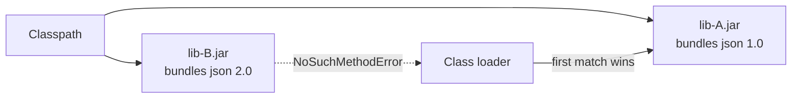

> [!summary] TL;DR
> The JVM loads whichever version of a class it finds first on the classpath, so two JARs bundling different versions of a library cause `NoSuchMethodError` at runtime. Build tools' dependency mediation, shading and the Java module system mitigate it. In .NET, the equivalent problems show up as assembly binding conflicts.

## Problem
- Several versions of a library appear on the classpath.
- Class-loading order decides which version wins.
- Errors appear only at runtime when a missing method is called.

## Solution
- Use Maven/Gradle dependency management and inspect the dependency tree.
- Shade or relocate conflicting libraries.
- Use the Java Platform Module System or OSGi for isolation.
- In .NET, use central package management and binding diagnostics for the same problem.

## Structure

## When to use / when not to
| Tolerable when | Harmful when |
| --- | --- |
| Never by choice | Fat JARs bundling common libraries without shading |

## Trade-offs
| Why it's tempting | What it costs |
| --- | --- |
| None; it's a failure mode | Runtime errors that builds don't catch |

## Related patterns
- **Fix with:** dependency mediation; shading; module systems
- **Often found with:** [[Dependency Hell]]; [[DLL Hell]]
- **Related anti-patterns:** [[Extension Conflict]]
- Catalog: [[Software Design Patterns & Anti Patterns#Configuration management|Configuration management anti-patterns]].
