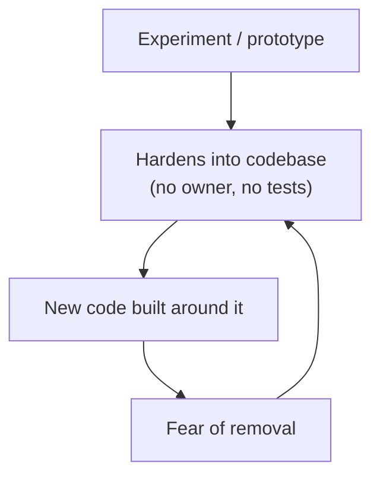

> [!summary] TL;DR
> Code from old experiments and half-finished features stays because nobody knows whether something depends on it. Over time it solidifies like cooled lava, and new code grows around it. Find out with tests, telemetry and coverage, then remove it.

## Problem
- Unexplained code, commented-out blocks and unused classes accumulate.
- Fear of breaking something prevents removal.
- New developers waste time understanding code that does nothing.

## Solution
- Add characterization tests around uncertain areas.
- Use code coverage and production telemetry to confirm code is dead.
- Delete it in small, reviewed steps; version control keeps history.
- Prevent recurrence: finish or remove experiments; avoid committing commented-out code.

## Structure

## When to use / when not to
| Tolerable when | Harmful when |
| --- | --- |
| Never as a steady state | Any code without known purpose or owner |

## Trade-offs
| Why it's tempting | What it costs |
| --- | --- |
| Avoids the immediate risk of removal | Growing maintenance burden |
|  | Confusion and slower onboarding |

## Related patterns
- **Fix with:** tests plus deletion; [[Business Justification for Refactoring]]
- **Often found with:** [[Boat Anchor]]; [[Big Ball of Mud]]
- **Related anti-patterns:** [[Structural Decay]]
- Catalog: [[Software Design Patterns & Anti Patterns#Programming|Programming anti-patterns]].
