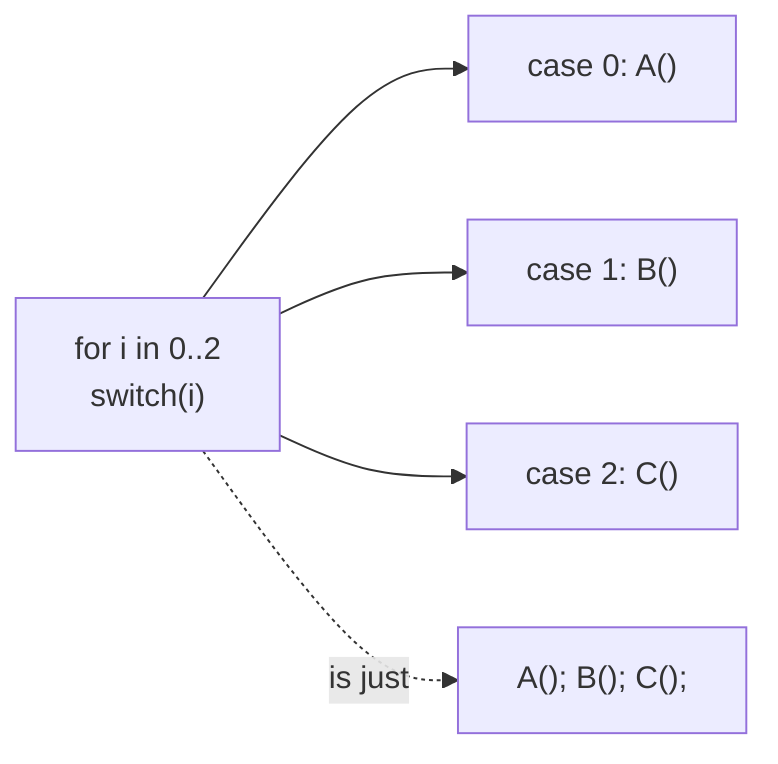

> [!summary] TL;DR
> `for (i = 0; i < 3; i++) switch (i) { case 0: A(); case 1: B(); case 2: C(); }` is just `A(); B(); C();` made harder to read. Write sequential code sequentially; use a real state machine if the steps genuinely depend on state.

## Problem
- A known, fixed order of steps is written as a loop with a switch.
- Readers have to mentally simulate the loop to see the sequence.

## Solution
- Replace with straight-line code.
- If steps vary by data, use a list of delegates or a [[Pipeline Pattern]].
- If behavior depends on state transitions, use [[State Pattern]] or an explicit state machine.

## Structure

## When to use / when not to
| Tolerable when | Harmful when |
| --- | --- |
| Genuine state machines driven by input (with clear state names) | Fixed sequences of steps |

## Trade-offs
| Why it's tempting | What it costs |
| --- | --- |
| None for fixed sequences | Obscures control flow |
|  | Harder to modify and test |

## Related patterns
- **Fix with:** straight-line code; [[Pipeline Pattern]]; [[State Pattern]]
- **Often found with:** [[Spaghetti Code]]
- **Related anti-patterns:** [[Sequential Coupling]]
- Catalog: [[Software Design Patterns & Anti Patterns#Programming|Programming anti-patterns]].
