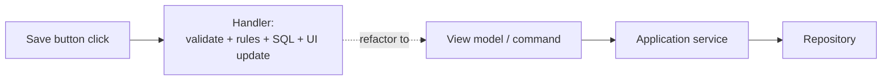

> [!summary] TL;DR
> The click handler reads the form fields, validates them, runs business rules, talks to the database and updates the UI, all in one method. It's quick in a forms designer, but the logic can't be reused, tested without the UI, or changed safely. Move the logic into services and keep the handler thin.

## Problem
- UI event handlers contain validation, business rules and persistence.
- Logic is duplicated across screens and can't be unit tested.

## Solution
- Move business logic into application services or commands.
- Use MVVM/MVC/MVP so the UI binds to a view model or calls a controller.
- Keep event handlers to gathering input and calling one method.

## Structure

## When to use / when not to
| Tolerable when | Harmful when |
| --- | --- |
| Tiny throwaway tools or prototypes | Any application that will be maintained or tested |

## Trade-offs
| Why it's tempting | What it costs |
| --- | --- |
| Fast to build with designers | Untestable logic |
|  | Duplication across screens |
|  | UI changes break business logic |

## Related patterns
- **Fix with:** [[Command Pattern]]; MVVM/MVC (see [[UI and UX Design Patterns]]); [[Layered Architecture]]
- **Often found with:** [[Input Kludge]]; [[Spaghetti Code]]; [[God Object]]
- **Related anti-patterns:** [[Anemic Domain Model]]
- Catalog: [[Software Design Patterns & Anti Patterns#Generic|Generic anti-patterns]].
