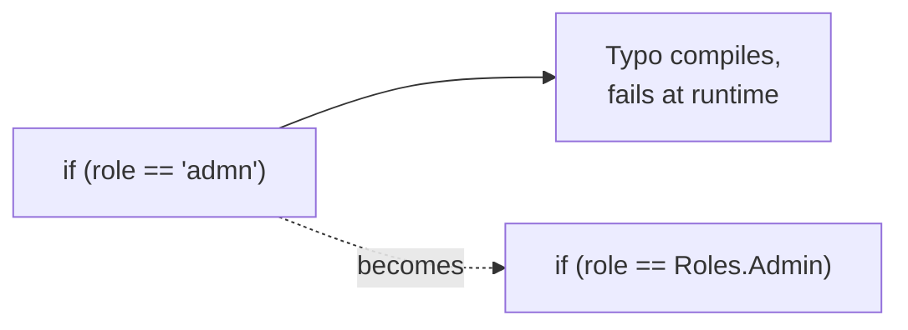

> [!summary] TL;DR
> `if (role == "admin")`, `config["Smtp:Host"]` and `cache.Get("user_" + id)` repeated across files break silently on a typo and can't be found by "rename". Use constants, enums, `nameof` and strongly typed options.

## Problem
- Strings act as identifiers or switches (roles, keys, event names, routes).
- Typos compile and fail at runtime.
- Refactoring tools can't find or rename them.

## Solution
- Define constants or enums for fixed values.
- Use `nameof()` for member and type names.
- Bind configuration sections to options classes.
- Use strongly typed IDs and route helpers.

## Structure

## When to use / when not to
| Tolerable when | Harmful when |
| --- | --- |
| User-facing text (which belongs in resources anyway) | Identifiers, keys and switches used in more than one place |

## Trade-offs
| Why it's tempting | What it costs |
| --- | --- |
| Quick and readable at first | Runtime errors from typos |
|  | No refactoring support |
|  | Duplication |

## Related patterns
- **Fix with:** constants; enums; `nameof`; options classes
- **Often found with:** [[Magic Number]]; [[Hard Coding]]; [[Coding by Exception]]
- **Related anti-patterns:** [[Soft Coding]]
- Catalog: [[Software Design Patterns & Anti Patterns#Programming|Programming anti-patterns]].
