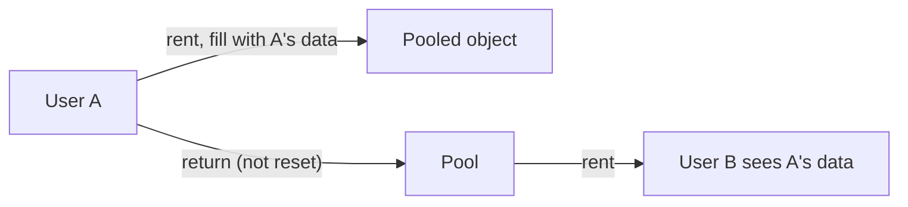

> [!summary] TL;DR
> An object pool only works if returned objects are reset. When they aren't, the next caller gets leftover state: a previous user's data in a buffer, an open transaction on a connection, a half-filled list. Reset on return, or discard objects that can't be reset.

## Problem
- Pooled objects keep state from their last use.
- Bugs appear far from their cause and only under load.
- Can leak data between users or tenants.

## Solution
- Reset objects in a pool policy's `Return` method (clear collections, reset fields, roll back transactions).
- Validate on rent and discard objects in a bad state.
- Prefer immutable or stateless objects where pooling isn't needed.
- Clear pooled arrays when they held sensitive data (`ArrayPool<T>.Return(array, clearArray: true)`).

## Structure

## When to use / when not to
| Tolerable when | Harmful when |
| --- | --- |
| Never: reset is always required | Any pool of mutable objects |

## Trade-offs
| Why it's tempting | What it costs |
| --- | --- |
| Skips reset cost | Data leaks between callers |
|  | Heisenbugs under load |

## Related patterns
- **Fix with:** [[Object Pool]] with a reset policy; no pooling
- **Often found with:** [[Object Pool]]; [[Multiton Pattern]]
- **Related anti-patterns:** [[Action at a Distance]]
- Catalog: [[Software Design Patterns & Anti Patterns#Object-oriented|Object-oriented anti-patterns]].
