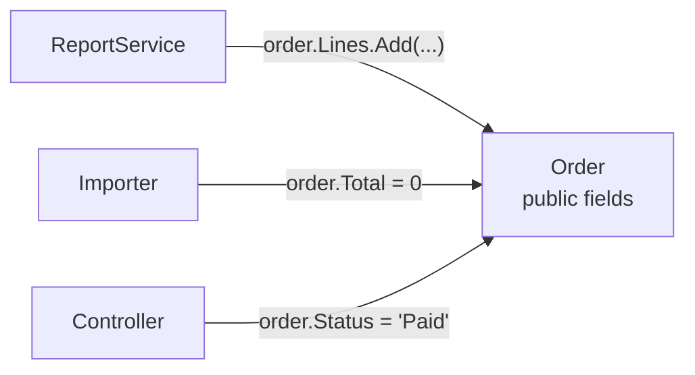

> [!summary] TL;DR
> When everything is public and mutable, every class reaches into every other, invariants can't be enforced, and a change to one object's internals breaks code everywhere. Encapsulate state behind behavior and expose read-only views.

## Problem
- Public fields, public setters and exposed mutable collections.
- Other classes modify state directly, bypassing rules.
- Internal representation can't change without breaking callers.

## Solution
- Make fields private; expose behavior instead of setters ("tell, don't ask").
- Expose collections as `IReadOnlyList<T>` and copy on the way out.
- Use `init`-only and immutable types where possible.
- Follow the [[Law of Demeter]].

## Structure

## When to use / when not to
| Tolerable when | Harmful when |
| --- | --- |
| Plain DTOs and records used only to carry data | Domain objects with invariants |

## Trade-offs
| Why it's tempting | What it costs |
| --- | --- |
| Easy access from anywhere | No encapsulation; invariants broken |
|  | High coupling to internals |

## Related patterns
- **Fix with:** encapsulation; immutable types; [[Iterator Pattern]] instead of exposing collections
- **Often found with:** [[Anemic Domain Model]]; [[Action at a Distance]]
- **Related anti-patterns:** [[God Object]]
- Catalog: [[Software Design Patterns & Anti Patterns#Object-oriented|Object-oriented anti-patterns]].
