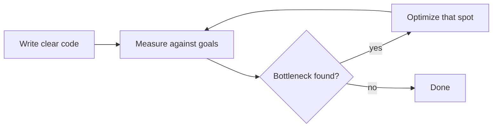

> [!summary] TL;DR
> "Premature optimization is the root of all evil" (Knuth): micro-optimizing code that isn't a bottleneck makes it harder to read and change for no measurable benefit. Write clear code, measure with a profiler or benchmarks, and then optimize the hot spots. Architectural performance decisions are different and should be made early.

## Problem
- Developers optimize code paths by intuition before profiling.
- Clever code is harder to read, test and change.
- Real bottlenecks (I/O, queries, allocations in hot loops) go unaddressed.

## Solution
- Make it work, make it right, then make it fast.
- Define performance goals and measure against them (BenchmarkDotNet, profilers, APM).
- Optimize the measured hot spots only and keep the benchmark as a guard.
- Make architectural performance decisions (caching, data model, communication style) deliberately and early.

## Structure

## When to use / when not to
| Tolerable when | Harmful when |
| --- | --- |
| Known hot paths with measured requirements (latency budgets, high-frequency loops) | Code whose performance hasn't been measured or doesn't matter |
| Architectural decisions that are expensive to change later |  |

## Trade-offs
| Why it's tempting | What it costs |
| --- | --- |
| Can avoid later performance work when guesses are right | Harder-to-maintain code |
|  | Effort spent in the wrong places |
|  | Real bottlenecks ignored |

## Related patterns
- **Fix with:** profiling-driven optimization; [[Performance vs Responsiveness]] goals
- **Often found with:** [[Double-Checked Locking]]; [[Flyweight Pattern]] used too early
- **Related anti-patterns:** [[Accidental Complexity Anti-Pattern]]
- Catalog: [[Software Design Patterns & Anti Patterns#Methodological|Methodological anti-patterns]].
