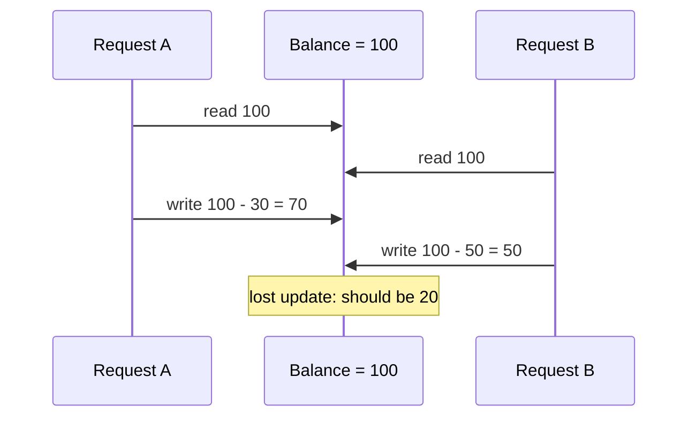

> [!summary] TL;DR
> When the outcome depends on which of two concurrent operations happens first, the system has a race condition: lost updates, double charges, check-then-act failures. These bugs are rare in testing and common in production. Remove shared mutable state or synchronize access to it.

## Problem
- Concurrent threads, requests or services read and write shared state without coordination.
- Check-then-act sequences (`if (!exists) create`) interleave with other actors.
- Failures are intermittent and hard to reproduce.

## Solution
- Eliminate shared mutable state where possible (immutability, ownership transfer).
- Make check-and-act atomic: locks, atomic operations, database constraints, optimistic concurrency tokens.
- Use idempotency keys for distributed operations.
- Test with stress and concurrency tools.

## Structure

## When to use / when not to
| Tolerable when | Harmful when |
| --- | --- |
| Never intentionally; only where the result is provably order-independent | Any shared mutable state across threads, requests or services |

## Trade-offs
| Why it's tempting | What it costs |
| --- | --- |
| No synchronization overhead (until it breaks) | Data corruption and lost updates |
|  | Intermittent, hard-to-reproduce bugs |
|  | Security issues (TOCTOU) |

## Related patterns
- **Fix with:** [[Lock Pattern]]; [[CPU Atomic Operation]]; [[Safe Concurrency with Exclusive Ownership]]; optimistic concurrency
- **Often found with:** [[Action at a Distance]]; [[Busy Waiting]]
- **Related anti-patterns:** [[Double-Checked Locking]] done wrong
- Catalog: [[Software Design Patterns & Anti Patterns#Generic|Generic anti-patterns]].
