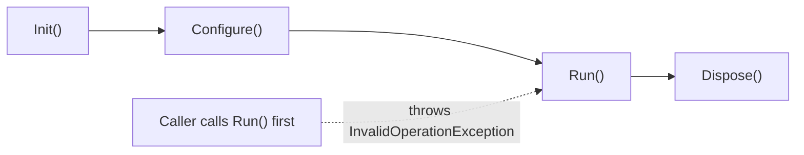

> [!summary] TL;DR
> If `Run()` fails unless `Init()` and `Configure()` were called first, callers must know a hidden protocol. Make invalid sequences impossible: do the work in the constructor or factory, use a builder that returns the finished object, or use types that represent each stage.

## Problem
- Methods only work if called in a specific order.
- Calling them out of order throws or silently misbehaves.
- The protocol lives in documentation, if anywhere.

## Solution
- Initialize fully in the constructor or a factory method.
- Use a [[Builder Pattern]] or step builder so only valid next steps are available.
- Represent stages as different types (`UnconfiguredClient` → `ConfiguredClient`).
- Use [[Template Method]] to run steps in the right order internally.

## Structure

## When to use / when not to
| Tolerable when | Harmful when |
| --- | --- |
| Lifecycle methods controlled by a framework, not by callers | Public APIs where callers must remember the order |

## Trade-offs
| Why it's tempting | What it costs |
| --- | --- |
| Simple to implement | Fragile usage and runtime errors |
|  | Hidden protocol |

## Related patterns
- **Fix with:** [[Builder Pattern]]; [[Fluent Interface]] step builders; [[Template Method]]; [[State Pattern]]
- **Often found with:** [[Call Super]]
- **Related anti-patterns:** [[Loop-Switch Sequence]]
- Catalog: [[Software Design Patterns & Anti Patterns#Object-oriented|Object-oriented anti-patterns]].
