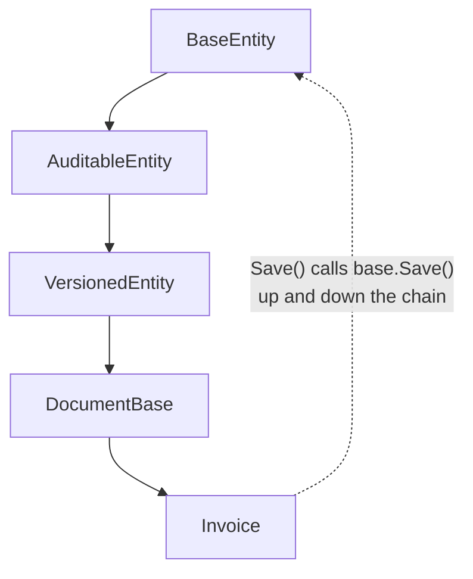

> [!summary] TL;DR
> When a method's behavior is spread over six levels of base classes with overrides and `base` calls, readers have to yo-yo up and down the hierarchy to understand it. Flatten the hierarchy and prefer composition.

## Problem
- Deep inheritance chains with overrides at many levels.
- Following the control flow of one method means opening many files.
- Changes to a base class ripple unpredictably.

## Solution
- Prefer composition and [[Delegation Pattern]] over inheritance.
- Keep hierarchies shallow (two or three levels).
- Seal classes by default; open them deliberately.
- Use [[Strategy Pattern]] or [[Decorator Pattern]] for variation.

## Structure

## When to use / when not to
| Tolerable when | Harmful when |
| --- | --- |
| Framework hierarchies that are stable and well documented | Application code where composition works |

## Trade-offs
| Why it's tempting | What it costs |
| --- | --- |
| Code reuse through inheritance | Hard to understand and debug |
|  | Fragile base classes |

## Related patterns
- **Fix with:** composition; [[Strategy Pattern]]; [[Decorator Pattern]]; interfaces
- **Often found with:** [[Call Super]]; [[Circle-Ellipse Problem]]
- **Related anti-patterns:** [[Lasagna Code]]
- Catalog: [[Software Design Patterns & Anti Patterns#Object-oriented|Object-oriented anti-patterns]].
