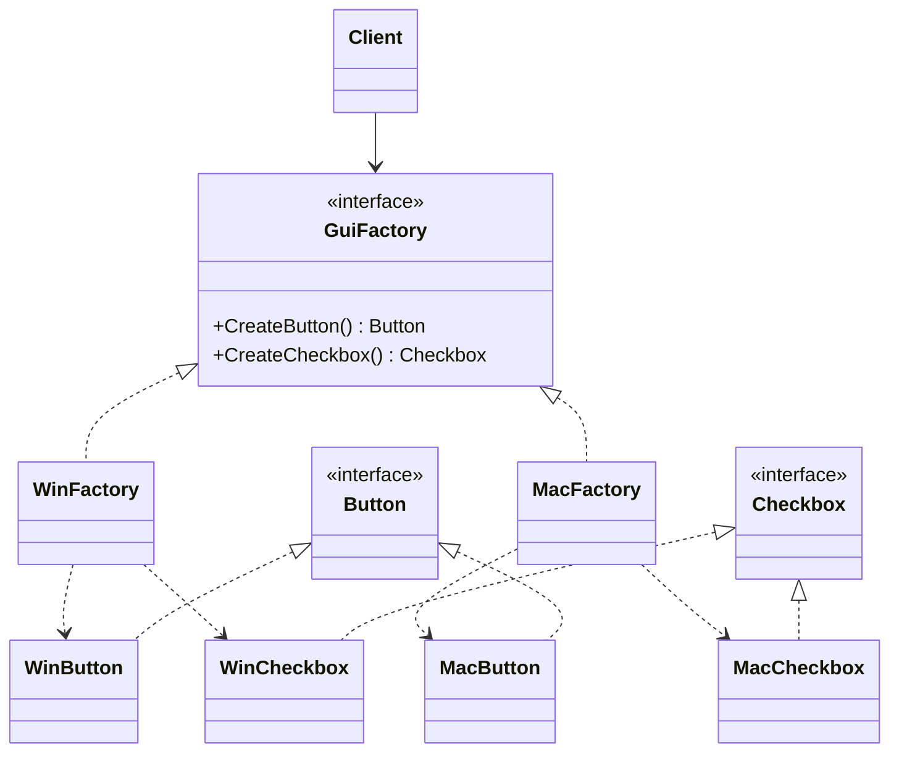

> [!summary] TL;DR
> Client code asks a factory interface for each product (`CreateButton`, `CreateCheckbox`) and gets a matching set from whichever concrete factory was configured. Switching the whole family means switching one factory, and products from different families can't be mixed by accident.

## Problem
- A client needs several related objects that must be used together (Windows button with a Windows checkbox, never a macOS one).
- Calling `new` on concrete classes scatters the choice of family through the code and makes adding a family a shotgun edit.

## Solution
- Declare an abstract product interface for each kind of product.
- Declare an abstract factory with one creation method per product kind.
- Implement one concrete factory per family; each returns that family's products.
- Choose the concrete factory once (configuration or composition root) and pass it to clients.

## Structure

![[Pasted image 20260618091439.png]]

## When to use / when not to
| Use when | Avoid when |
| --- | --- |
| The system must work with one of several families of related products | There's only one family, or products vary independently |
| Products in a family must be used together consistently | New product *kinds* are added often (each one changes every factory) |
| You want to hide concrete product classes from clients |  |

## Trade-offs
| Pro | Con |
| --- | --- |
| Guarantees products from one family are compatible | Adding a new product kind changes the interface and every concrete factory |
| Swapping a family is one change at the composition root | Many small classes for simple cases |
| Concrete classes stay out of client code |  |

## Related patterns
- **Alternatives:** [[Factory Method]] (one product); [[Prototype Pattern]] (clone configured instances); [[Dependency Injection]] with keyed registrations
- **Often combined with:** [[Singleton Pattern]] (one factory per family); [[Factory Method]] (often used to implement each creation method); [[Bridge Pattern]]
- **Anti-pattern to watch for:** [[Accidental Complexity Anti-Pattern]] (a factory hierarchy for a family of one)
- Catalog: [[Software Design Patterns & Anti Patterns#Creational|Creational patterns]].
