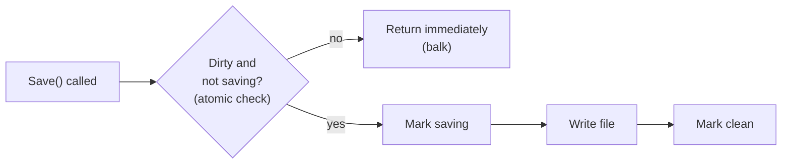

> [!summary] TL;DR
> If the object isn't ready (already saving, already started, not dirty), the method just returns. It avoids duplicate work, such as a second auto-save or a second `Start()`, without blocking the caller. The state check and the state change must be atomic.

## Problem
- A method may be called when it's pointless or harmful to run: the job is already running, or there's nothing to save.
- Waiting until the state becomes right isn't wanted; the call should simply be ignored.

## Solution
- Check the guard condition under a lock or with an atomic compare-and-swap.
- If the condition fails, return immediately (optionally reporting that it balked).
- If it holds, update the state ("now running") atomically and perform the action.

## Structure

![[Pasted image 20260607165730.png]]

## When to use / when not to
| Use when | Avoid when |
| --- | --- |
| Idempotent start/stop or initialization methods | The caller needs the action to eventually run (use [[Guarded Suspension]]) |
| Auto-save or refresh that shouldn't overlap | Silently ignoring calls would hide bugs |
| Callers don't need the action to happen on every call |  |

## Trade-offs
| Pro | Con |
| --- | --- |
| Prevents duplicate or overlapping work | Calls are silently dropped unless reported |
| Never blocks callers | Requires careful atomic state handling |

## Related patterns
- **Alternatives:** [[Guarded Suspension]] (wait instead of balking); queuing the request
- **Often combined with:** [[State Pattern]]; [[Lock Pattern]]; [[CPU Atomic Operation]] (`Interlocked.CompareExchange`)
- **Anti-pattern to watch for:** [[Race Hazard]] (check and update done non-atomically); [[Error Hiding]]
- Catalog: [[Software Design Patterns & Anti Patterns#Concurrency|Concurrency patterns]].
