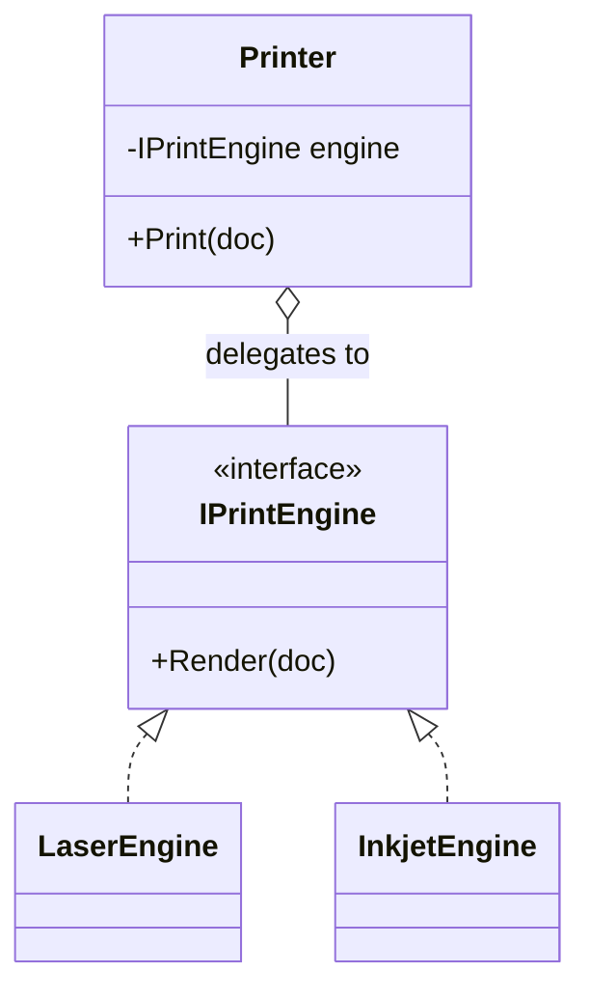

> [!summary] TL;DR
> Rather than inheriting from a class to reuse its behavior, an object holds an instance of it and forwards calls. This is the "favor composition over inheritance" principle in its simplest form and underlies [[Strategy Pattern]], [[State Pattern]] and [[Decorator Pattern]].

## Problem
- Inheriting just to reuse code couples the subclass to the base class's internals and exposes members it shouldn't.
- A class can have only one base class, so reusing behavior from several sources by inheritance isn't possible.

## Solution
- Hold a reference to the delegate (injected or created).
- Expose only the members you need, each forwarding to the delegate.
- Swap the delegate to change behavior without changing the delegator.

## Structure

![[Pasted image 20260607124307.png]]

## When to use / when not to
| Use when | Avoid when |
| --- | --- |
| Reusing behavior without an "is-a" relationship | A genuine "is-a" relationship with full substitutability |
| Behavior should be swappable at runtime | Delegating every member one-for-one (consider inheritance or a different design) |
| You want to expose a narrow subset of another class's API |  |

## Trade-offs
| Pro | Con |
| --- | --- |
| Loose coupling and runtime flexibility | Boilerplate forwarding methods |
| Avoids fragile base-class problems | An extra object and indirection |

## Related patterns
- **Alternatives:** inheritance; C# default interface methods for shared behavior
- **Often combined with:** [[Strategy Pattern]]; [[State Pattern]]; [[Decorator Pattern]]; [[Proxy Pattern]]
- **Anti-pattern to watch for:** [[Poltergeist Anti-Pattern]] (classes that only forward and add nothing); [[Yo-Yo Problem]]
- Catalog: [[Software Design Patterns & Anti Patterns#Structural|Structural patterns]].
