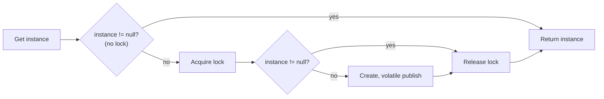

> [!summary] TL;DR
> Check whether the instance exists; only if it doesn't, take the lock and check again before creating it. It avoids a lock on every access, but it's easy to get wrong because of memory reordering, so it's often listed as an anti-pattern. In .NET, prefer `Lazy<T>` or `LazyInitializer`, which do it correctly.

## Problem
- Lazy initialization of a shared object needs thread safety, but locking on every access is expensive once the object exists.

## Solution
- First check without locking; if initialized, return it.
- Otherwise take the lock and check again (another thread may have initialized it).
- Create the object and publish it with a volatile write so other threads see a fully constructed object.
- In practice, use `Lazy<T>` instead of writing this by hand.

## Structure

![[Pasted image 20260607170232.png]]

## When to use / when not to
| Use when | Avoid when |
| --- | --- |
| Hot-path lazy initialization where a library primitive isn't available | Almost always in modern .NET: `Lazy<T>`, static initializers or DI singletons are simpler and correct |
| Understanding legacy code that uses it | Languages or runtimes with weak memory models without proper barriers |

## Trade-offs
| Pro | Con |
| --- | --- |
| Avoids lock cost after initialization | Subtle memory-model bugs (seeing a partially constructed object) |
|  | Hard to review and maintain |

## Related patterns
- **Alternatives:** [[Lazy Initialization]] (`Lazy<T>`); static initialization; singleton lifetime in [[Dependency Injection]]
- **Often combined with:** [[Singleton Pattern]]; [[Lock Pattern]]
- **Anti-pattern to watch for:** [[Race Hazard]]; [[Premature Optimization]]
- Catalog: [[Software Design Patterns & Anti Patterns#Concurrency|Concurrency patterns]].
