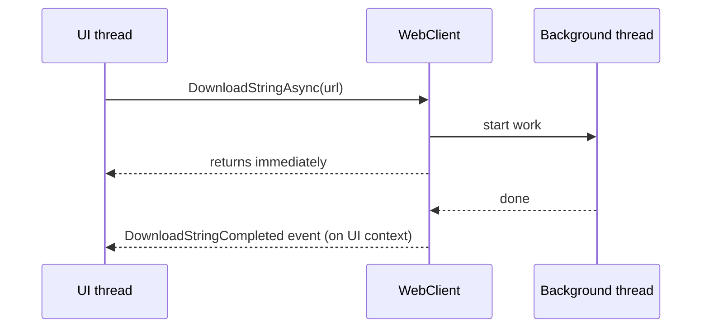

> [!summary] TL;DR
> An older .NET async model (EAP): call `DownloadAsync`, keep working, and get a `DownloadCompleted` event, raised on the UI thread through the synchronization context, with the result or error. It made background work easy in WinForms-era code; the Task-based pattern (`async`/`await`) has replaced it.

## Problem
- Long operations block UI threads, and the earlier callback-based model (`Begin/End` methods) forced callers to marshal results back to the UI thread themselves.

## Solution
- Provide `OperationAsync(args)` that starts work and returns immediately.
- Raise `OperationCompleted` with result, error and cancelled flag, on the captured synchronization context.
- Optionally provide `ProgressChanged` and `CancelAsync`.

## Structure

![[Pasted image 20260607170349.png]]

## When to use / when not to
| Use when | Avoid when |
| --- | --- |
| Maintaining legacy components (`WebClient`, `BackgroundWorker`) | New code: use Task-based async (`async`/`await`) |

## Trade-offs
| Pro | Con |
| --- | --- |
| Results arrive on the right thread automatically | Hard to compose or chain operations |
| Simple event-based programming model | Event subscription leaks |
|  | Superseded by TAP |

## Related patterns
- **Alternatives:** Task-based asynchronous pattern (`async`/`await`); [[Reactor Pattern]]
- **Often combined with:** [[Observer Pattern]] (events)
- **Anti-pattern to watch for:** [[Busy Waiting]] (polling for completion)
- Catalog: [[Software Design Patterns & Anti Patterns#Concurrency|Concurrency patterns]].
