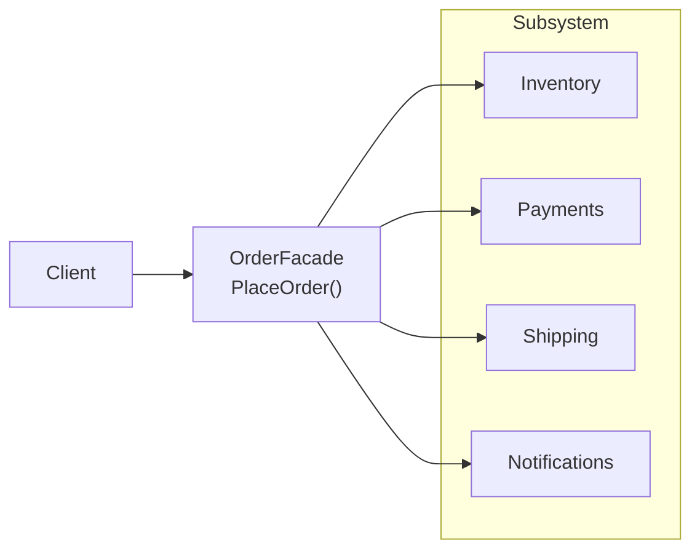

> [!summary] TL;DR
> A facade sits in front of several collaborating classes and offers a few task-level methods (`PlaceOrder`) that coordinate them. Clients get a simple entry point and are decoupled from the subsystem's internals, which can still be used directly when needed.

## Problem
- Using a subsystem requires knowing many classes and calling them in the right order.
- Clients coupled to all those classes break when the subsystem changes.

## Solution
- Create a facade class with methods that match client tasks.
- Each method coordinates the subsystem classes; the subsystem doesn't know about the facade.
- Keep the facade thin: orchestration, not business logic.
- Split into several facades if one grows too large.

## Structure

![[Pasted image 20260607084822.png]]

## When to use / when not to
| Use when | Avoid when |
| --- | --- |
| A complex subsystem needs a simple default entry point | The facade would just forward each call one-to-one |
| You want to layer a system and reduce coupling between layers | Clients really need the subsystem's full flexibility |
| Wrapping a legacy or third-party subsystem |  |

## Trade-offs
| Pro | Con |
| --- | --- |
| Simpler client code | Can grow into a god class |
| Decouples clients from subsystem internals | May hide functionality advanced clients need |
| One place to change when the subsystem changes |  |

## Related patterns
- **Alternatives:** [[Adapter Pattern]] (matches an interface rather than simplifying); [[Mediator Pattern]] (coordinates peers that know the mediator)
- **Often combined with:** [[API Access Facade]] (a service-level facade); [[Singleton Pattern]]; [[Abstract Factory]]; [[Layered Architecture]]
- **Anti-pattern to watch for:** [[God Object]]; [[Poltergeist Anti-Pattern]] (a facade that adds nothing)
- Catalog: [[Software Design Patterns & Anti Patterns#Structural|Structural patterns]].
