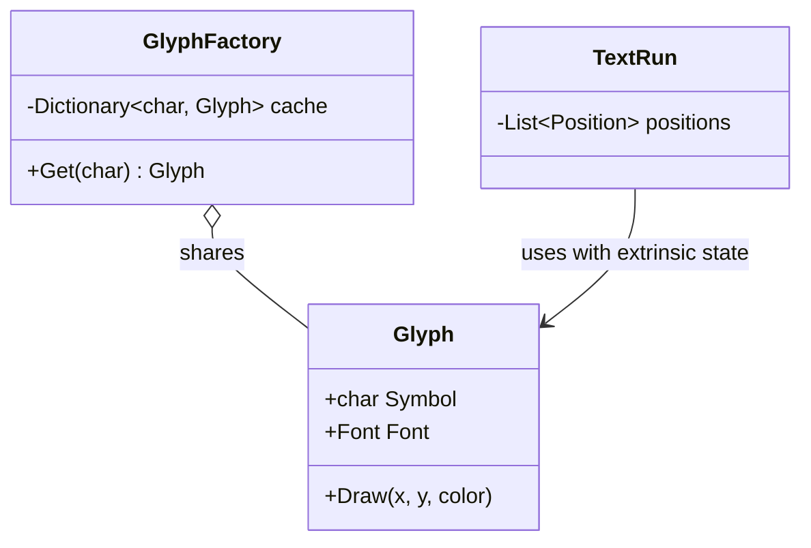

> [!summary] TL;DR
> Split an object's state into the part that's the same across many instances (glyph shape, tree mesh) and the part that varies (position, color). Share one immutable object per distinct intrinsic state from a factory cache, and pass extrinsic state in at use time. String interning is a built-in .NET flyweight.

## Problem
- Millions of fine-grained objects (characters in a document, trees in a forest) exhaust memory.
- Most of each object's data is duplicated across instances.

## Solution
- Separate **intrinsic** state (shared, immutable) from **extrinsic** state (context-specific).
- Store intrinsic state in flyweight objects created and cached by a flyweight factory keyed by that state.
- Clients keep extrinsic state and pass it to flyweight methods (`Draw(x, y)`).

## Structure

![[Pasted image 20260607084845.png]]

## When to use / when not to
| Use when | Avoid when |
| --- | --- |
| Very many objects share most of their state | Objects are few or mostly unique |
| Memory is a measured constraint | Extrinsic state is expensive to compute or pass around |
| Shared state can be made immutable |  |

## Trade-offs
| Pro | Con |
| --- | --- |
| Large memory savings | More complex code split between object and context |
| Immutable shared objects are thread-safe | CPU cost of recomputing or passing extrinsic state |

## Related patterns
- **Alternatives:** [[Object Pool]] (reuse mutable objects); value types / structs (see [[Struct vs Class in CSharp]])
- **Often combined with:** [[Composite Pattern]] (shared leaves); [[Multiton Pattern]] (keyed instances); [[Entity Component System]]
- **Anti-pattern to watch for:** [[Premature Optimization]] (flyweights before memory is measured)
- Catalog: [[Software Design Patterns & Anti Patterns#Structural|Structural patterns]].
