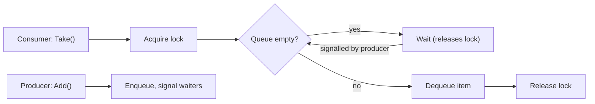

> [!summary] TL;DR
> If `Take()` is called on an empty queue, the caller waits rather than failing, and wakes when another thread adds an item and signals. The wait releases the lock so producers can make progress. `Monitor.Wait/Pulse`, `SemaphoreSlim`, `BlockingCollection` and `Channel<T>` all implement it.

## Problem
- An operation can only proceed once a condition holds (queue not empty, buffer not full), and the condition depends on other threads.
- Spinning on the condition wastes CPU; failing immediately pushes retry logic onto callers.

## Solution
- Acquire the lock and loop while the guard condition is false, waiting on a condition variable (the wait releases the lock).
- Threads that change the state signal waiters.
- Re-check the condition after waking (spurious wake-ups, competing consumers).
- Prefer higher-level primitives such as `Channel<T>.Reader.ReadAsync`.

## Structure

![[Pasted image 20260607165715.png]]

## When to use / when not to
| Use when | Avoid when |
| --- | --- |
| Producer-consumer queues and bounded buffers | Callers can't afford to wait (use [[Balking Pattern]] or a timeout) |
| Resources that become available later | Async code: use awaitable primitives instead of blocking threads |

## Trade-offs
| Pro | Con |
| --- | --- |
| No busy waiting | Risk of indefinite waits and deadlocks |
| Callers get a simple blocking or awaitable API | Lost-wakeup bugs if signalling is wrong |

## Related patterns
- **Alternatives:** [[Balking Pattern]]; timeouts; message queues
- **Often combined with:** [[Monitor Object]]; [[Thread Pool]] (work queues); [[Thread Delegate Pattern]]; [[Producer Control Flow Pattern]]
- **Anti-pattern to watch for:** [[Busy Waiting]]
- Catalog: [[Software Design Patterns & Anti Patterns#Concurrency|Concurrency patterns]].
