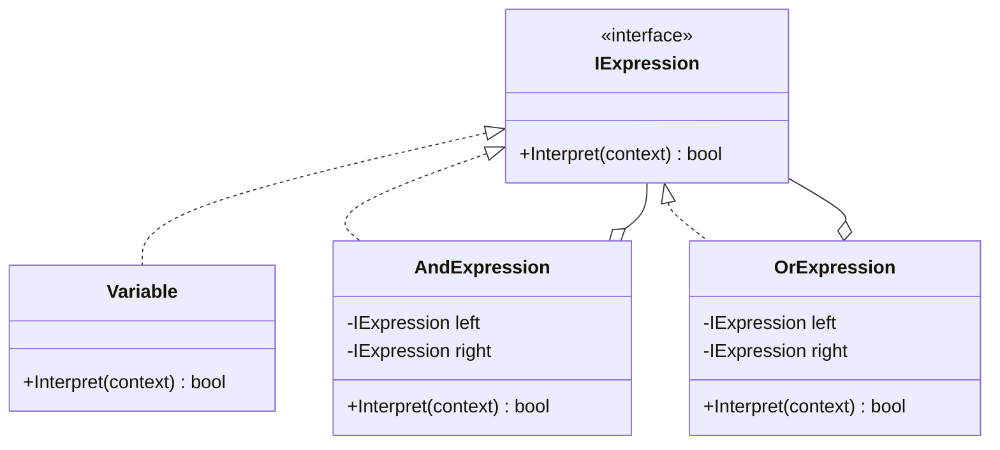

> [!summary] TL;DR
> Represent each rule of a small language (rules engine, filter expressions, a calculator) as a class with an `Interpret(context)` method. A sentence becomes a tree of these objects, and evaluating it is a recursive call. It suits small grammars; large ones need a parser generator. .NET expression trees are a related idea.

## Problem
- Users or configuration need to express rules, filters or formulas in a small language that the program evaluates.
- Hand-written string parsing with conditionals becomes unmaintainable.

## Solution
- Define an abstract expression with `Interpret(context)`.
- **Terminal** expressions (numbers, variables) return values; **non-terminal** expressions (and, or, plus) combine child expressions.
- A parser builds the syntax tree from text; the client calls `Interpret` on the root.

## Structure

![[Pasted image 20260607165347.png]]

## When to use / when not to
| Use when | Avoid when |
| --- | --- |
| A small, stable grammar (rules, filters, formulas) | Large or evolving grammars (use a parser generator or a real scripting engine) |
| Efficiency is not critical | Performance-critical evaluation |
| Users need to write expressions at runtime |  |

## Trade-offs
| Pro | Con |
| --- | --- |
| Easy to extend the grammar with new classes | Class explosion for big grammars |
| Grammar is explicit in code | Slow compared to compiled evaluation |

## Related patterns
- **Alternatives:** parser generators (ANTLR); embedding a scripting language; .NET expression trees compiled to delegates
- **Often combined with:** [[Composite Pattern]] (the syntax tree); [[Visitor Pattern]] (operations over the tree); [[Specification Pattern]]; [[Flyweight Pattern]] (shared terminals)
- **Anti-pattern to watch for:** [[Inner-Platform Effect]]; [[Soft Coding]]
- Catalog: [[Software Design Patterns & Anti Patterns#Behavioral|Behavioral patterns]].
