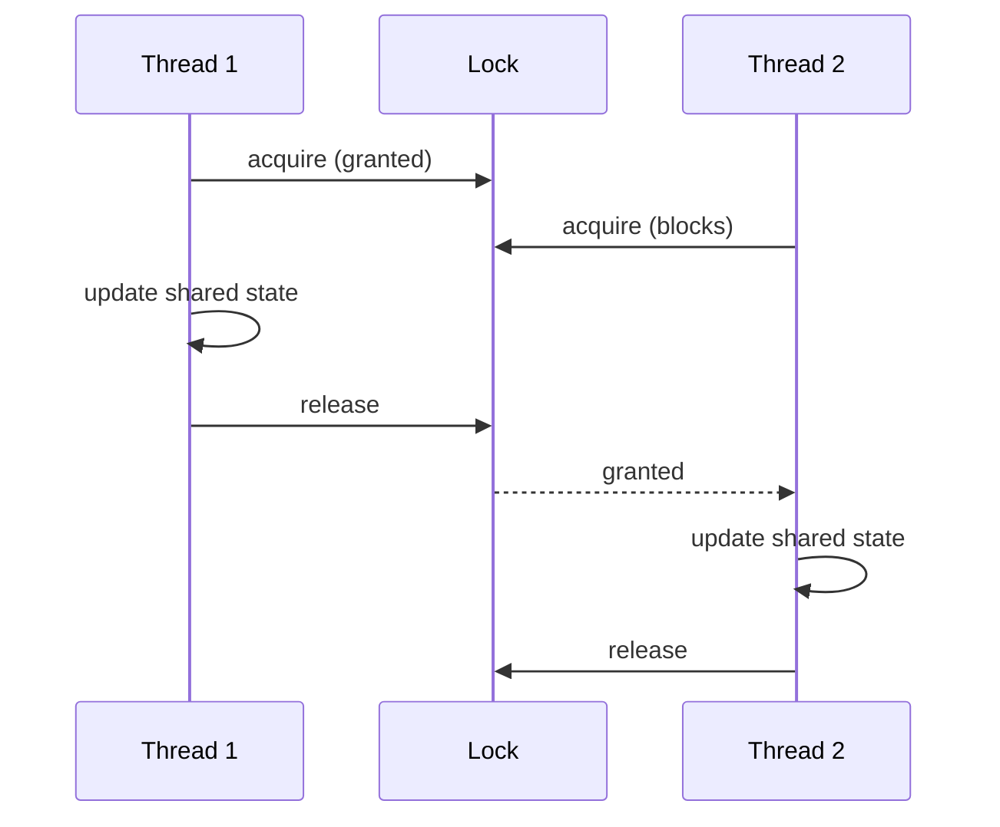

> [!summary] TL;DR
> A lock (mutex) ensures only one thread runs a critical section at a time, protecting shared state from concurrent modification. In C#, `lock` (or `System.Threading.Lock` in .NET 9+) covers in-process synchronous code; `SemaphoreSlim(1,1)` covers async code; distributed locks cover multiple processes.

## Problem
- Several threads read and write the same data, and interleaved operations corrupt it.

## Solution
- Identify the shared state and the invariants that protect it.
- Acquire the lock before touching the state and release it in a `finally` (or with `lock`/`using`).
- Keep critical sections short, never call unknown code or `await` inside a `lock`.
- Always acquire multiple locks in the same order to avoid deadlock.

## Structure

![[Pasted image 20260607170517.png]]

## When to use / when not to
| Use when | Avoid when |
| --- | --- |
| Shared mutable state with multi-step invariants | Single-variable updates ([[CPU Atomic Operation]] is enough) |
| Low to moderate contention | Read-heavy workloads ([[Read-Write Lock]]) |
|  | Designs that can avoid sharing altogether |

## Trade-offs
| Pro | Con |
| --- | --- |
| Simple, well understood | Deadlocks, contention and priority inversion |
| Protects arbitrary invariants | Blocking threads hurts scalability |
|  | Easy to forget a code path |

## Related patterns
- **Alternatives:** [[Read-Write Lock]]; [[CPU Atomic Operation]]; [[Active Object]]; [[Safe Concurrency with Exclusive Ownership]]
- **Often combined with:** [[Monitor Object]]; [[Guarded Suspension]]; [[Resource Acquisition Is Initialization]] (scoped release)
- **Anti-pattern to watch for:** [[Race Hazard]]; [[Busy Waiting]] (spinlocks misused)
- Catalog: [[Software Design Patterns & Anti Patterns#Concurrency|Concurrency patterns]].
