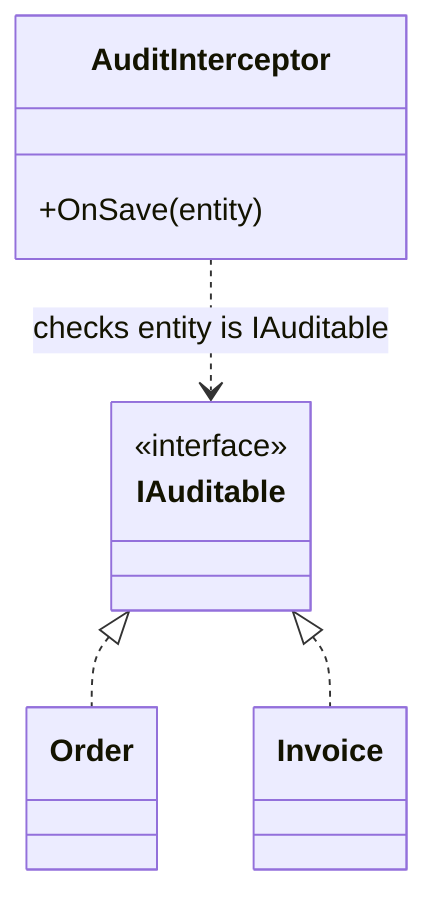

> [!summary] TL;DR
> A marker interface declares no members; implementing it just labels a class so tools, generics or reflection can recognize it (`IDomainEvent`, `IRequest`). In C#, attributes often do the same job, but markers work as generic constraints and with DI assembly scanning.

## Problem
- Code needs to treat a category of types specially (register all handlers, serialize these types, audit these entities) without a shared behavior to put in an interface.

## Solution
- Declare an empty interface (`public interface IAuditable {}`).
- Tagged classes implement it.
- Consumers check with `is`, generic constraints (`where T : IAuditable`), or assembly scanning.
- Use an attribute instead when you need parameters or when tagging members rather than types.

## Structure

![[Pasted image 20260607124518.png]]

## When to use / when not to
| Use when | Avoid when |
| --- | --- |
| Type-level tagging that should work with generic constraints | You need data with the tag (use an attribute) |
| Assembly scanning to register a category of types | The tag really implies behavior (put the members on the interface) |
| Compile-time checks that a type belongs to a category |  |

## Trade-offs
| Pro | Con |
| --- | --- |
| Simple, compile-time checkable | Carries no data |
| Works with generics and DI scanning | Inherited by subclasses even if they shouldn't be tagged |
|  | Overuse turns into hidden behavior keyed off empty types |

## Related patterns
- **Alternatives:** attributes; naming conventions
- **Often combined with:** [[Extension Object]]; [[Mediator Pattern]] (request and notification markers); [[Dependency Injection]] (scan by marker)
- **Anti-pattern to watch for:** [[Constant Interface]] (another interface used for something other than behavior)
- Catalog: [[Software Design Patterns & Anti Patterns#Structural|Structural patterns]].
