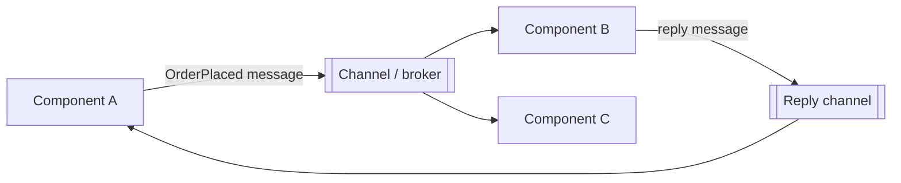

> [!summary] TL;DR
> Components send self-contained messages to each other and never share state or call methods across the boundary. This decouples components in time and location and avoids shared-memory concurrency problems. Within a process it looks like channels or mailboxes; between processes it's message brokers.

## Problem
- Direct method calls between concurrent components couple them tightly and share state across threads.
- Components in different processes or on different machines can't share memory at all.

## Solution
- Define messages as immutable data with everything the receiver needs.
- Each component exposes one messaging interface (send/receive) and processes messages independently.
- Use a channel, queue or broker to carry messages.
- Design for asynchronous delivery, ordering and duplicate messages.

## Structure

## When to use / when not to
| Use when | Avoid when |
| --- | --- |
| Concurrent components should not share state | Tight request/response loops where a direct call is simpler and fast enough |
| Components run in separate processes or machines |  |
| Temporal decoupling (sender and receiver need not be up together) |  |

## Trade-offs
| Pro | Con |
| --- | --- |
| Loose coupling and location transparency | Harder debugging and tracing |
| No shared-memory races | Delivery semantics (ordering, duplicates, loss) must be designed |
|  | Serialization overhead |

## Related patterns
- **Alternatives:** direct calls; shared memory with locks
- **Often combined with:** [[Point-to-Point vs Publish-Subscribe Messaging]]; [[Enterprise Integration Patterns]]; [[Guaranteed Message Delivery]]; [[Events vs Messages]]
- **Anti-pattern to watch for:** [[Database-as-IPC]]
- Catalog: [[Software Design Patterns & Anti Patterns#Concurrency|Concurrency patterns]].
